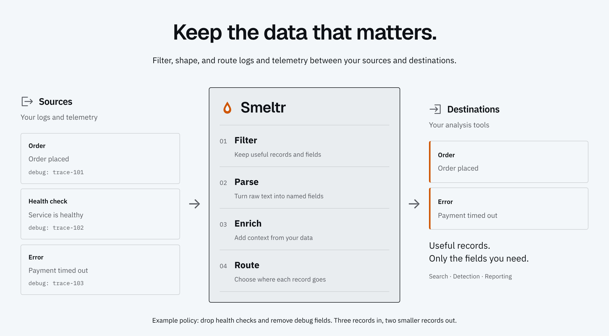

# Smeltr

Fast, self-hosted telemetry pipelines. Built visually. Managed with Git.

Smeltr moves logs, metrics and events from your sources to your destinations and changes them on the way: filter, parse, enrich, route. You build each pipeline in a browser, test it on samples captured from the live stream, and deploy it as a Git commit, so every change is reviewed before it runs and can be rolled back after.

<picture>
  <source media="(prefers-color-scheme: dark)" srcset="docs/readme-flow-dark.png">
  
</picture>

## Get it

```sh
docker pull ghcr.io/smeltr-sh/smeltr:latest
```

Linux and Windows archives, checksums and the SBOM, STIG and CVE reports are on the [download page](https://smeltr.sh/download). The [install guides](https://smeltr.sh/docs/getting-started) take a leader from a fresh install to rows flowing.

## Documentation

- [smeltr.sh/docs](https://smeltr.sh/docs): installing, building pipelines, every source, destination and step, the function reference, operations.
- [`docs/smeltr-design.md`](docs/smeltr-design.md): what must be true, and the [architecture](docs/architecture/) of each system.
- [`docs/status.md`](docs/status.md): what is built.

## Build from source

Stable Rust, Node 22 and [`just`](https://just.systems); the native dependencies also need a C and C++ compiler, CMake and Go, as the [`Dockerfile`](Dockerfile) installs them. Docker runs the live checks and builds the release archives.

```sh
just build        # frontend, then an optimized binary with it embedded
just run          # the same, started
just build-dev    # frontend, then an unoptimized binary: what the GUI tests run, and quick to rebuild
just run-dev      # the same, started
just check        # what the files changed since origin/main can break; run before every push
just --list       # everything else
```

| directory | holds |
|---|---|
| `src/` | the engine, leader and worker |
| `gui-frontend/` | the leader's browser interface |
| `website/` | smeltr.sh, its documentation and function reference |
| `tests/` | integration, GUI and live tests, and their fixtures |
| `docs/` | design and architecture |
| `tools/` | the citation checks and release tooling |
| `bench/` | throughput benchmarks |

## License

[Business Source License 1.1](LICENSE). Production use is free for individuals and for organizations with fewer than 250 employees; larger organizations [buy a license](https://smeltr.sh/get). Evaluation, development and testing are free for everyone. Each release becomes Apache 2.0 four years after it ships.
