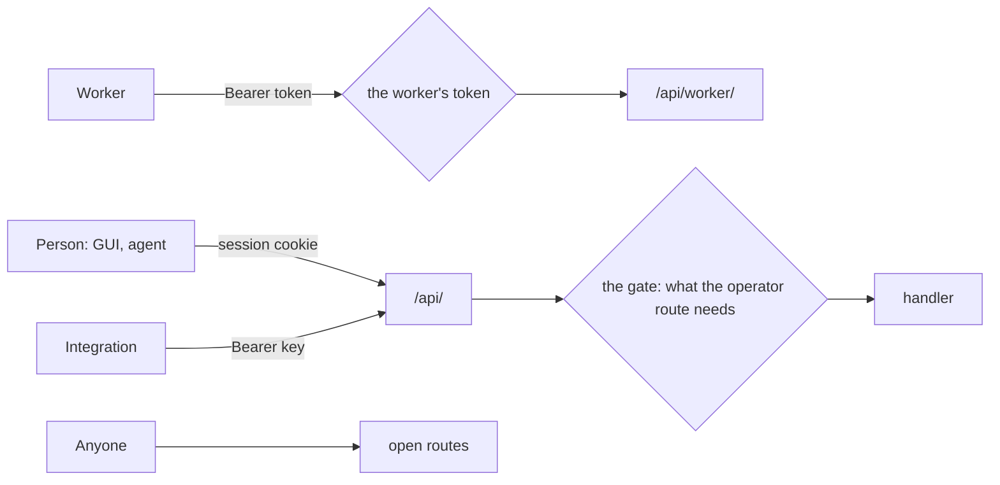

# API

The leader answers three families of HTTP routes, told apart by the credential
a caller holds. Workers call under `/api/worker/` with the token they enrolled
for.
People, through the GUI and their AI agent, and integrations call under `/api/`
as operators. A few routes are open, because they are how a caller gets a
credential in the first place. An operator request is judged from its request
line alone against one table of what each route needs, before any handler reads
it. Every JSON answer has one shape, and its status says whether it succeeded.
What the API answers never holds a secret's value.

## Families

**Worker.** Everything else under `/api/worker/`, judged by the worker's Bearer
token from enrollment. These messages cross builds, so they follow the control
plane's rule for messages between builds
([control-plane.md](control-plane.md), Upgrades): they only grow, a field added
is optional, and a field a reader does not know is ignored. They carry no
envelope.

**Open.** `/api/worker/enroll`, `/api/worker/authority`, `/api/auth/login`,
`/api/auth/oidc/*`, `/api/docs*` and the ACME challenge. Each is how a caller
gets a credential or what it needs to trust one, and each holds nothing a
stranger may not see.

**Operator.** Everything else under `/api/`, outside `/api/worker/`. A person
calls with a session cookie, and an unsafe method also carries a matching
Origin and the CSRF header. An integration calls with its Bearer key.

## Who may call what

A person holds one of three levels in each area -- viewer, editor, deployer --
or is an administrator ([security.md](security.md), Identity and access). Each
operator route needs one of: a level in the area its path names, a level in
at least one area, any account, or an administrator. The need is decided from
the method and path alone, per route, in one table (`policy.rs`), and a route
the table does not name is for administrators. A route whose area is in its
body or its branch asks for a level somewhere, and its handler checks the rest
once it knows the area. Each route's need lives in the same row as the agent
catalog's description of it, so the two cannot drift.

## The answer

Every JSON route of the operator and open families answers
`{ok, errors[], ...fields}`. `ok` is the status: a
2xx answers `true`, a 4xx or 5xx `false`, and no failure is answered at 200.
`errors` on a 2xx is advisory. The gate, a body that cannot be parsed, a wrong
method and an unknown path answer the same shape.

| status | means |
|---|---|
| 400 | the request could not be read |
| 401 | no session or key |
| 403 | not allowed, for any reason |
| 404 | no such route or thing |
| 405 | wrong method |
| 409 | the state refuses it: a stale base, a name that exists, another build running |
| 413 | too large |
| 422 | read, and refused by validation |
| 429 | throttled; `Retry-After` says when to ask again |
| 500 | the leader's fault |
| 503 | try later |

The routes that answer bytes are the named exceptions: the authority's PEM
(open), and a lookup file, the ledger stream and the git repository (worker).
A failure there is a bare status.

A request body refuses a field it does not know. An answer may add fields.
Every answer under `/api/` is `Cache-Control: no-store`.

## Names

A resource is a plural noun with its id in the path. An area's resources live
under `/api/areas/:area/`. A branch is `?branch=` and a commit `?at=`: both
modify what a route reads or writes rather than name a resource of their own.
Fields are camelCase.

| method | does |
|---|---|
| GET | reads |
| PUT | replaces whole |
| DELETE | removes |
| POST | creates, acts, or reads with a body |

An action that is none of these is `POST /resource/:id/<verb>`. A list that
grows without bound takes `limit` and a cursor.

## Compatibility

The GUI and the agent ship in the binary and meet no other build, so they move
with it. An integration outside it does not, so within a major no field leaves
a request or an answer of the operator API, and a field added is optional.

## What the API never does

It never answers a secret's value. It never sends a sealed credential
anywhere. It never answers a worker a file outside the repository.

## Seams

[Security](security.md) decides who holds which level where; this decides how a
route asks for one. The [control plane](control-plane.md) owns what the worker
family's messages mean; this names where they go.
