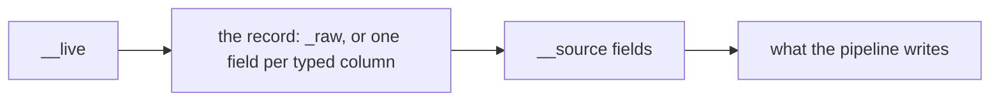
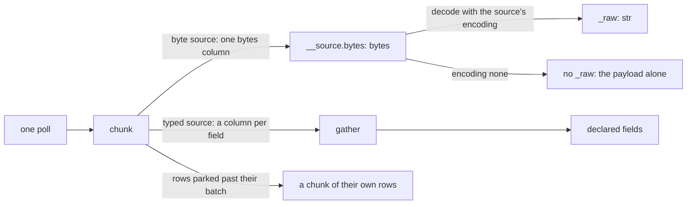

# Columnar data model

A system of the [design document](../smeltr-design.md).

A batch is a set of typed columns, one per field, each a flat buffer with a
validity bitmap; a row is an index into all of them. A pipeline step is one
call over every row, so per-row dispatch cost disappears into the batch. A
single record is a batch of length one, and that is also the preview path.
There is no row-wise fallback. What the values mean is the
[language](language.md); this file says how they are held.

```text
  a batch of n rows, one column per field

    status      │ 200 │ 404 │  ·  │ 200 │   a flat buffer and a validity bitmap
    env         │ "prod"                │   Constant: one value, no buffers
    user.id     │                       │   Empty: all null, no buffers
    o           │ {…} │  5  │  ·  │ "x" │   Variant: one value per row, its shape its own
    user.*      │ {…} │  ·  │  ·  │ {…} │   user's unclaimed fields, a variant object per row
    *           │ {…} │ {…} │  ·  │ {…} │   the record's unclaimed fields
```

A variant column holds a value whose shape only the row knows: each row is
one encoded value, a null, a bool, a number, a string, a time, a span, bytes,
an array or an object, kept as it arrived. It is stored as a string is, so moving, selecting and
copying rows cost what they cost for text.

## Empty and constant columns

A column has two more representations.

```text
Empty(T)                   all null, no buffers
Constant(T)                one value, every row; no buffers
```

A constant column is one value and a row count. The serializer reads the
value. So does a comparison, or arithmetic on numbers, dates and durations,
given one as an operand; a chain of `+` on text, `&&`, `||` or `??`; and a
function given one as an argument its kernel reads as one value: a needle,
count, index, unit or format, a bound of `min`, `max` or `clamp`, the
replacement of `replaceAll`. `status == 200`, `"user:" + name` and
`includes(path, "/api")` each read one column, not two. Every other reader
is given rows, built from the batch's own pool, so it pays what a literal
broadcast to every row has always cost. A literal assigned to a field stays
one value for the batch exactly where the serializer is its only reader, and
there it is never broadcast. So does a `__source` field every record of a
batch shares: an OTLP export's resource and scope, which its receiver's polls
end where they change. Egress reads the delivery's topic and identity
itself, so a literal assigned to either is rows.

## The unclaimed fields

A parser writes each declared field into a column of its own, typed. Every
other key a parser finds goes into the **unclaimed fields** of an object: a
variant object per row, holding those keys nested at their dots, however many
there are. Each object of the [name tree](compiler.md#names-and-slots) has its
own, the record's included, since the record is the root object. Each is a
slot the tree names, `user.*` for `user`'s and `*` for the record's, and a step
reaches one only through its object: a spread, a copy or a rename takes it
with the object, and a read or a write by key reaches a key in it where the
object is [open](language.md#an-object-is-closed-or-open), each value a
variant as the column holds it. Only JSON and key-value discover: a field's
name comes from the record itself. Grok reads its names off the pattern and CSV off its
ordered column table, so both produce exactly what their field table names: a
name with no row, or a grok capture with no name, matches and keeps nothing,
and such a name may repeat. Two rows for one name are a compile error.

A key goes to the deepest object the tree holds at its name, and the rest of
its name is its key there: after `http.x = 1`, a parse that finds
`http.method` lays `method` into `http`'s unclaimed fields. A value at an
object's own name that is no object is dropped, and the row carries a
warning. A parse lays its keys over the object's unclaimed fields from before
it: where both hold a key, the later value replaces it, and where both hold an
object there, the two are one object. A parse that declares an object
replaces it, unclaimed fields included.

The serializer walks the name tree. At each object it writes the fields,
then the unclaimed fields' keys that no field claims, as they arrived. So a
name a step writes claims the record's key of that name on every row, and the
key stays claimed after a rename takes the name away. A key a step reads is a
declared field.

## What a step may be

Three rules bound what a step may be:

- A batch's row count is fixed once it exists. Anything that changes
  cardinality produces a new batch by selecting indices out of the old one,
  and that one primitive serves both compaction and fan-out.
- A column's buffer is reusable only once nothing live can read it, the
  serializer at exit included. Violating this serializes the wrong bytes
  rather than crashing.
- A construct whose steps are ordered and dependent within a row is a **row
  barrier**, declared by the function and listed in the compiled plan, never
  discovered at runtime.

## Selection blends

Selection blends, it does not mask: a guarded step computes for the full batch
and selects per row between the new and prior value. A side no row of the
batch takes is not computed, since none of it would be selected, and neither
is what a guarded step computes ahead of its blend, a parse among it unless
it merges into an object's unclaimed fields. Every step blends, a parser and a
rename included. Unroll is the one exception: it changes how
many rows there are, and a row the guard does not take would have no element
for the field it unrolls, so an unroll under a guard is a compile error. Row
barriers already run row at a time. So does a parser that walks rows itself,
which may leave a masked row untouched: the blend that follows never reads
the parsed value on a masked row. A row answers only for the value it took:
an exception from the branch it did not take, or from the operand of `&&`,
`||` or `??` that JavaScript would not have read on that row, is not the
row's.

## Regions

A block a row can leave early is a region: an `if` branch, a loop and each
of its trips, an inlined function's body, a `try`. A region's guard is a
mask of the rows still in it. Leaving clears a row's bit in every region
from the innermost out to the one it leaves: `continue` the trip, `break`
the loop, `return` the body, and a failure the nearest `try` with a
`catch`, or with none the outermost `try`. A row that left blends its prior
value for every later write, as a row the guard never took does. A
`finally` runs on every row that entered its `try`. A `while` tests its
condition before the loop and at the end of each trip, outside the trip, so
a row the test fails takes no further trip and a `continue` still reaches
the test.

## The record a source hands

A source declares its record's fields by name and type, and a batch's slots
begin with them: the liveness mask, then the record, then the kind's
`__source` fields.



Every source hands each poll's records as one chunk of columns, and each
record is a row of it. Retry, parking and the bounded hand-off stay per
record, while the data stays in columns.



A byte source is one whose client hands over payloads. Its record is one field,
`_raw: str`, and it lists `__source.bytes: bytes` among its `__source` fields.
Its chunk is one column, the payloads as read. `__source.bytes` is that column,
undecoded, and a pipeline reads it like any `__source` field, paying nothing
when it does not. `_raw` is that column decoded before routing, with the
encoding the source declares, so `str` is text from there on and no string
function revalidates. A source whose `encoding` is `none` decodes nothing: its
record has no field, and its payload is `__source.bytes` alone. A destination
writing bytes writes one `bytes` field of each source record, `__source.bytes`
unless it names another.

A `str` column holds valid UTF-8 and a `bytes` column holds any bytes, in the
same layout. Only `str` is text: a text kernel takes `str`, and `bytes` become
text in one spelling, base64 (`format::bytes_text`), wherever they are written
as text.

A source whose data arrives already in typed columns, as a query's rows do,
declares a field per column, and its chunk has those columns. It has no
`__source.bytes`. Ingest copies each
field's rows out of the chunk, with nothing parsed. A value that is not its
field's type is null, and its row carries the exception naming the field.

A record kept past its batch, for a retry or a full destination, holds only its
own rows: parking copies the parked rows into a chunk of their own, unless they
are the whole chunk.

## Arrow

A column is laid out as an Arrow array is: a typed buffer, a validity bitmap,
and u32 offsets into a flat buffer for text, bytes and arrays. It is not an
Arrow array, and the engine runs no Arrow kernels, because four things here
have no Arrow form:

- A buffer comes from the batch's pool, which holds it to the worker's memory
  budget when it is taken and reuses it once nothing live reads it. An Arrow
  buffer is shared and immutable, and is freed when its last reader drops it.
- A constant column is one value, and an empty one has no buffers. An Arrow
  kernel takes rows.
- A variant column holds one encoded value per row, whatever its shape.
- An object carries its unclaimed fields.

The kernels follow the [language](language.md), which DataFusion's do not.
Destinations that write Arrow (Parquet, Delta, Iceberg) cut their columns from
the batch at egress, once per batch, and that copy is all Arrow would save.

## Seams

The [compiler](compiler.md) resolves every name to a column slot. The
[runtime stages](runtime-stages.md) hand batches between them whole. The
serializer walks the compiler's name tree, and is the only place a leaf is
nested into its object.
