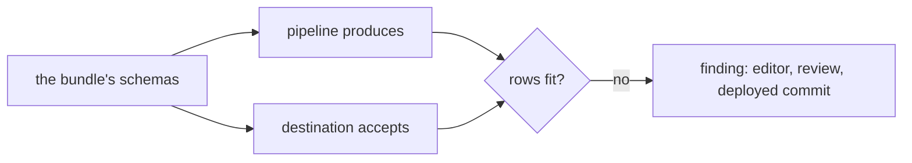
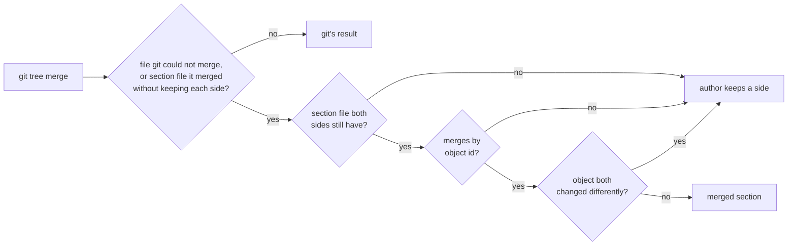
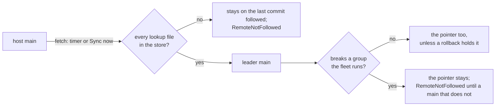
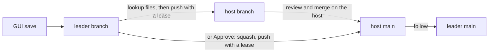

# Config plane

A system of the [design document](../smeltr-design.md).

Configuration is a directory of files, the **bundle**: sources, destinations,
routes, lookup tables, grok patterns, one file per pipeline and per schema, and the samples and
tests an author works from. It is meant to be read by humans and reviewed like code,
so it lives in git and a deploy points the fleet at a commit on `main`. Every
object is keyed by a string id, unique in its scope.

```text
  main
  ├── groups/<group>/   one bundle per group
  └── shared/           what several groups share

  edit ──► save: a commit on a branch ──► change ──► deploy: one commit on main,
                                                              and the fleet on it
```

## Validation

One rule governs the plane: **what is stored is always valid and runnable**.
Validation happens at save time and refuses a change that would produce a
broken configuration, with a reason. Configuration moves in one direction,
from the wire format through validation into a resolved topology and then into
live objects, and no runtime concern reaches back into the file format. A
save edits the files it read and writes them back; nothing reconstructs a file
from the compiler's structures.

## Calls, lookup tables and grok patterns

A pipeline may call another; the call is inlined before the compiler sees it,
so the compiler never learns calls exist. Every step has an id, an `if` and a
call included, and no two steps of a pipeline share one, counting the steps
its calls inline. A lookup table is shared by id, and its file sits in the
`lookups/` folder of the bundle that declares it, named relative to that
bundle, so the same commit works at whatever path each host checked it out
to. In a commit that file is a pointer to the lookup store, which holds the
bytes under their SHA-256; a plan maps the stored file, so one copy serves
every plan on a host.

A grok pattern is shared by name the same way: declared once in a bundle,
named as `%{NAME}` from any grok in the group. One name means one pattern in a
group, so a step's own pattern may not take a shared one's name, and a shared
one may not take a built-in's. A shared pattern resolves against shared ones
and the built-ins alone, so it reads the same in every step, and it is checked
at save whether or not a step names it yet.

## Schemas

A schema is what a pipeline's rows should hold: a table of fields, each a
path from the record's root, the type it must hold, whether a row must hold it,
and what it means. A path spells its keys with dots, and a type is spelled as
a declaration spells one, so a schema, a parser's field table and a
declaration read the same. A bundle declares its schemas as such tables. A
schema is also read from a file a standard or a spreadsheet gives, each format
by its own reader: JSON Schema (`schema::json_schema`), ECS's `fields.csv` or
`ecs_flat.yml` (`schema::ecs`), one class of `ocsf-schema-compiler`'s output,
cut to as many keys deep and to the requirements asked for (`schema::ocsf`),
and a CSV of fields, one row per field, its columns chosen by their place or
found by the header's names (`schema::csv`). A type is read as smeltr spells
it, or by the name a database, a spreadsheet or a standard gives it, from one
map every reader shares (`schema::named`); a CSV's type the map does not know
is read as the type it is told. Each reader gives the same table, checked as a
bundle's schema is, and a field may carry an example of a value it holds, which ECS,
OCSF and the CSV fill. A schema is exported as
JSON Schema, or as the mapping an Elasticsearch index holding its rows should
have. A field may say how it maps in Elasticsearch, a piece of mapping laid
over the one its type has; its `type` is checked at save to be one a value of
the field's type can be indexed as, and its other parameters are
Elasticsearch's to check. A pipeline
names the schemas it produces, and a destination may name the schemas it
accepts. Both are checked at save to name a schema the group can see. A
schema is also imported: a pipeline of the bundle run over an uploaded
file's records writes one row per field, `field`, `type`, `required`,
`description` and `elasticsearch`, and the rows are the schema. A file no
reader takes comes in that way.



A finding never refuses a save or a deploy: it says where the rows do not fit.
Review shows the findings a change adds, not those main already had where the
branch left it, field by field: a finding that names several fields names only
those the change adds.
The record's type is held to the table path by path: a field whose type only
the row knows keeps any, an object keeps any object type, and a required field
is missing where the object it sits in is there and does not declare it. A
field several schemas name is a misfit only where every one of them says so,
and a field one requires is missing only where every schema the pipeline
produces requires it. A route delivering to a destination whose accepts names
none of what its pipeline produces is a finding of the same kind.

## Groups and `shared/`

A repository holds one bundle per group under its subtree and one `shared/`
bundle several draw on; a group is checked merged with `shared/` before it is
committed. Samples and tests sit beside the bundle and no worker reads them.

A sample reaches `main` only when a test beside it names it. Deploying a change
leaves out every sample it adds or changes that no test names, and its review
sets those apart as left out. They stay on the branch, and go with it. A
sample removed is removed, and a bundle holding a test that does not read keeps
every sample, since what that test names cannot be known.

## Bringing a change current

A change behind `main` is brought current by merging `main` into its branch,
so it is reviewed and deployed against what is running. Git merges the tree.
Git merges lines, not objects, so a section file both sides changed keeps
git's merge only when each object in it holds what each side did to it.
Otherwise, or when git could not merge it, the file is merged again by object
id, so two changes to different objects of one section both stand. An object kept from either side keeps the
bytes it was saved with.



What is left is a conflict the author answers, one side per file or object.
Nothing is written until every conflict has its side, and the sides only
count against the two commits they were chosen at. Keeping a side of a lookup
table brings the file that side's table names. A section's order is one
side's order of the objects all three versions share. A section merges by
object only when every version is an array of objects with unique ids, both
sides kept the shared objects in one order, and there is one merge base;
otherwise the file is the author's choice.

A save writes only the file its section owns, so an edit to one section never
touches another.

## Kafka client settings

Kafka client settings smeltr owns are set and cannot be overridden by a
bundle; the rest pass through, validated against the linked library at save
time so the plane cannot promise what the binary cannot do.

## What differs between workers is the worker's

Every worker of a group runs one bundle, so what must differ between them is
the worker's to set, never the bundle's: its id, and the availability zone and
listen address its startup settings name. A connector that can prefer what sits
in its own zone is told the zone when it is built; a Kafka consumer names it as
its rack. An Elasticsearch, Splunk HEC or HTTP POST destination may name an
address per zone, and a worker sends to its own zone's, or to the destination's
URL when its zone has none. An Elasticsearch destination that sniffs learns the
cluster's nodes from that address and sends to those in its zone first, by the
node attribute it names; while the nodes cannot be learned it sends to the
address and logs a warning. Sniffing costs a periodic lookup of the cluster, a
credential with the `monitor` cluster privilege, and a route from every worker
to every node. Every receiver a worker runs listens on its listen address, every
address of the host unless the worker names one, so a bundle names a receiver's
port and never an address. A Kafka consumer also joins its group as a static
member under the worker's id, so a redeploy that rejoins within the session
timeout keeps its partitions and moves none of the group's. The cost is a worker
that leaves for good, or comes back under a new id: what it read waits out the
session timeout before the group hands it on.

## A connector names a certificate

A connector's TLS is its own settings: the certificate it presents, which is
an entry of the leader's list named by name (`security.md`, A certificate
travels with its key), and the trusted authorities it verifies the far end against,
PEM in the bundle. A worker presents the entry's newest version. A form's
save refuses a name the list does not hold. A client
trusts the authorities on top of the public roots, Mozilla's and its host's,
unless told to trust the authorities alone; a receiver serves the certificate
and admits by the authorities alone (`io::trust`). One shape for every
connector, because a connector must not have to know that one kind of client
reaches TLS through properties and another through a client the code builds.
TLS a connector also answers by hand, or under a protocol that negotiates no
TLS, is refused at save time: there is one place each answer comes from, and
configuration nothing reads is a lie about what is running.

## The GUI is sugar over the file, never a second copy

Every page that changes configuration writes the file that is actually used,
and every save is a commit on a branch. A save is accepted when the bundle's
error list does not get worse, so a stale reference elsewhere never blocks an
unrelated fix. The GUI's own design is in [`gui-design.md`](../gui-design.md).

## Review moves `main`, unless a git remote owns it

A save is a commit on a branch; `main` is never edited directly. A change is
opened for review as a whole branch, its tests travel with it, and deploying
merges it as one commit by whoever holds `deploy` on everything it touches,
once the branch is current with `main`. But `main` is an input: a shell, a
restored backup or an external git host can all move it. The leader reconciles
with whatever `main` says and warns when a deployed commit has a group that does
not load or a test that fails.

With a git remote set, the remote's `main` is the one authority. The leader
fetches it and follows it, and following is then the one thing that moves the
leader's `main`, but for an Approve the host has already taken:



Approve keeps the same rule: a group that does not load where the fleet runs
does not stop a change, and one it would break does. `main` follows the host
even when the fleet does not, so the fix is approved on top of it, and the
fleet moves on with the first `main` that breaks nothing it runs. A rollback
is a person's choice and holds the fleet through approvals and follows alike,
until `main`'s head is released from History.

A lookup file the store lacks is downloaded from the host's Git LFS server, or
the one the commit's `.lfsconfig` names, and checked against its pointer before
the commit is loaded. Workers never talk to the host, and the remote's
credential never leaves the leader or goes to any origin but the remote's.

Every other branch goes the other way. A save is a local commit at once; the
leader then pushes it to the host's branch of the same name, its lookup files
to the host's LFS server first, by a lease on what it last pushed. A branch
someone else pushed to on the host is refused until an admin overwrites it, and
a host that is down gets the save once it is back. An empty host is given the
leader's `main` and owns it from then on. Review and merge happen on the host,
and the leader follows the `main` that comes of them, unless the remote's
settings let Approve push to it. Then Approve squashes the change as it does
without a remote and pushes the squash to the host's `main` by a lease on the
leader's own `main`, so the host takes it only on top of what the fleet was
approved onto and drops nothing. Only once the host takes it do the leader's
`main` and the fleet move; were that move to fail, the change is merged on the
host all the same and the next sync follows it. A host that refuses, by its
branch protection or because its `main` is not the leader's, leaves everything
where it was and says why.



## Seams

The [compiler](compiler.md) takes the resolved topology. The
[control plane](control-plane.md) distributes the commit. The
[secrets boundary](security.md#secrets-boundary) decides what the files may
hold.
