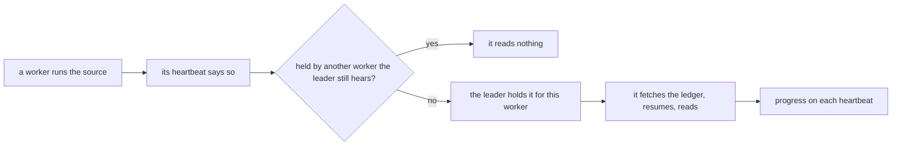
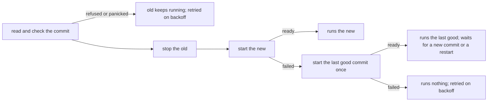
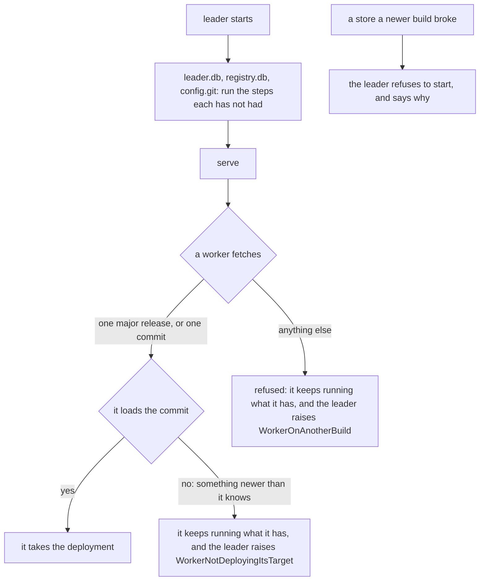
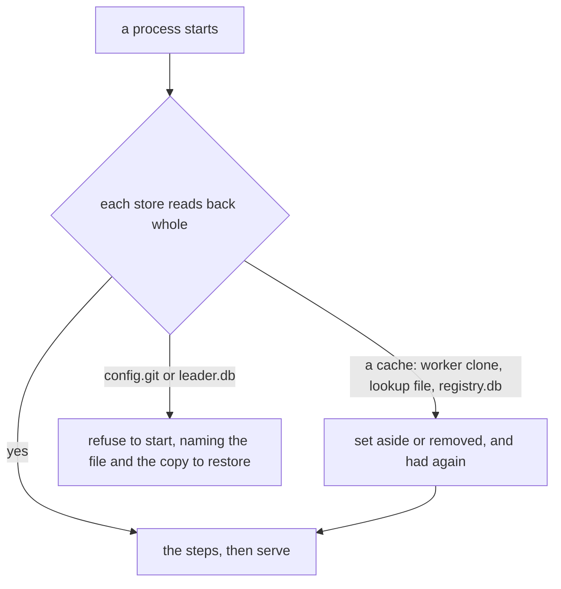

# Control plane

A system of the [design document](../smeltr-design.md).

A worker runs exactly one deployment: one bundle at one commit. Which one is
not its own decision; it is told, and this is the plane that tells it.

## The leader

The leader is one process holding a git repository, a small store for
what is not configuration (worker credentials, grants, sealed secrets), an
in-memory registry assembled from heartbeats, and the GUI. One leader owns a
data directory: a second started on it is refused, and the refusal names the
directory and says to stop the other leader or give this one a directory of
its own. It validates people, distributes commits, previews changes over
captured data and shows the fleet. It keeps each person's conversations with their AI agent, and
deletes one nobody has added to for the days an administrator sets. What the model is sent of a conversation stays
bounded: past a size, a summary stands in for its older turns, written by the provider where it can and by the
model at the leader's ask where it cannot, while the conversation is kept whole. Standalone means smeltr plus a source plus a destination. A smeltr
process is a leader or a worker; both roles compile into one binary, and
setting a leader address is what makes a process a worker. Running both in
one process spawns a worker that talks to its own leader over the same API an
external one uses.

```text
worker                                                   leader

  |--- an enrollment code ------------------------------>|
  |<-- a durable credential, stored locally -------------|  enroll

  |--- what I am doing, and what has happened since ---->|
  |<-- what only the leader knows -----------------------|  heartbeat

  |--- fetch what is deployed --------------------------->|
  |<-- objects ------------------------------------------|  config

                      no arrow starts on the right
```

Every exchange is worker-initiated. Workers behind NAT work identically to
public ones, and the leader's picture of the fleet is what workers last said,
never what it observed. A worker that stops talking stays in the view as it
last spoke, until the leader forgets it.

## Groups

Configuration belongs to a group, not to a worker. A group is a named fleet
with its own subtree of the one repository, drawn in its own color; `shared/`
beside the groups holds what several use, and the deployed pointer is the ref
every group deploys by. A group exists on a commit exactly when its subtree there holds
anything, so deleting a group removes the whole subtree. A worker serves one
group, named in its own startup file along with the settings it must hold
before it has heard from a leader. The group is the addressing unit for
health, sampling and access.

## Heartbeat

A short-interval poll, not a standing connection. Up: the worker's identity,
the commit it runs, its threads and what each holds, the metrics
accumulated since the last acknowledged heartbeat, and the progress of every
single-worker source it holds. Down: only what the leader
alone knows, such as every capture it still wants from this worker, the
single-worker sources it holds, a
certificate authority it has just minted, or an operator's directive to restart
its deployment or shut down. A directive names no commit: what to
run is the deployed pointer, and the worker fetches it for itself over plain git and runs
its own group's subtree merged with `shared/`. A commit that moves nothing the
worker runs is not a redeploy. The leader answers that fetch with git's
protocol, and a lookup file by its SHA-256 from its lookup store, and nothing
else: no path a worker sends returns a file git keeps to itself or one beside
the repository, such as the secret store or the key of the leader's own authority.

A lookup file's bytes do not travel in git. A commit holds a pointer naming
them by SHA-256; the worker fetches the files its own deployment names, checks
each against its pointer and keeps only those. The leader keeps the newest few
versions of each uploaded file name and whatever a branch or a running
deployment names, so a rollback reaches as far back as that.

Every exchange with the leader gives up once it has stalled for a time budget,
the first included: the fetch of the root an enrollment code names by
fingerprint, made before the worker can verify the leader at all. A leader
that accepts a connection and never answers costs the worker one failed
attempt, and the worker reports it.

## Holds

A single-worker source is read by one worker of its group at a time. Every
worker running it says so on its heartbeat, and the leader holds the source
for one of them, sticky, spreading a group's sources across its workers. The
holder reads; the others read nothing. Its progress is what every destination
has acknowledged: a **cursor**, one position, where the source's own protocol
orders what it holds, or a **ledger**, the items it has read, where nothing
does. The holder reports progress on its next heartbeat, and the leader keeps
it in its store, taking it only from the holder.



A holder loses the hold once the leader has gone three heartbeat intervals,
the holder's own or the leader's, whichever is longer, without hearing from it, or without it listing the source, so a redeploy
that briefly runs nothing keeps its holds. One that says it is stopping gives
them up once its last progress is kept. The next worker resumes from the last
progress the leader kept: what was delivered since is delivered again. A leader that restarts counts
every stored holder as heard at its own start. A holder that cannot reach the
leader keeps reading, as every worker keeps running its deployment, so a
partition between the two can leave two readers until it heals. That costs
duplicates, never lost rows. A hold that moves opens or closes one reader
inside the running deployment and restarts nothing else.

Progress belongs to a source in its group at the place it reads. The leader
keeps it while any bundle it may run reads the source there: the deployed
commit's, `main`'s head's, or one a worker still runs, and while a worker it
hears lists the source. Once neither holds, the leader forgets the hold and
its progress, so its store holds what is deployed
rather than all that ever was. A source that comes back afterwards, by a new
deploy or a rollback, starts afresh, and one that keeps what it reads reads it
all again.

## Deploying moves a pointer

What workers fetch is a pointer to one commit of `main`'s history, not `main`
itself. Approving a change moves `main` and the pointer together. Rolling back
moves only the pointer, to an earlier commit, and writes nothing: the fleet is
then *held*, and stays held while `main` moves on, until somebody releases it by
deploying `main`'s head or approves another change. A hold is a warning for as
long as it lasts, naming who held the fleet, when, and how many commits on
`main` it does not run, since a fleet that does not take what was deployed after
it looks to everyone else like a deploy that failed. Every move of the pointer
is a marker in a deploy log the leader keeps beside it, which is where who held
it comes from.

```text
  approve ──► main and the pointer move together          not held
  roll back ──► the pointer moves back, main stays        held
  main moves on ──► the pointer stays                     still held
  release, or approve ──► the pointer moves to main       not held
```

## Lifecycle

A worker runs nothing until it has checked in once; its clone
buys speed, not independence. After that first directive it runs indefinitely
without a leader, subject only to its own stop-after-unreachable setting.
Redeployment is wholesale: fetch, fetch the lookup files it names, load,
check named secrets, stop the old, start the new, so every refusal comes
before anything stops. A panic while reading a commit is one of those
refusals. Nothing is
checked out -- a commit is already an immutable snapshot, and a bundle is read
out of one.



A commit that fails only once started cannot be refused before the old
deployment stops, so the worker starts the last commit that ran here again.
It reports why the target did not start, and does not try the target again
on a timer: each try would stop the deployment that works.

## A worker asked to stop ends its deployment, then says so, then exits

```text
  asked to stop ──► deployment ends ──► last heartbeat ──► exit
                    drained, and        says it is stopping
                    confirmed dead,
                    as for a redeploy
```

The notice comes last so that no beat lands after it to say the worker is
back, and so that it carries what the deployment counted and said to its end.
Each step is bounded: a deployment that will not end, or a leader that does
not answer, delays the exit and never prevents it. A notice that does not land
leaves a worker that stopped without one. A second request to stop exits at
once.

## A worker is a supervisor and a deployment, and the deployment is a process

Talking to the leader must never wait on what the worker is running, because
what it is running is the thing that can refuse to stop: a stalled connector
cannot be interrupted, a thread cannot be killed, and a second deployment
beside an abandoned reader is two consumers on one source. So heartbeat,
discovery and deployment run on schedules of their own, and the deployment
runs in a child process the supervisor can end.

```text
  supervisor process                         runtime process
    heartbeat  ── every interval ──► leader
    discovery  ── every interval ──► deployed    one deployment
    deployment ── start, stop, kill ───────────► readers, transform, egress
```

A receiver's port outlives the runtime serving it. The supervisor binds the
address of every receiver its deployment names and hands the socket to each
runtime it starts, so a sender that connects while one runtime stops and the
next starts waits in the socket's queue and is answered by the next, rather
than being refused. A receiver's UDP socket is held the same way, and a
datagram sent meanwhile waits in its buffer until that buffer fills. That is
unix only, since it hands the socket over as an
inherited descriptor; on Windows each runtime binds its own, and a sender that
connects while one runtime is replaced is refused and sends again.

## The invariant: no deployment state can stop a worker from being given a new one

A target that will not load, will not start or will not stop is a
bounded attempt followed by a retry, and the newest observation always wins --
ordering is by when this worker looked, never by commit ancestry, so a
rollback is eligible the moment it is seen. Nothing takes a runtime's place
until that runtime is confirmed dead.

It holds while the supervisor, the operating system and the network do. Three
things are outside it, and each is reported rather than recovered from: a host
that is gone, a supervisor that is gone, and a process the operating system
will not confirm dead -- which leaves the worker blocked from deploying, still
heartbeating, and saying so. In all-in-one the supervisor is a thread of the
leader, so a runtime hang is recoverable there and a supervisor hang is not.

A supervisor that is gone confirmed nothing, so the one thing that must not
happen anyway is enforced without it: a runtime holds an advisory lock on its
worker's directory for as long as it lives, and a runtime that cannot take that
lock refuses to start. The operating system releases it when the holder exits,
crash included. So an orphan draining alone keeps it, a replacement supervisor's
first runtime is refused while that lasts, and two readers of one source is the
state the system has no way to reach rather than one it tries to avoid.

## Sampling

Only a worker ever opens a connection to a broker or cluster.
On the leader's invitation a worker taps its live ingest, or reads a source
without advancing it where the source supports that, or taps the rows its
pipelines finish for a destination, into a bounded buffer. Every capture takes
a filter, read where it taps: the record as it arrived at a source, the row as
its pipeline finished it at a destination. A capture of a source a block holds
is shown the records that blocked, once, each with why. So is a capture at a
destination the rows it refused and keeps, whatever its filter. A capture of a stream source
starts where it asks, at the latest unless it names another start; one that
names another start reads the source itself on every worker, a worker whose
deployment already reads the source included. For a source, the leader runs the
transform over them in process, with preview destinations in place of real
ones. One such request, from invitation to end, is a **capture**. A worker
fills its buffer only while the leader still wants the capture from it. A
credential lent for a capture stays only while the capture is wanted from that
worker or the worker's answer to it is still owed. What the leader holds for
one capture has a fixed ceiling, however many workers answer. Rows a block
holds fill it before any other, and a capture does not end on its total
before every worker that held such rows when it opened has reported. A worker
holding them takes no other row for the capture, and reports nothing, until it
has shown them. Once a capture
is over at the leader, what the leader holds of it is final. What it holds,
saved, is a **sample**: a saved sample and a test built from it are bundle
files that travel with the configuration they belong to.

## Warnings

The leader raises every warning, because the sharpest one, a worker gone
silent, is one no worker can report about itself. A worker that said it was
stopping is not silent, whatever its kind: going without notice is the one
thing about a gone worker that warns. An ephemeral worker that is gone -- by
its notice, or by a silence longer than the operator allows -- is forgotten,
and leaves the view, the roster and every wait that counts the fleet. Silence
is what the leader was up to hear: a fleet that ran on through the leader's
own outage is not forgotten for it. A permanent one stays in the view, stopped
or silent. Most read the facts workers report; the rest read what the fleet is
running, since a certificate in the deployed bundle runs out on a date no
heartbeat mentions. A warning is derived on every heartbeat, never stored, and
clears when its fact stops. The catalog is fixed: each entry names a subject,
the fact it reads and the sentence that says what to do.

A blocked source warns by what holds it, because each releases differently:
rows only a new config lets through, rows a destination refused, or a
destination not taking records. The last releases on its own once the
destination is back, so it is a warning where the other two are failures.

A source reading more or fewer rows than it normally does warns either way.
Its normal is the last seven days at the same time of day, and holds the
share of those windows the operator sets. A source with too little history
has no normal yet. One held, unreachable or on a silent worker is not judged
against it: a warning that names the cause is already up. Nor is one for a
window after such a warning ends, while the window still holds the stop and
the catch-up after it. The leader keeps when each warning held, for as long as
it keeps hourly rows, so the end is known across a restart.

## Upgrades

A released smeltr starts on whatever an earlier supported release left, and
carries it forward with no manual step. A worker takes a deployment from any
leader of its own major release, so besides the leader's own stores the
configuration and the messages between leader and workers cross builds too.



- **A store has steps.** Each store's version is how many of its ordered
  steps it has had. A step is appended, never edited once released, and a
  test holds every released step to the hash it shipped with. A rebuild that
  adds no step leaves every store as it was.
- **Only a breaking step stops a rollback.** A step is additive when a build
  without it can still use the store: a new table, a plain index, a column a
  row may leave empty. Anything else is breaking, including a change to what
  stored values mean, which is a step of its own. A store keeps the fewest
  steps a build must know to use it, and only a breaking step raises that; an
  older build is refused only below it.
- **A build is its commit.** The date in the version changes on every rebuild
  and does not count. A build with uncommitted edits to its sources is its
  commit and those edits. A build that cannot read its commit fails to build.
- **A release is a tag on `main`.** `v1.2.0`, semver. A build from that commit
  with no edits carries the release name.
- **Releases of one major work together.** A worker takes deployments from a
  leader of its own major, in either direction. Any other pair, a pre-release
  or a build that is not a release included, must be one commit. Within a
  major, a newer release reads what an older one wrote with the same meaning,
  and an older one refuses what it does not know and never reads it otherwise.
- **A major release is one that breaks that.** It also raises the upgrade
  floor or ships a breaking store step; a minor adds only additive steps, a
  patch adds none, and `just cut-release` refuses a release named otherwise.
- **Messages between builds only grow.** Heartbeat and enrollment messages
  gain optional fields and ignore ones they do not know, so a leader and a
  worker one release apart still hear each other.
- **Config files are upgraded as they are read.** The leader never rewrites a
  file nobody saved.
- **Each release is kept.** `just cut-release` stores the data directory
  and the messages a release writes, and every later build must start on them,
  load the deployment they hold, and read every message.
- **Nothing from before the first release is upgraded.** A store with no
  record of its steps is refused, with a message to move it aside.

## Damaged stores

Every store is checked when its process starts, before anything acts on it. A
store that can be had again is had again; one that cannot stops the process
with what is damaged and how to restore it. Nothing runs on the part of a
store that still reads.



- **Reading back whole** is SQLite's own check for a database, and for a
  repository every ref, every commit in their history, and every object under
  each ref's tree, each hashed against its id. A lookup file is hashed against
  its name.
- **`leader.db` has no other copy**, so each start that finds it sound keeps
  one beside it. The refusal names that copy and its age. Restoring it loses
  what changed since, and sources resume from the positions it held.
- **`config.git` is not rebuilt.** A git host holds its `main` and pushed
  branches but not unpushed saves, changes or the deploy log, so what to
  restore it from is the operator's call. The refusal names the host.
- **A lookup file comes back from where it came:** a worker fetches it from
  the leader, and a leader with a git host from the host's LFS server, for
  `main` and for what runs.

## Seams

The [config plane](config-plane.md) defines what a commit holds; the control
plane decides which commit runs where. The
[secrets boundary](security.md#secrets-boundary) rides the authenticated worker
channel. The heartbeat is [observability](observability.md)'s first consumer.
