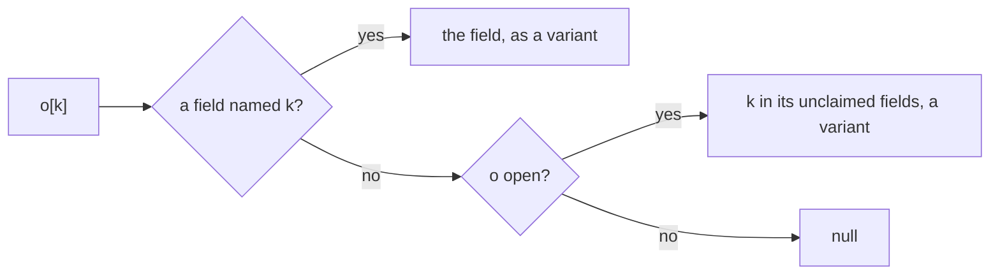

# Language

A system of the [design document](../smeltr-design.md).

A pipeline's steps are written for one record. They read and write it by name,
and every name is a path in one tree. Every value has a type the compiler knows
before anything runs. A record key a step reads is declared, with a type; every
other key passes through untouched. This file says what a pipeline means. How a
record is held in memory is the [columnar data model](columnar-data-model.md);
how a pipeline becomes instructions is the [compiler](compiler.md).

## A record is one tree of paths

A name is a path, and a column holds a leaf. A dot in code is a path step; a
dot in data is a character. A key a parser reads is one key, whatever it
holds: `{"a": {"b": 0}}` names `a.b`, and `{"a.b": 0}` names the one key
`a.b`, spelled `["a.b"]`. A parser takes `splitDots: true` to split its keys
at dots into paths; `kv` and `grok` do by default, `json` and `csv` do not.
A record whose keys contradict after splitting keeps the last in record
order and carries an exception. `a.b`, `a["b"]`, `at(a, "b")` and
`a.at("b")` are one read of one path, and a bare name is `$["name"]`: `$` is
the record, the root object. Nesting happens once, at serialization.

```text
  record                          columns
  {"source": {"ip": "10.0.0.1",   source.ip      │ 10.0.0.1
              "port": 443},       source.port    │ 443
   "event.kind": "alert"}         ["event.kind"] │ alert
```

A name has one spelling wherever it is written out, in a message, the
preview or a step's field: keys joined by dots, except that a key holding any
of `.` `[` `]` `"` `\` is written as a JSON string in brackets,
`labels["app.kubernetes.io/name"]`. That is the path code reads it by, and a
step's field is read as one.

A bare name is letters, digits, `_` and `$`, dotted. A field whose name
holds anything else, ECS's `@timestamp` or a header's `user-agent`, is
read and written as `$["@timestamp"]`, which is the same name to
everything after the parser. A bare spelling of such a name is a compile
error that shows the quoted form. A name that lexes as an expression,
`user-agent` as `user - agent`, gets no such error: the compiler sees a
subtraction of two names.

## The types are the engine's, under the engine's names

Nothing else exists, and a type annotation names one of these but `null`.

```text
bool
i64 | f64                  overflow fails the row; no u64
datetime | duration        i64-backed
str                        valid UTF-8, always
bytes                      never text; written as base64
array<T>                   offsets + a flattened child column
struct                     named child columns; a shape the compiler knows, and its unclaimed fields, closed or open
variant                    a value whose shape only the row knows
null                       no value; a column of it is Empty
```

Arithmetic on two `i64` yields `i64`, and with an `f64` on either side
yields `f64`: the `i64` widens, wherever an `i64` and an `f64` meet, in a
comparison, a ternary, `??`, `min` and `max`, an array's elements, a
struct's field, a push and a write to an `f64` name. `array<i64>` beside
`array<f64>` is `array<f64>`. `/` yields `f64`; `idiv(a, b)` divides and
truncates toward zero as `%` does, an `i64` from two `i64`s and an `f64`
beside an `f64`, and a divisor of zero fails the row. An `i64` result that overflows fails the row: null, with an
`Overflow` exception. A `datetime` or `duration` operand yields the type
its operator says.

`+` takes two texts or two numbers; `str + i64` is a compile error. Text
from a number is a template literal or `toString()`; a number from text is
`parseInt()` or `parseFloat()`. No operator renders a value to fit beside
another.

`bytes` is not text. A function of text, `trim`, `split`, a regex or
`parseTime` among them, takes `str`, and `bytes` there is a compile error.
What reads bytes as bytes takes them: `length` counts bytes, `md5`, `sha1`,
`sha256` and `sha512` hash either, `==` and `!=` compare two, and a fold's
`+` joins bytes to bytes, never to text. Bytes have one spelling as text,
base64, wherever they become text without a form named: the serializer,
`toString`, `as str`, a template literal, `join`, and a field's text, such as an
Elasticsearch index read from a `bytes` field. `toString(b, form)` names the
form, `"base64"`, `"hex"` or `"binary"`, and `parseBytes(text, form)` reads
it back; `as bytes` and a declared `bytes` field read base64. `decode(b, encoding)` reads bytes as text in an encoding, as a
source's `encoding` reads its records, and `encode(text, encoding)` is the
text's bytes in a charset. A form or an encoding the call cannot use, text
that is not the form, or a character the charset cannot spell is null with a
`CoercionRefused` error.

## Null

`null`, `undefined` and missing are one nothing-value. Reading an absent field
yields null; null propagates through arithmetic and never coerces to zero.
A comparison is true or false on every row: `==` is true where both sides
are null and false where one is, `!=` is its negation, and an ordering with
a null side is false. A field compares by value. A condition is `bool`: an
`if`, a ternary, a filter, a route and a delivery's `when`, and the operands
of `!`, `&&` and `||`. Any other type there is a compile error; there is no
truthiness. Null reads false: an `if` runs its `else`, a ternary takes its
second branch, and a guarded write leaves the value from before it. Whether
nulls appear in output is the serializer's decision. `x == null`,
`x != null`, `isNull(x)` and `x ?? y` compile on a `variant`, since they
read presence, not content; `x ?? y` is a variant.

`null` belongs to every type. Its own type, `null`, is the type of a value
with nothing in it. It meets any type `T` as `T`, at any depth: a blend of
`null` and `T` is `T`, `[null, "a"]` is `array<str>`, and `{a: null}` beside
`{a: "x"}` is `{a: str}`. `[]` is an empty array, a value like any other, of
type `array<null>`: it meets `array<T>` as `array<T>`, and nothing but an
array. So a blend of `[]` and `array<T>` is `array<T>`, and so is `[] + xs`, a
push onto `[]`, and `[]` given where `array<T>` is declared. An array's
positions are its structure, as an object's keys are: a position may hold
nothing, which reads as null, and it stays where it is so the positions after
it keep their index. A position is made by what builds the array: a literal
spells its positions, data brings its own, and `resize` makes as many as it is
given, each holding nothing until a write fills it. A write of null puts
nothing, so it clears an existing position: `[1, null]` has two positions, and
so has `push([1], null)`.

## A field is declared

A declared field has a type. A record key is declared by a row of its parser's
field table. `name: type;` states a name's type once, before anything binds
it, and `expr as type` converts. Each row coerces to the type by one
table, whoever converts the value. Where the table refuses, the field is null
and the row carries an exception.

```text
  to \ from text                             i64     f64     bool    datetime  duration  bytes  array | object
  bool      true | false, trimmed            ·       ·       keep    ·         ·         ·      ·
  i64       a number, trimmed, rounded       keep    round   ·       ·         ·         ·      ·
  f64       a finite decimal, trimmed        widen   keep    ·       ·         ·         ·      ·
  str       keep, untrimmed                  render  render  render  render    render    base64 JSON text
  datetime  a time, recognized or by format  epoch   epoch   ·       keep      ·         ·      ·
  duration  a duration, recognized           micros  micros  ·       ·         keep      ·      ·
  bytes     base64, untrimmed                ·       ·       ·       ·         ·         keep   ·
  array<T>  ·                                ·       ·       ·       ·         ·         ·      each element to T
  struct    ·                                ·       ·       ·       ·         ·         ·      each declared leaf; the rest kept if open, else dropped

  ·  refused: null and an exception
```

An `f64` into `i64` rounds, half away from zero: `2.5` is `3` and `-2.5` is
`-3`; nothing truncates, and a value out of `i64`'s range refuses. Text into
`i64` reads the number, `"007"`, `"+5"` and `"2.5"` alike, then rounds the
same way. An epoch's unit
is read from its magnitude; a duration's count is micros. Bytes and text
convert through base64, and text that is not base64 refuses. One element that refuses refuses the row's
whole array; a leaf the object lacks is null, and a key an open object type
does not name is kept as it arrived, among the object's unclaimed fields. A
closed object type keeps its fields and drops each such key, silently: the
type says so. A blank value under a
declared number, bool, datetime or duration is nothing: the field is null
and the row is clean. A declared `str` keeps the empty text. A time with no format,
declared or given to `parseTime`, is recognized from its text, and a batch
whose rows share one format pays for that search once, not once a row. A
field declared as an object is its leaves, each declared:
`source: {ip: str, port: i64};` declares two. A first write binds its
target to the value's type, so `y = 1` declares `y` as `i64`. `null` and
`[]` have none: a name first written either takes the type every write after
it in the block blends to, as a construct's first write does, so `let out =
[]; for (let x of xs) { out = push(out, x * 2); }` makes `out` an
`array<i64>`. With no write after it to give one, the first write names the
type: `x: i64 = null`, `xs: array<str> = []`. A
declaration after it is a compile error, as is one of a path under it or of a
key an open object may hold: after `x = $.v`, `x: i64;`, `x.a: str;` and,
after a JSON parse, `k: str;` each name the conversion instead. A later
assignment keeps the type and converts nothing: an `i64` widens to `f64`,
a value holds in a `variant`, and any other value is a compile error naming
`expr as type`. An object keeps its type the same way:
its fields take the value's, a field the value lacks is null, a key an open
object has no field for joins its unclaimed fields, and an open value does not
fit a closed object. `expr as type` converts the value, whatever it is, by
the same table, and the name it is written to keeps its type: `o = p as
{a: i64}`. Only `name: type = expr` changes a type, and it converts only a
variant: `x: i64 = $.v`, `y: array<str> = []`, `x: str = x as str`. `__live`, which the runtime reads back after the run, stays bound and stays `bool` to the end of a pipeline: a step that removes it or changes its type is a compile error. An object converted to an object type
takes each field from the value's field of that name, else from a key of its
unclaimed fields; an open type keeps the value's other keys, and a closed one
drops each. A name is bound at the top level. A first write inside an `if`
or a loop binds the name there, typed by every write to it in that
construct, and null on a row no arm ran: `if (c) x = 1; else x = "1";` makes
`x` a variant, and a lone `if (c) x = 1;` an `i64`. A declaration inside the
construct states that type instead, once, and the construct's other writes
keep it; a declaration there of a name bound outside is a compile error, and
`let` binds the body's own names. Where the record may hold a key of the
name, a row no write runs on keeps the key, converted: the name is declared
before the construct as `name: type = name`. A
parse function that cannot read its text is an exception, as a
declared field that refuses is.

A record key no field declares passes through untouched in the unclaimed
fields, and leaves as it arrived: an integer stays an integer, a float a
float, and rows that disagree each keep their own. The object that holds it
is open ([below](#an-object-is-closed-or-open)), so a read reaches it as a
variant, and a conversion, `n: i64 = $.k`, is the only path to a typed value
from it. A
read of a key a closed object lacks is a compile error, wherever it
appears.

```text
  record key ──► declared?  ── yes ──► coerce ──► typed column
                    │                    └─ refused ─► null + exception
                    no
                    ▼
                                  unclaimed fields  ── read only where open ──► serializer
```

## What a parser and a lookup write

A parse is a function of text: `json`, `kv`, `cef`, `csv`, `grok` and `lookup` are
written where a statement writes them. Each takes its text, then what its
kernel needs, then an options literal for what has a default; everything but
the text is a literal the compiler reads.

```ts
Object.assign($, json(_raw))                       // into the record
$ = json(_raw)                                     // replaces the record
app: {msg: str, ...} = json(log);                  // into a name, typed
json(text, {splitDots: true})                      // a dotted key is a path
kv(text, {pairSep: " ", kvSep: "=", quote: "\"", escapes: true})
kv(text, {skip: ["devid", "tz"]})                  // keys that make no field
cef(text)                                          // CEF header fields and extension
csv(text, ["a", null, "c"], {delimiter: ","})      // null: a column that makes no field
csv(text, ["a", "b"], {quote: "'", escape: "\\", squeeze: true, trim: true})
grok(text, ["%{INT:status}"], {patterns: {NAME: "regex"}, formats: {ts: "%d/%m/%Y %H:%M"}})
lookup("geo", ip, {match: "cidr", column: "net", first: true, fields: {city: "city_name", cc: ["country", "?"]}})
```

`Object.assign($, f(…))` writes into the record: on each row, every key it
finds replaces what was under that name, whoever wrote it, and a key it does
not find leaves the prior value. Last write wins. `$ = f(…)` replaces the
record with what the parse gives. Each bound field is a declared field
of the parse, converted to its type, and a key no field claims goes to the
unclaimed fields. `x = f(…)` makes `x` the object the parse gives, and binds a
name nothing binds; `x: T = f(…)` binds it afresh at `T`. A grok capture or a
CSV header nothing types is `str`. A `json` or `kv` parse lays keys no guard
reaches, so it runs outside every `if` and loop.

`grok`'s built-in patterns include whole lines, a syslog line or a web access
log line, and each of those names its own fields as the Elastic Common Schema
does, so `%{SYSLOGLINE}` alone writes `host.hostname`, `process.name` and the
rest.

`json` also reads what log systems write beyond JSON: a trailing comma, raw
control characters in a string, `\xHH` byte escapes, any other escaped
character as itself, a surrogate escape without its partner, and `NaN` and
`Infinity`. A read that loses a value warns on its row: text that names no
character becomes U+FFFD, and a number an f64 cannot hold becomes no value.

`csv` and `kv` read their variants the same way, and text no variant reads is
an `Unparsable`. In `csv`, spaces may follow a closing quote, and a quote the
record never closes runs to its end; that record is an `Unparsable`, since
its last field may be cut. In `kv`, a key with no
`kvSep` is a bare key whose value is `"true"`. Variants that contradict each
other are options: `csv`'s `quote`, an `escape` in place of a doubled quote,
`squeeze` for runs of the delimiter, and `trim`, and `kv`'s `escapes`, under
which a backslash escapes any character in any value.

`cef` reads ArcSight's Common Event Format. It skips text before `CEF:`, such
as a syslog header, and names the seven header fields as the specification
does: `version`, `deviceVendor`, `deviceProduct`, `deviceVersion`,
`deviceEventClassId`, `name` and `severity`. Each extension key is a field as
written, and its value runs to the space before the next key. A record with
fewer than seven header fields, or text before its first extension key, is a
`Unparsable`.

A `json`, `kv`, `cef` or `csv` record that does not parse whole keeps the
fields read before it broke off.

`csvRebuild` and `kvRebuild` write a record's text back without what a parse
skips: a CSV column left empty, so every column after it keeps its place, and
a key-value pair left out. They read the text as `csv` and `kv` do and keep
every other byte as it was written, its quotes and spacing too, so whatever
reads the line downstream reads it as it read the original. Text that does
not read whole comes back as it was. A CSV or key-value Parser step with
`rebuild` lowers to its parse and then one of these, written to the field it
read.

Each function takes `formats`, which maps a `datetime` field it writes to the
format its text is read in; without one the field is read in any format the
parser knows. Text the format does not read fails that field on its row, as a
number that does not parse does. `formats` naming a field that is not a
`datetime` the call writes is a compile error.

A parser or lookup step is this code. It declares each of its fields where
the name does not hold that type yet, so two filtered parsers may name one
field, and a field the name holds at another type is a compile error on the
step. A `datetime` field with a format is read in it through `formats`, so two
filtered parsers may read one field in two formats. A key the record may hold
that no step has typed yet is read as `str` and converted after the step,
`t: datetime = parseTime(t, format)`.

A lookup's `fields` maps each output to its column, or to its column and its
default; `first: true` takes table order, `all: true` an array of every match,
and the longest match otherwise. A lookup output is a declared field. It carries a scalar type or a
`datetime`, `str` unless declared, and a miss writes the default or null and
is never an exception. A key that is a number or a bool matches the cell that
holds its text, so `404` finds `"404"` with no cast. A row table is read
whole before a worker runs, so a cell or a default that does not fit the type
is a compile error. An MMDB value is met at run time: one that does not fit
fails only its own field, as a parser's declared field does.

## Every expression has a type

Every expression has a type at compile time. A call, an index or an operator
compiles only when the types it is given fit, and any other type, `variant`
included, is a compile error. A bracket read is a path read, whatever its key:
under a `variant` it is a `variant`, and under `array<T>` a number key is `T`.
So a kernel never meets a type it does not take. A reference to a name nothing
binds is a compile error before the deployment starts, wherever it appears.

Where two values of types that do not meet blend, as a variant and a number
do in `flag ? o : 0`, the result is a variant: each row keeps the value of the
branch it took, as that branch had it.

## The expression language

The expression language is a TypeScript subset: arithmetic, comparison, member
access, string methods, `if`, `let`, `for...of`, `while`, `break`, `continue`,
`return`, template literals, object spread, user-defined functions, `map` and
arrows (`xs.map(x => x * 2)`), and type annotations on a field, a local, a
parameter and a return. Every list, of arguments,
parameters, array items, object entries or object type fields, may end in a
comma, and a plain name alone in an object literal is a key and its value:
`{level}` is `{level: level}`. It is shared by evaluation steps,
filters and code blocks, and everything compiles to the same instructions.
Sugar desugars in the parser and adds no execution mode. A function is a
value: an arrow, `(a, b) => a + b` or `x => { let y = x * 2; y }`, is bound
with `let`, passed to a function and called, and so is a declared function's
name. It reads the names where it was written. A name that holds a function
holds nothing else. An object body takes parentheses, `x => ({x})`, as in
TypeScript. `map` and `filter` are functions of the prelude, written in the
language as a `for...of` loop that pushes. A loop over an array vectorizes
where its trips do not depend on one another: each name its body writes
outside its own locals is written once, as an associative accumulator, a
`push` or an overwrite, at the top level or under `if`s, and read nowhere else
in the body, and nothing in the body leaves the loop. Any other loop body is a
row barrier. Every call is
inlined; recursion is accepted only as a tail call of a declared function,
which becomes a loop. A call standing alone is a statement, and its value is
dropped. A call in an operand of `?:`, `&&`, `||` or `??` runs only on the rows
that reach it. A loop that cannot be bounded at compile time
carries a budget per row. Precedence is TypeScript's, three times excepted:
bitwise binds tighter than comparison, so `flags & 3 == 3` is `(flags & 3) ==
3`; exponentiation binds tighter than unary minus, so `-a ** b` is `-(a **
b)`; and `??` binds below `&&` and `||`, so `a ?? b || c` is `a ?? (b || c)`
where TypeScript refuses the mix. An array literal nests: `[[1]]` is
`array<array<i64>>`. `a[i]` reads element `i` and `a[i] = x` writes it; a
negative `i` counts from the end, as it does for `at`, `insert` and `remove`.
Past the array's end the read is null, the write does nothing, and the row
carries an `IndexOutOfRange` exception.

```ts
status: i64;                       // declares a field
source: {ip: str, port: i64};      // declares two leaves
tags: array<str> = split(raw, ","); // declares and assigns
let n: i64 = 0;                    // a local
function host(u: str): str { ... }
```

A declaration names any type of the table, `variant` among them: `v:
variant = null;` holds a value whose shape only the row knows. A `let`
needs none: `let x = 1` takes its value's type.

A parameter or a return with a type written, which is never `variant`, must
have it at every call: an argument its parameter's type, and every `return`
the return type, or the pipeline does not compile. One with no type written
takes its value's, as a `let` does. A body's last expression
with no `;` after it is its value, as in Rust, and so is each branch's of a
final `if`/`else`: `function f(x: i64): i64 { if (x < 0) { 0 } else { x * 2 } }`.
A function takes a name of its own, never a built-in's, such as `drop`, `json` or `length`. `null` has every type,
inside an array or an object too, and an `i64` widens to `f64`. Nothing else
converts: a plain write of an `f64` to an `i64` name is a compile error, and
`x = 2.5 as i64` is the write that converts. An object has an
object type that names each of its fields and takes each one's type, and a
field it lacks is null. A closed object has an open type too, and an open
one, such as a literal that spreads a variant, has no closed type. A call has
its function's return type, a built-in's as a written function's, an object
included: `parseUrl(u).domain` reads a field of what `parseUrl` returns. A declaration inside a function names a field,
never a parameter or a local.

## The statements

```ts
if (level == "debug") drop();       // one statement needs no braces
delete(a, b.c);                     // the names leave the tree
move(src, dst);                     // a Rename
unroll(items, false);               // one row per element
$ = {...$, seen: true};             // replaces the record
try { n = parseInt(s); } catch (e) { why = e.message; } finally { done = true; }
try { v = json(s); } catch (e: NaN | Overflow) { v = {}; } catch (f) { why = f.kind; }
switch (c) { case "a": x = 1; break; default: x = 0; }
```

- `delete(a, b.c)` is the reverse of a declaration. At the top level the name
  leaves the tree, and a later write binds it afresh. Inside an `if` or a loop
  a bound name is a compile error, `a = null` clears it; a key an open object
  may hold is taken out on the rows selected.
- `o.b = null` over the object `o.b` nulls each of its fields and keeps
  them at their types, so `o.b.c` reads null and a whole read of `o` still
  has a type. The serializer leaves the empty object out.
- `move(from, to)` is `let t = from; delete(from); to = t;`. At the top level
  it rebinds and emits nothing, as a Rename does. Inside an `if` it clears a
  bound `from` on the rows selected.
- `drop()` ends the row on the rows its `if` selects. It is refused in a loop.
- `unroll(field, keep)` gives one row per element of `field`, which becomes
  the element. With `keep` false every other field leaves the record, one a
  local hides among them; the locals stay. It is refused inside an `if`, a
  loop and a `try`.
- `$ = e` replaces the record's fields and unclaimed fields; the engine's
  `__` fields and the locals stay, and `_raw` goes unless `e` carries it.
- A `try` stops where an exception happens: the row leaves the body, and every
  block and loop inside it, for the nearest `try` with a `catch`. A write
  whose value fails does not happen: the name keeps what it held. The `catch`
  runs on the rows that left, after their exceptions are cleared; `catch (e)`
  binds an object: `e.kind` is the first exception's kind, by its name, and
  `e.message` the exceptions' text, each naming its field. A `finally` runs on
  every row that entered the `try`, and an exception stops it as one stops a
  body. A `try` needs a `catch`, a `finally` or both; with no `catch` its
  exceptions stay on the row. A `try` is a construct, as an `if` is.
- `throw e` takes only a name a `catch` around it binds. It puts back the
  exceptions that `catch` cleared, once, and the row leaves for the next `try`
  out with a `catch`, as on an exception; with none, they stay on the row for
  its `exceptions` answer. It is refused in a loop inside its
  `catch`.
- `catch (e: K | L) { B }` runs on the rows holding K or L among their
  exceptions. `e.kind` is the first of them on the row and `e.message` their
  text; the `catch` clears only those, and the row's other exceptions go on as
  if no `catch` had taken them. An encoding or delivery kind is refused,
  since a `try` does not catch one.
- A `try` may have several `catch`es. Each in turn runs on the rows holding a
  kind it names and clears those; the kinds it leaves go on to the next
  `catch`, and past the last as if no `catch` had taken them. A row holding
  kinds two `catch`es name runs both, in order. A `catch` that names no kind
  takes every kind left and is the last. No kind is named twice. `throw e` in
  one hands every exception on its row to the next `try` out, past the `catch`es
  after it.
- A caught exception is read and never written: `e = …`, `e.kind = …` and
  `delete(e)` are refused.
- `switch` is TypeScript's: a case without `break` falls through to the next.
  It is an `if` chain.
- `rest(o)` is `o`'s unclaimed fields as an open object; on a closed object it
  is a compile error.

## A name is a leaf or an object

A name is a leaf, which holds a value, or an object, which holds its fields
and its unclaimed fields, and it is the same one on every row. An assignment
replaces everything at or under its target, the record's keys included: after
`o = {key: 1}` nothing that was under `o` is left, and a parser after it may
declare a path there again. Under a guard, or in a loop body, it replaces what
is there only on the rows it runs: a row it skips keeps it, the record's key
included. A name nothing bound starts there as the record's key, so it is a
variant until it is converted. A write there that would make a leaf an object,
or an object a leaf, is a compile error.

An object literal is an object, its entries applied in order, bound to a name
or held as a value alike, and `o.key = 5` rebinds one of its leaves. A key the
literal names twice, itself or through a spread of a literal, is a compile
error. A write under an object keeps the rest of it: `a.b.c = v` keeps what
else `a.b` holds. Where `a.b` is still a key of `a`'s unclaimed fields, the
write makes `a.b` an object whose unclaimed fields are that key's other keys;
on a row where the key holds no object, the write replaces it. Under a guard
it does so only on the rows the guard takes: a row the guard leaves keeps the
key's value, object or not. A write under a variant or a scalar is a compile
error: convert the variant to an object first, `q: {...} = q`. A name that holds `null` gives way to the
object.

A spread `...p` lays `p` over what is before it: each leaf over the leaf of
its name where it holds a value, each object over the object of its name, and
its unclaimed fields over the unclaimed fields there, a key at a time. A
variant lays down the keys its value has on each row. A spread takes an object
or a variant, by name or as a literal; a spread of a scalar is a compile
error. A variant that is no object on a row lays down nothing there.
`Object.assign(p, a)` is `p = {...p, ...a} as T`, `T` the type `p` holds, so a
closed `p` keeps only its fields; each source merges in turn, and a parse,
`Object.assign(v, grok(s, […]))`, is parsed first and merged as an object.
Inside an `if` or a loop, `Object.assign($, a)` writes each key `a` is known to
hold, as `key = a.key` would, so the rows it skips keep theirs; an `a` that may
hold other keys is a compile error there.
`y = o` gives `y` the fields and
unclaimed fields of `o`. A whole read of an object is the value its fields and
unclaimed fields make, and the serializer nests them the same way.

A `struct` is a value whose shape the compiler knows: a whole read of an
object, an object literal, an element of an array whose element type is
declared. A field a spread lays over another meets it as a ternary's branches
do. A path read under it has the leaf's type. A `variant` is a value whose
shape only the row knows: a blend or a member of a variant. It holds a
value of any type, a `datetime`, a `duration` and `bytes` among them. A
variant is assigned, renamed, copied, spread, serialized and tested for null,
and a path read under it is a variant too.
Every other use is a compile error that names the type to give it,
`name: type = name`, which converts it by the table above. Neither exists where the data has
no object: a path read under a scalar is a compile error, since the type has
no such path.

## An object is closed or open

A closed object has no unclaimed fields. An open one, `{a: i64, ...}`, may
have them, and a read reaches them by path, by a literal key or by a key
only the row knows. Each value there is a variant: it is given a type before
use, `n: i64 = o.k;`, as any variant is. Member access spells a path,
`o.a.b`; a string in brackets and a key only the row knows each apply one
key, so `o["a.b"]` and `o[k]` with `k` holding `"a.b"` read the key named
`a.b`, and `o[a][b]` is a path from values. `o[k]` reaches every field of
`o` at once, and its unclaimed fields where it is open, and is a variant,
null where the key names nothing. `$[k]` reads the record so.



`o[k] = v` writes the same place `o.a = v` would, on each row whose `k` is
`a`: the field of that key, a leaf or an object, else the key in `o`'s
unclaimed fields. `v` is coerced to the field's type by the table above, and
a row it does not fit is null there with an exception. A null `v` takes the
key out; `omit(o, k)` is that write. On a closed object it is a compile
error; a name nothing binds becomes an open object with nothing in it first,
so a loop may build one: `for (let p of pairs) { o[p.key] = p.value; }`.
Each trip writes the row's unclaimed fields whole, so a loop writing n keys
costs time in n²; `fromEntries(pairs)` builds the same object in time linear
in n.

A parser that lays down the keys it does not declare, `json` or `kv`,
gives open objects, the record among them, so after one `$.typo` is a
variant, null on every row. A closed object type keeps its fields and drops
each other key, wherever it meets an object: one
the parser declares, one in a declared array, and a variant converted to it,
`q: {name: str} = q`. A variant converted to an open object type keeps the
keys the type does not name. `csv` and `grok` give
closed objects. An object literal is closed unless it spreads an open
object, and a copy is open as its source is.

An object a write builds without a declaration, `x = {a: 1}` or `x.a = 1`,
is open, and the compiler knows it holds no other key: a read of one it
lacks is a compile error, as on a closed object, and a write of one,
`x[k] = v`, is allowed. Once a parse or a key only the row knows lays keys
there, a read of one is a variant. A declared object type stays as it is
declared, closed or open. Two objects meet open where
either is, so an object a guard or a loop opens on some rows is open.
`o: {...} = o` opens an object and converts nothing: each value stays as it
arrived, and a wrong one is found where a read of it is given a type. A
function's parameter of a closed object type given an open value is a compile
error; a conversion to a closed type closes it.

`keys(o)` is the object's keys on each row, in the order the serializer
writes them: each field that holds a value, then, where `o` is open, its
unclaimed keys no field has. `entries(o)` pairs each key with its value, as
`{key, value}`, so the values meet as one type, a variant where `o` is
open. `fromEntries(pairs)` is an open object with no fields, holding each
pair, a later key winning. `omit(o, k, ...)` is `o` without those paths: a
literal key drops its field, and a key only the row knows nulls the field
it names there, at any depth. Each is also a method: `o.keys()`.

## Rename

A Rename, `move(o, p)` in code, moves a bound name with every path under it, and a Rename of a name
nothing binds is a compile error: after `o` becomes `p`, `p.k` is what `o.k`
was, and nothing is left under `o`. It is `p = o` without the copy, so it
replaces what was under `p`. A copy `q = o` is a Rename that keeps `o`.
Unguarded, a Rename rebinds at compile time and emits nothing. Under a guard it
is `let t = o; o = null; p = t` on the rows the guard takes, one move, so `o`
may become `o.k`. A copy names the same slots, and under a guard or in a loop
costs one slot per leaf.

## Locals

A local -- `let`, a loop variable, a parameter -- is scoped with every path
under it: `o.key` written under `let o` leaves with the block, and an
outer `o.key` is out of reach inside it. So is an outer `o` from the `let`
on, whatever the local's value binds. A local's name has no dot.

## Seams

The [compiler](compiler.md) checks a pipeline's types against these rules and
turns what it means into instructions. The
[columnar data model](columnar-data-model.md) holds the values, and the
serializer writes them out.
