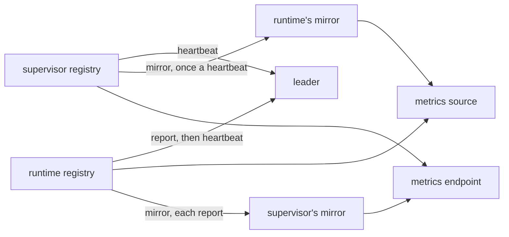
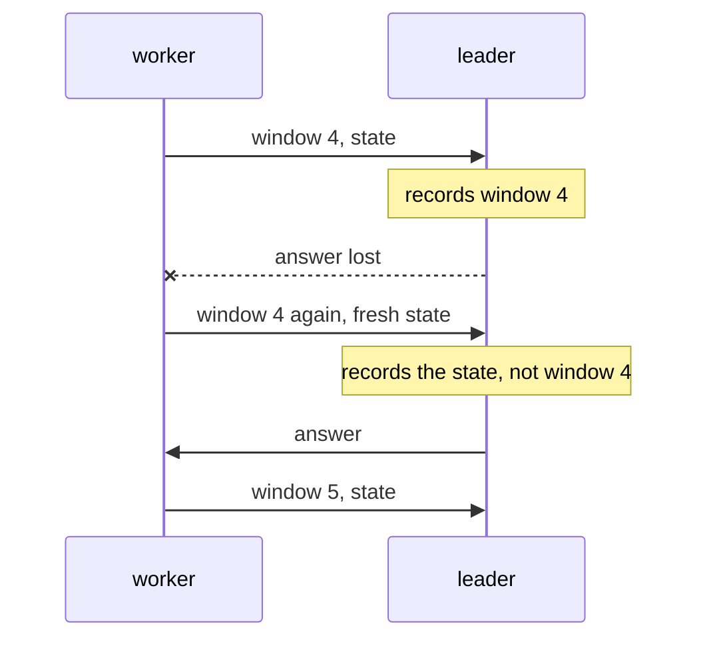
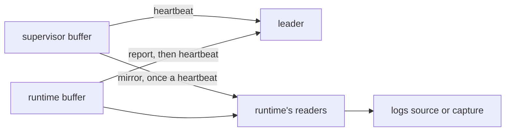

# Observability

A system of the [design document](../smeltr-design.md).

A process keeps two accounts of itself: counters and gauges in one registry,
and logs in one buffer. The heartbeat carries both to the leader, and a bundle
can route either through a pipeline to any destination.

## Metrics

Every thread records counters and gauges into one registry per process. A
counter sums; a gauge keeps the last write. A counter holds a whole number,
or a float where its total is not one, such as seconds spent. A sample is a
name plus a label set, recorded once per batch and never threaded through
kernels.

A metric is named by the Prometheus standard, so every consumer reads the
name it was recorded under: a counter's name ends in _total, and a quantity
is in its base unit, seconds or bytes, named last before that, as in
`smeltr_tick_poll_seconds_total`. Whatever only goes up is a counter.

Consumers do not share a read position. Each reads through a **cursor** of
its own, sees what accumulated since it last committed, and commits only
once its delivery has landed, so a failed delivery leaves the counts owed.
A counter that did not move reports 0, so every reader tells an idle
subject from a silent process: only a process that stopped reporting
leaves a gap. A reader and an egress thread start their row counters at 0,
so a subject reports before its first row.
Three consumers, for three audiences: the heartbeat carries metrics to the
leader for the live view of the fleet, a **smeltr metrics source** turns
the registry into ordinary records that route through a pipeline to a real
destination like any other data, and a worker's **metrics endpoint** answers a
Prometheus scrape with every counter's total and every gauge's current value.
A scrape reads totals, beside every cursor rather than through one, and
Prometheus takes the differences itself. Metrics are the one place smeltr trades
durability for simplicity: a dropped bucket loses one window of counts,
never data. The metrics pipeline's own activity increments the registry,
bounded because draining is timer-driven.

## A worker's two registries

A worker is two processes, each with a registry of its own: the supervisor's
lives as long as the worker, a runtime's as long as its deployment. The leader
hears every series once, from the process that wrote it. A metrics source runs
in the runtime and reads the whole worker, because the supervisor mirrors its
registry to the runtime once a heartbeat. The metrics endpoint runs in the
supervisor, which outlives every runtime, and reads the whole worker the other
way round: the supervisor mirrors what each report carries.



A mirror is read by metrics sources and the metrics endpoint, never reported
onward, so nothing either process wrote reaches the leader twice. Its cost is
one heartbeat of delay on the supervisor's series in the runtime, and one
report's on the runtime's series at the endpoint. A runtime that goes takes
its gauges with it, and leaves its counters, which the next runtime's counts
add to. A counter at the endpoint so never falls while the supervisor lives,
and Prometheus reads a reset only when the supervisor restarts. The cost is
that a counter a removed source wrote stays at its last total until then,
and that the endpoint loses at most the runtime's last report. A series both
processes write, like the logs buffer's own gauges, carries a `process` label
naming the one that wrote it. A capture's carries none, since either process
may run one: the endpoint adds the two processes' counts, as the leader does.

## Logs

A process also says things about itself, and they go to one buffer per
process for the same reasons the registry is one: most of what smeltr has to
report happens where no deployment exists. A log is structured like a metric
is -- a time, a severity, the call site, a constant sentence and typed fields
-- so what reads it searches fields rather than parsing prose.

Three consumers read that buffer, each bounded its own way:

```text
                          ┌──► console       drops when full, counts per site
  every thread ──► buffer ─┼──► leader       held until acknowledged, cut to
                          │                  length, capped by row count
                          └──► smeltr logs   one queue per reader
```

A write never blocks: the console's latency belongs to whatever is reading
it, and a thread moving data must never wait on that. What the buffer drops
it counts per site, which is the only thing that can say whether one site is
drowning the rest.

What bounds output is the call site. A loop that refuses a thousand rows
reports once, with a thousand in a field; occupancy is then a property of the
code, which can be read, rather than of the traffic, which cannot. A path
about to exit prints and goes, since a buffer has nothing to offer a process
that will not outlive the handoff; an orderly exit empties the buffer first,
bounded so that logs delay an exit no more than they may block a write.

## What a heartbeat carries

A heartbeat is fresh state and one window. The state -- what each thread is
doing, what the supervisor holds, the commit it runs -- is read again for every
beat. The window is what accumulates: the metric samples, logs, streams and
progress gathered since the window before. Each window is numbered in the
worker process's life and sent again, unchanged, until the leader answers,
with what arrives meanwhile held for the next; the leader records each number
once, so a lost answer costs a round trip and counts nothing twice. Logs keep
their own sequence number and the boot id of the process that wrote them, and
progress its item, so the leader keeps each once whichever beat carried it.



Each part of a window has its share of the leader's limit. Logs and progress
past theirs wait in order for the windows after. Counters go by whole threads:
past their share, a window takes threads' counters in turn from where the last
one stopped. What the rest count meanwhile stays owed and arrives summed on
their turn, so a deployment with more series than fit lands its counts a few
beats late. Gauges and facts are state, not window: every beat carries them for
every thread, so what the leader shows of a thread is always its latest.

A beat past the leader's limit is refused, and its window is dropped rather
than kept, since sent again it would be refused again; its progress goes back
for the next window. A beat the leader cannot record is refused too, and its
window goes again; only streams that will not write are left out and the rest
recorded, since they would fail the same way every time the window came. One
loud worker can fill the leader's cap at the expense of the rest. The last
heartbeat is the notice that the worker is stopping, and nothing is held past
it: a notice that does not land costs what it carried.

A log raised while logs are being delivered reaches the console and stops
there. Otherwise a delivery that fails reports that it failed, and that report
is in the next delivery.

## Smeltr logs

Smeltr logs is the metrics source's twin: a bundle declares it, and each
event reaches a pipeline as JSON. The pipeline behind it is not delivery-local,
so a destination refusing a batch reports it, once for the batch.

## A worker's two buffers

A worker holds two of these buffers, one per process, as it holds two
registries, and its logs travel the way its metrics do. The leader hears every
event once, from the process that wrote it: the runtime's by riding a report to
the supervisor and its heartbeat onward. A logs source runs in the runtime and
reads the whole worker, because the supervisor mirrors its own events to the
runtime in the same frame, once a heartbeat, as its registry.



A mirrored event reaches the runtime's readers only, never its console or its
queue for the leader, so nothing the supervisor said is written or delivered
twice. Its cost is one heartbeat of delay on the supervisor's events, and the
supervisor keeps them only while a runtime runs. With no runtime, the
supervisor serves a capture itself, and its buffer is then the whole worker.
In all-in-one the leader's own events are in that same supervisor buffer.

Every reader of a buffer has a queue of its own, as every metrics reader has a
cursor of its own: a deployed logs source, a capture and the supervisor's
mirror each see every event from their opening on, and none takes from
another. Each queue is bounded on its own and refuses what does not fit,
counting it.

## Streams

A worker's third account is of the data itself: what each Parser produces,
and what arrives that no route takes. Like the registry and the buffer it is
one per process, written by every transform thread, drained into the report
and carried on the heartbeat. Unlike them it describes records, so it carries
names and counts and never a value.

```mermaid
flowchart LR
  P[Parser, one batch per interval] -- fields, kinds, coverage --> A[account]
  U[rows no route took, every batch] -- stream key --> A
  A -- report, then heartbeat --> L[leader: one row per field, per key]
  L --> API[/api/streams]
```

A Parser tallies one batch per route per heartbeat interval: which fields it
produced, how many rows held each, and as what, and how many of an
undeclared field's values read as a time: a shape the automatic time reading
takes, or a count with an epoch's digits. A field all of whose values did is
proposed as a `datetime`, from a sample or from production alike. The first batch to reach the
route after the interval tallies, decided with one atomic load, and every
other batch runs untouched, so the cost follows the configuration and the
clock rather than the traffic. A row no route took is keyed on every batch,
because a stream nothing selects is what those rows are: a HEC or S2S
sender's sourcetype, an Elasticsearch sender's index, an object's bucket and
directory prefix up to its first dated segment, and otherwise the record's
topic, which a receiver fills with the sender's address. A batch that
`Unmatched` blocks is keyed too, before it is held: the stream that blocked
it is the one to set up. It is held until a new config, so its rows are
keyed once.

What one report carries is bounded by the code: a cap on field names per
Parser and on keys per source, with the rows past either counted rather than
named. A field name is data, not structure, and without the cap a source
inventing names would grow a heartbeat without one.

The worker keeps no baseline. It reports a window and forgets it once the
leader has it: the heartbeat's window ([What a heartbeat
carries](#what-a-heartbeat-carries)), so a beat whose answer was lost counts
nothing twice. The leader sums every window from every worker
of a group into one row per field and per key, each with when it was first
and last seen. The same caps hold there, so the
tables grow with the configuration. That accumulated shape is what a
proposed declaration, a drift warning and the map's unrouted streams read
(design doc, Deferred: runtime schema and learning are the leader's, never a
worker's).

A drift warning says production no longer matches a step's declarations, per
pipeline of a group: a declared field whose values failed to coerce within the
drift window, or one no row has held for the window while its step read rows.
A field is summed over every source and route of the group that ran its step,
so it is gone only once none of them carries it. A declared field is reported
on every tallied batch, present or not, so the leader keeps when each was last
present and last failed apart from when it was last reported.

A stream is unrouted while rows no route took arrive under it within the same
drift window, which raises a warning on its source in that group naming its
streams. A worker reports only what no route took, so the warning clears once a
window passes without such rows, however the route that takes them is written.

## What the leader keeps

The leader serves back what reaches it, newest first -- which is what holds a
reader steady against the cap, since the cap takes from the other end. A
worker states its group on the beat that carries them, so a log keeps the
group it was delivered under. What a group's workers saw of their streams is
summed under the group, and served whole by `/api/streams` to whoever holds
viewer in it.

A sum holds only while it still describes a running pipeline. A step whose
declared fields or types differ from what the leader holds for it runs another
pipeline: reported from the group's deployed commit, its sums start over, and
reported from any other, as during a rollout, it is left out. A source no kept bundle version reads takes
all of its streams with it. Whatever has not been seen for the longest series
tier's window goes with that tier's points, and a worker the leader forgets
takes its window with it. An undeclared field whose type changes keeps both
counts; the newest suggestion is the one served.

A leader writes its own logs into the same table, under the
name `leader`, so an administrator reads them where they read the fleet's, and
they count against the same cap. Among them is every issue's history: the
fact clock that times an issue logs its beginning and its end, so what the
Issues page no longer shows can still be read. Such a line is the issue
itself, and the catalog's "a worker logged warnings" entry leaves it out.
A failure a page shows from the leader's own state -- why the last ACME order
failed, why the remote is not followed, why a save is not on the host, why the
list of releases was not read -- is logged where it is recorded, by
construction: the message is held as a `Noted`, which only the line that logs
it can make, so a stored failure that was never logged does not compile.

## Seams

Every [stage](runtime-stages.md) and every [exception
answer](exception-taxonomy.md) writes here. The [control
plane](control-plane.md)'s warnings are derived from what the heartbeat
carries. A Parser's tally comes from the [compiler](compiler.md)'s own
field accounting, the one a preview proposes a declaration from, so what the
leader learns of a stream is what the parser did.
