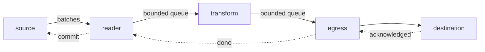

# Runtime stages

A system of the [design document](../smeltr-design.md). Its terms are in
[definitions](../definitions.md).

A deployment inside a worker moves each batch through five stages. A source
receives a stream and frames it into payloads, and a destination sends
payloads, each over as many connections as its system gives it. Transform,
between them, does all the work on records. A
reader for each source and an egress for each destination keep the books: what
is in flight, what to send again, what to commit. Acknowledgments flow back
the same way: destination, egress, reader, then the commit to the source.
Bounded queues join the stages, and a full queue is the only backpressure.

| stage | threads | does | scales by |
|---|---|---|---|
| source | its own, as many as its connections need | receives a stream, decompresses and frames it into payloads, hands them over in batches | connections |
| reader | one per source | tracks each batch for commit, queues it for transform, stops the source while the queue is full | nothing: one thread |
| transform | one pool, sized by hardware threads | decodes payloads into records, routes, runs pipelines, encodes records into payloads | hardware threads |
| egress | one per destination | paces what is sent, hands each delivery unit to its destination, hands over again what was not delivered, reports what was | nothing: one thread |
| destination | its own, as many as its connections need | frames payloads into what its system takes, compresses, sends | connections |

Every path a record takes through these stages, and what each one commits,
is drawn in [`data-paths.md`](../data-paths.md).

## What each stage touches, and how it scales

- A source decompresses the stream it receives and frames it into payloads.
  It hands over the payloads and where each came from, and nothing else.
  A source whose system gives typed values, as a query does, hands over
  those columns.
- Only transform reads what is inside a payload, and only transform touches
  a record. A reader and an egress handle a batch as a whole, so what a batch
  costs them does not grow with its records.
- Transform encodes the payloads a destination sends. The destination's own
  threads frame them, compress them and send them. A file destination
  writing Parquet encodes it itself, since a Parquet file is built from the
  columns of many batches.
- A source and a destination work one stream at a time, so they scale by
  connections. Transform scales by hardware threads. A reader and an egress
  do not scale: each is one thread.

## Source

A source hands over a batch and, when told, commits it. It holds what it has
received in an inbox until its reader takes it, and hands over a batch once
it holds a batch's worth or its oldest record has waited a moment, so records
arriving a few at a time still make whole batches. What divides a source's
input among workers is one of three things:

| kind | who divides the input | when it has no room |
|---|---|---|
| shared | the source's own protocol, among a group's members | pauses its shards and keeps its membership |
| single-worker | the leader, which holds the source for one worker ([control plane](control-plane.md#holds)) | stops reading |
| receiver | the senders, or a balancer in front of the group | answers busy at once, or stops reading a streaming connection |

Sources of one group and connection share one client, so a worker pays for
one membership however many sources read through it, and a full source pauses
only its own shards. A single-worker source hands over its progress after
each commit, and whichever worker holds it next resumes from there.

A receiver answers a request once it is in the inbox, so a sender never waits
on a destination; a stop delivers what the inbox holds, and a crash loses
it. Set to answer after delivery, it answers once commit has retired the
request's last record, and a protocol whose answer is its acknowledgement
always does. A receiver counts everything it holds against one ceiling.

## Reader

A reader blocks when its queue is full: it stops its source, stays connected,
and keeps whatever membership the source's protocol requires. A stalled
destination never costs a source its membership.

The reader runs the source's commit tracker, the only component that knows
the at-least-once rule: a batch is committed once every destination it
reached has acknowledged it. It tracks batches in the order they were read
and retires a prefix, so a batch that finishes early waits for its elders. A
source commits by a watermark, by acknowledging each record, or not at all.
With no commit, a record the worker holds is the only copy, so at-least-once
ends at the source's edge.

## Transform

Transform is stateless per batch. It is the only stage running user-authored
logic, so panic isolation lives here. One batch fans out to one delivery unit
for each destination it touched, encoded once. A capture taps a batch at
both ends of transform: as its records arrive, and as each route's pipeline
finishes its records.

A batch runs through transform in slices sized to the L2 cache one hardware
thread has to itself, since a pipeline runs each step over all its input
before the next. A batch stays whole on either side: it is read, delivered
and committed once, whatever its slices.

A route selects a pipeline for a source's records. Routes have no order: every
route sees every record of its source, and a record two routes match runs both
pipelines. Delivery belongs to the route as a list of rules over the pipeline's
output; rules are additive, so a record matching two goes to both.
Every record a pipeline finishes is delivered, dropped by a drop its author
chose, or answered as `Unmatched`
([exception taxonomy](exception-taxonomy.md)).

## Egress

Retry belongs to egress: it keeps each delivery unit until acknowledged and
hands it over again itself, so a reader carries offsets and nothing else. A
destination that names which records were not delivered has only those sent
again. A delivery unit that failed waits its own backoff, so the ones
delivered beside it do not wait on it; only a destination where nothing is
delivered backs off as a whole.

Egress paces each destination with BBR (Bottleneck Bandwidth and Round-trip
propagation time), as the IETF draft
[draft-ietf-ccwg-bbr](https://datatracker.ietf.org/doc/draft-ietf-ccwg-bbr/)
specifies it, with a batch for a packet and for the send quantum.
It hands over a batch only while the congestion window has room for it, or
nothing is in flight, and the pacing rate allows it. The window is never over
the destination's limit and never under four batches; the queue's
budget is the window and one batch ready behind it. An answer that asks to be
sent less (429, 503, or a full queue) counts as loss. Its rows come back to
egress as soon as it is answered and go again after the wait the destination
asked for, so the model hears a throttle within the round trip that drew it, as
TCP hears a loss. A destination that delivers a batch in order waits a throttle
out itself, since its rows cannot go back behind those after them.

A full queue refuses a batch at once and never holds the thread that offered
it. The refused batch waits and transform passes over that source until the
queue has room. Once the wait outlasts the destination's stall threshold, the
source's reader is told, which stops the source. So a stalled destination stops every source
feeding it and nothing else.

## Destination

A destination is handed a delivery unit whole, after the batch has run
clean. Its own threads send it without waiting, and it reports what was
delivered and each record refused as it learns of them. It builds without
reaching its system, so a deployment starts during an outage and reports it
as a connection error. A payload on its way out carries the topic or index
it is bound for, an identity and a partition key; the last two are separate
on purpose.

## Queues are the memory budget

Where the worker does not know its memory, every queue has a fixed cap, so
flow memory is linear in the number of sources and destinations. A worker that knows its memory
sizes the caps to it instead: what the bundle fixes is set aside, and the
destination queues share the rest as one pool. Each queue holds one batch as
its reserve and borrows above it as far as its pacing asks. While any queue
wants more than the pool has, each holds an equal share at most, so a busy
destination takes what idle ones leave and a slow one holds little. Receivers
share a pool of their own the same way. A file destination's open files hold
their encoded records and their codecs' state within its buffer.

Transform has one budget of its own, checked on allocation: the memory it
takes to turn one batch into another, which no queue cap can see. The logs
buffer is the one queue that drops when full, because a report of a stall
must not be stalled by it.

## Seams

The [compiler](compiler.md)'s plan is what transform runs. The
[exception taxonomy](exception-taxonomy.md) decides what each stage does with a bad
record or batch. Every stage records into the [observability](observability.md)
registry. The [control plane](control-plane.md) starts and stops the whole
assembly.
