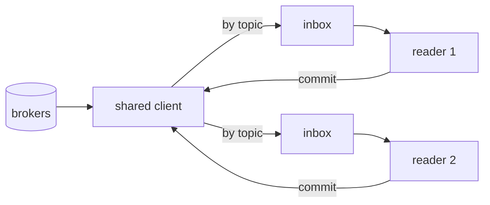
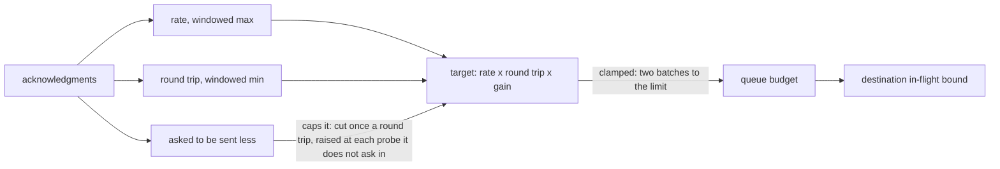
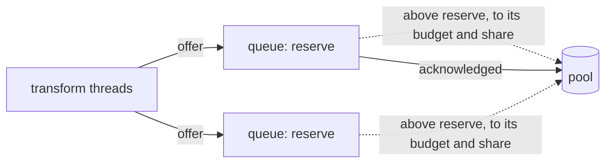

# Runtime stages

A system of the [design document](../smeltr-design.md).

A deployment inside a worker is four stages joined by bounded queues. Each
stage's concurrency is set by one thing the others cannot change. A full
queue is the only backpressure, and the reader it reaches blocks.

```text
ingest         one reader per source
   |  batch: records + ack tokens            one bounded queue per source
transform      one pool, sized by cores
   |  one delivery unit per destination      one bounded queue per destination
egress         one thread per destination
   |  completion: what landed, what was refused
commit         one tracker per source, on the reader
```

Every path a record takes through these stages, and what each one commits,
is drawn in [`data-paths.md`](../data-paths.md).

## Concurrency and sizing

Four stages, because each one's concurrency is set by something the others
cannot influence:

| stage | limit |
|---|---|
| ingest | the source's shards, divided across workers by the source's own protocol, or one worker the leader holds a single-worker source for, or the connections and datagrams senders send to a receiver |
| transform | cores |
| egress | the destination's own capacity |

Sizing is part of this system, not a separate one. "How many threads" is
three questions, one per stage, and a worker's finite envelope is the sum.

## Ingest

Ingest owns the reader. A shard is whatever unit of parallelism the source
defines. A poll is bounded by bytes with rows as a backstop, and a record
larger than the cap comes back alone. Backpressure reaches ingest as a full
queue, and its response is to **block**: stop supplying, stay connected, keep
whatever membership the source protocol requires. A stalled destination never
costs a source its membership.

A source whose protocol divides its shards among a group's members joins the
group through a client the worker shares with every source of the same
group and connection. The worker pays for one connection, one membership
and one fetch queue however many sources read through it, and hands each
record to its own source's inbox, where its reader takes it. A full inbox and
a blocked source pause only that source's shards. The shared client keeps
the membership on its own, so a reader that stops reading for the group's
poll interval has its source taken out of the subscription, and its shards
go to members that read. Two sources reading one shard in one group would
each see part of it, so the second is refused and says why.
A source may name its shards by a pattern. The worker lists the cluster's
shards on a timer and subscribes to those the pattern matches, so routing
sees only shards by name. A pattern leaves a shard another source already
reads to that source and reads the rest; a source that names a shard
outright is still refused when another source reads it.



A source whose input has no protocol to divide it, such as a bucket read by
listing it, is **single-worker**. The leader holds it for one worker of the
group ([control plane](control-plane.md#holds)), and its reader on every other
worker reads nothing. After each commit the source hands over its progress,
and whichever worker holds it next resumes from there. That progress waits
in a bounded queue until the leader takes it, and a full queue stops the
worker's single-worker readers until it drains.

A source the sender connects to is a **receiver**. Every worker of the group
listens on its port, and the sender, or a balancer in front of the group,
puts each connection on one of them. A sender drops what it sent once it is
answered, so a receiver answers a request only once commit has retired the
request's last record. Until then the sender holds the only other copy, and a
worker that stops with a request held never answers it, so the sender sends
it again. A protocol with acknowledgement IDs lets the sender take an ID at
once instead and ask about it later; the ID reads acknowledged only once commit
has retired the request, and a worker that stops forgets its IDs, so the
sender sends again. The worker that gave an ID is the only one that can
report it, so a balancer keeps a sender's asks on that worker. A receiver
holds what its reader has not taken in an inbox, and counts everything it
holds against one ceiling: the inbox, the bodies it is reading, and what each
connection of a streaming protocol holds between requests. A full or blocked
receiver answers a new request busy at once; a streaming connection stops
reading instead, and its sender's window fills.

## Transform

Transform is stateless per batch and CPU-bound: routing, pipeline
execution, serialization. It is the only stage running user-authored logic, so
panic isolation lives here. One batch fans out to as many delivery units as
destinations it touched, serialized once. A capture taps a batch at both
ends of transform: as its records arrive, before any pipeline, and as each
route's pipeline finished its rows, before they are handed to egress. A batch a
block holds never runs again, so while it is held a capture of its source is
shown the records that blocked instead, each with why.

A batch runs through transform in slices, one after another. A pipeline runs
each step over all its input before the next step, so once that input
outgrows a core's L2 cache every step reads it back from main memory. Each
slice holds about half the L2 one hardware thread of the worker's CPU has to
itself, read from the CPU when the worker starts. A batch stays whole on
either side: it is polled, delivered and committed once, whatever its slices.

## Egress

Egress is one thread per destination, owning that destination's client and
draining a queue every reader pushes to. Retry belongs to egress: it keeps
each unit until acknowledged and re-sends it itself, so a reader carries
offsets and nothing else. A destination's limit is its share of the pool when
the worker sizes it, else the `bufferBytes` it states or its kind's default.
One that writes files holds up to its limit, since it acknowledges a batch
only once the file holding it commits. Every other destination is paced:
egress sets a target, the rate its acknowledgments come back at times the
least round trip they take, with a gain over it while the rate still grows
and a short probe above and below it after, and never over the limit. The
target is at least two batches, so the link does not idle while an
acknowledgment comes back. Once the least round trip is ten seconds old, the
target is one batch until one sent alone comes back, which is the round trip
measured again. When a destination asks to be sent less (a 429, a 503, or a
bulk item refused because its queue is full), the target is capped at a fixed
fraction of what it had in flight then, at most once a round trip, and the
cap is raised at each probe the destination takes without asking again. The
target is the queue's budget, and a batch's bytes stay in it until the
destination acknowledges the batch, so the target bounds what is in flight
too. A sample taken while the source was not pressing on the queue may
raise the estimate but never lower it, so a quiet source does not shrink a
fast link's target, and a slow link
stops the queue growing where more bytes would buy no more throughput. A link
measured to carry the limit or more, on average over five minutes of
delivering, when the worker sized the limit from memory, is a notice: memory,
not the link, is what bounds the destination.



## Commit

Commit is one tracker per source, running on the reader, and the only
component that knows the at-least-once rule: a batch's ack tokens are recorded
once every destination it reached has acknowledged it. It tracks at poll time,
in poll order, and retires a prefix, so a batch that finishes early waits for
its elders. A source picks one of three commit shapes: a watermark, where
recording a position asserts everything before it is done; per-record
acknowledgment, where completion order is irrelevant; or none, for a source
that cannot be told anything, such as a UDP stream or the smeltr metrics
source. With no commit, a record the worker holds is the only copy, so
at-least-once ends at the source's edge and a batch is done once delivered or
abandoned.

## Queues are the memory budget

Bounded queues are the only backpressure mechanism. The logs buffer is the one
bounded queue that is not: it drops rather than backpressuring, because a
report of a stall must not be stalled by it. With no memory to fit, every boundary has a fixed cap,
so flow memory is linear in the number of sources and destinations and an
operator sizes a container from the sum. One exception: a budget on the memory transform takes to turn one
batch into another, checked on allocation, because that is the one allocation
no queue cap can see. Each transform thread keeps as many buffers as the
most demanding of its recent batches needed, charged to the budget while
idle, so the next batch reuses them rather than allocating again. Together
the threads keep at most half the budget idle, since a thread the budget
refuses can free only its own.
Each bound reports what it holds beside its ceiling, and each process what it
holds in all, so the sum can be checked against a running worker.

A worker that knows its memory sizes the caps to it instead. What the bundle
and the operator fix is set aside: the worker's processes, each source's cap, the
lanes, every destination buffer the bundle states, and the columnar budget
when it is set. The columnar budget, the fetch queues the bundle leaves unset
and one pool share the rest, so a larger container holds more in flight with
no change to the bundle. The columnar budget stops at a fixed amount per
transform thread, past which a thread no longer waits on it, and leaves the
rest to the queues.

Each destination queue the bundle leaves unset holds one batch as its reserve
and borrows above it from the pool as far as its paced budget asks. Alone, a
queue may take the whole pool. A queue the pool refused is wanting for a
moment after; while any queue wants, each may hold only an equal share of the
pool, and one above it gives back as its acknowledgments come in, never by
taking back what is in flight. So a busy destination takes what idle ones
leave, a slow one holds little, and memory follows the traffic rather than
the count of destinations. A full pool refuses an offer as a full queue does,
and the batch waits on its lane. A stalled destination's target falls to one
batch, and an empty queue always takes one batch, so every destination moves.
A destination that grew alone and then stalls keeps what it has in flight
until that is acknowledged or given up, and the others share the rest
meanwhile.

Receivers share a pool of their own the same way. Each holds one request of
the largest it reads as its reserve, so every receiver takes a request
whatever the others hold, and borrows above it up to its ceiling.

Each lane and each reserve holds whole batches whatever the traffic, so they
grow with the count of sources and destinations. When they would take more
than half the memory, the worker cuts its batches smaller, down to a floor
below which the work per batch outweighs the batch. The senders a destination
starts with are held whatever the traffic too. A paced destination starts
another sender when all its senders are busy. Each sender borrows what it
holds from the pool before it starts and keeps it while the destination
lives, and the target is held to what the pool lends beyond the senders. A
sender gone idle hands back what its allocator holds free.



Its memory is what its startup configuration names, or else most of its
container's limit, or of the host's memory without one. The rest is left to
what runs beside it: a leader in the same process, or the host's own.

## A stalled destination stops every source feeding it and nothing else

A full queue refuses a batch at once and never holds the thread that offered
it. The batch waits on its lane, the pool passes that lane over until the
queue has room, and the lane's reader is told it is held once the wait has
outlasted the destination's stall threshold. A source that does not feed the
destination never notices.

## Sources, destinations, routes

Kafka is the primary implementation and must not be the only shape the runtime
can express, so a source and a destination are two small traits. A source
hands back a batch and later commits it; it declares the metadata fields its
records carry and the encoding they arrive in. A destination is handed a
batch's rows once, whole, after the batch has run clean; it delivers without
waiting, and reports completions and individual refusals as it learns of them.
A Kafka source builds without reaching its broker. A Kafka destination asks
its broker for its topic's message ceiling at build, within one bounded wait,
and builds with librdkafka's sizes when there is no answer. So a deployment
starts during a broker outage and reports it as a connection error. A Kafka source places each partition its group hands it: at the
group's committed offset, or else at its start, a timestamp resolved then.
Its stop, when set, ends each partition before the first record at or past
it. Each commit carries the start its offset descends from and the time of
the deployed commit that placed it. A partition whose commit carries another
start, placed under an older deployed commit, moves to the config's start
and commits it at once, so changing a source's start moves every partition
there once. A commit without that record is read on and gains it. A row on its way out carries its value,
the topic or index it is bound for, a document identity and a partition key;
the last two are separate on purpose.

A route selects a pipeline for a source's rows. Routes have no order: every
route sees every row of its source, and a row two routes match runs both
pipelines. Keeping two routes apart is their conditions' job. A row no route took
meets the group's `Unmatched` answer ([exception taxonomy](exception-taxonomy.md)). Delivery belongs to the
route as an ordered list of rules over the pipeline's output; rules are
additive, so a row matching two goes to both. A row no rule takes meets its
route's `Unmatched` answer, laid over the group's, so every row a pipeline
finishes is delivered, dropped by a drop its author chose, or answered as
`Unmatched`. A bundle may name any number
of destinations, and a rule can deliver a row to any of them. A tagged row
carries the tag field its route or group names and is routed by the same
rules. A pipeline sets internal variables with a reserved prefix; they
are never serialized and egress reads them back as the delivery's topic and
identity.

The intended shape past one team is tiers: one deployment normalizes onto a
Kafka topic and another fans out from it. Nothing in the engine knows this;
the second hop is an ordinary deployment whose source is the first's output.

No async runtime anywhere in the data plane.

## Seams

The [compiler](compiler.md)'s plan is what transform runs. The
[exception taxonomy](exception-taxonomy.md) decides what each stage does with a bad
row or batch. Every stage records into the [observability](observability.md)
registry. The [control plane](control-plane.md) starts and stops the whole
assembly wholesale.
