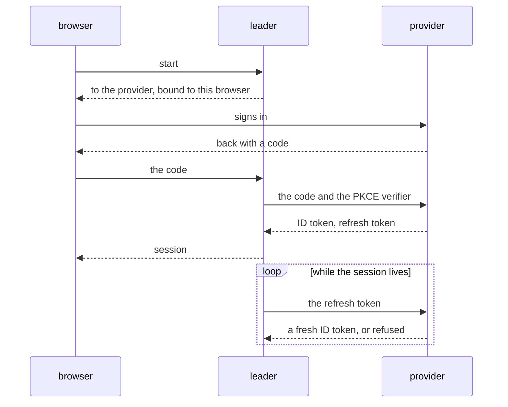
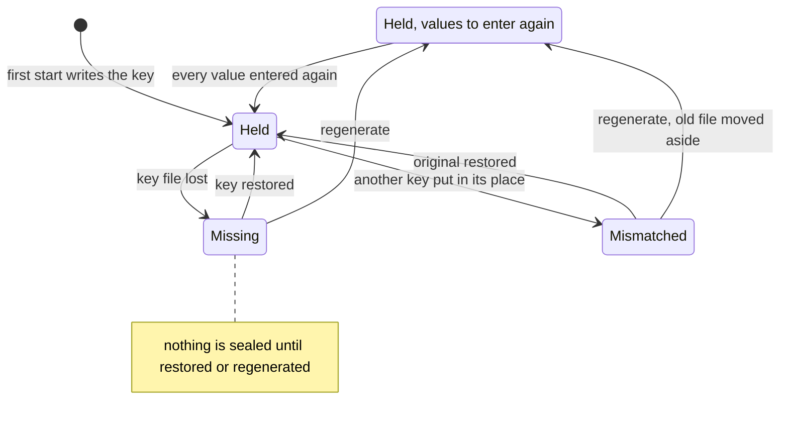

# Security

A system of the [design document](../smeltr-design.md).

Six parts decide who is trusted with what. A worker proves itself to the
leader with the token it enrolled for, and trusts the leader through a root it
holds. A person signs in to the leader, and the leader alone decides what they
may do. A sender proves itself to a receiver with a token or a certificate, and
a scraper to a worker's metrics endpoint with a password or a certificate. A
bundle names each credential a connector needs and never carries one. One module performs the cryptography under all of it, apart from Kafka's
own.

```text
  person ── signs in ──►  leader  ◄── enrolled token ── worker
                            │                             ▲
                            └── roots, and the ───────────┘
                                credentials its bundle names
```

## Trust

The cluster is the security boundary. An enrolled worker is trusted with the
whole of it -- every group's configuration and every credential the leader
stores -- whichever group it serves. An admin mints an enrollment code, which
has a kind that every worker it brings in keeps for life. A **permanent**
worker is one an operator placed; an **ephemeral** worker is one an autoscaler
starts and stops. A permanent enrollment code is bounded by a lifetime and by
how many workers it may bring in, as far as the operator chooses. An ephemeral
enrollment code is bounded by neither, since an autoscaler spends it every
time it starts a worker: it brings workers in until it is withdrawn. Either
ends with the root it names. A worker spends one for a durable credential that
is its identity, and the leader keeps only hashes. An enrollment code names
the root to accept as well as the secret, so the two cannot be copied apart --
and cannot be re-pointed either, which is why replacing that root withdraws
every enrollment code naming it. A worker accepts the leader's certificate
when it chains to a root the worker trusts and carries the leader's name. The
roots are the system's, and any the worker was given out of band, which may be an
authority the leader created for itself; a worker told not to trust the system's
roots trusts only those it was given (`trust_public`, as a connector's TLS). Naming that root by fingerprint is
being given it out of band: the worker fetches the certificate, keeps the one
that matches and refuses the rest. Such a leader signs the certificate it
serves rather than being it, so replacing that certificate reaches no worker
while replacing the authority reaches every one. A worker holds as many roots
as it was given, which is what lets an authority be replaced without stopping
the fleet. Replacing the authority is those two facts in order, whether the
leader is moving to another authority of its own or the certificate it serves
is changing source -- a certificate an operator chose from the list in place of
the leader's own, or back: the incoming root is published beside the outgoing one
and reaches each worker on its next heartbeat, and the leader serves under it
only once every worker it still expects to hear from holds it, once the wait
has run out, or once the operator tells it to stop waiting. A worker whose
trust its operator manages (`SMELTR_LEADER_CA`) is not waited for, since the
leader can hand it nothing: the operator gives it the incoming root, and the
leader names it as theirs to see to. An operator
rotating the leader's own authority sets the wait; a change of source waits
until the certificate being served, or the one it is switching to, is about to
run out, since nothing is lost by waiting until then. A chosen certificate under the root already in force
is a renewal, and is served at once, whatever rotation is open; a choice that
would change the root waits for the open rotation to finish or be abandoned. A
certificate the leader orders for itself from a certificate authority over
ACME (RFC 8555) arrives the same way, under the root that signed it, so a
worker is given that root as it would be given a chosen one; the leader
proves it holds each name on the port it serves (TLS-ALPN-01), on port 80
(HTTP-01), listened on only while an order is open, or with a TXT record
published through the zone's DNS provider (DNS-01), removed when the order is
over, and orders again two
thirds of the way through the certificate's life, whether or not it is
served, and at once when a regenerated key cannot open the newest order. The account it holds at
the authority lives beside its certificates and outlives them. A worker gone quiet is still expected: what it last
said it holds never ages out, so going quiet never ends the wait for it. A
revoked worker is not expected, and neither is a forgotten one. Signing first
strands every worker that has not yet asked, and strands it silently -- a
connection already open goes on succeeding while every new one is refused. The
outgoing root leaves the bundle at that same moment, because a root kept past
its replacement is one whoever holds its key can still impersonate the leader
with. A worker stops trusting it the way it started trusting the incoming one:
by being handed the bundle whole on its next heartbeat, a set it adopts rather
than adds to. One that never took the incoming root is past being reached by
then, and is torn down and enrolled again. Revocation is soft: a revoked
worker is refused and treats that like an unreachable leader, and it stays
out. A worker the leader does not know is refused as unknown instead, and one
still holding its enrollment code enrolls again with it, as a new worker. That
is how an ephemeral worker the leader forgot while it was away comes back.

## Identity and access

Identity and access are the leader's alone; nothing in the data plane
learns a person exists. Whoever calls the operator API is an **account**, and an
account signs in one way: a local account with a password, an OIDC account
through the organization's OpenID provider, a key account with a key. How it
signs in decides only how it proves who it is. What it reaches is what it
holds, and renaming, disabling, its agent permissions and the audit are the
same for every account. A local and an OIDC sign-in end in the same session,
so the gate, its deadlines, disabling and revocation treat the two alike.
Display names may repeat: an account is known by its id, which the audit and git record beside its name.

A local or key account holds the roles an administrator gives it, or
everything by its own administrator flag. An OIDC account holds the roles of
its provider groups, and never the flag. At least one enabled local account
keeps the flag: it is the way in when the provider is down or misconfigured.
An administrator makes local and key accounts.

A local account holds a username and a password the leader verifies. An OIDC account is one identity at one
provider, named by the issuer and the subject the provider gives it and
never by a name or an address. It holds no password. It is created the
first time the provider vouches for the person, and records the groups the
provider names at each sign-in and at each refresh. While a session lives the
leader refreshes it at the provider every few minutes with the refresh token
the sign-in gave, held in memory with the session: a provider that refuses the
refresh, or whose fresh ID token no longer names a group any role names, ends
the session. Only a person holding a group some role names is let in; anyone
else who can sign up at the provider would otherwise hold a session that gives
nothing. A refused sign-in is logged with the groups the provider sent, since
those are the names a role must match before anybody has been let in. The sign-in is the authorization code
flow with PKCE, bound to the browser that started it, and the ID token's
signature is checked in the module that performs all the leader's other
cryptography.



Access is per area, and governs every account. An area is `shared` or one
worker group, the scope every configuration read and write already names. A
role is one group the provider names and what holding it gives: viewer,
editor or deployer in each area, each including the ones before it, or
administrator. An account holds the highest level any of its roles gives in
each area, and reads `shared` if it holds any area, since a group is read
merged with it. Objects carry nothing, so a team's access is set once rather
than on every object it makes.

```text
  provider groups ──────┐
  (OIDC, at sign-in     │
   and each refresh)    ├─► roles ──► level per area ──► the gate, on every request
  given by an admin ────┘   (leader store)
  (local, key)

  administrator flag (local, key) ──► everything
```

The gate names the area and level each route needs
([api.md](api.md), Who may call what), and a route it does not
name is for administrators alone, so a route added without a decision is
closed rather than open. Editor covers capture, preview and samples as well
as saving, since they show production records. Approving or deploying a
change takes deployer in every area its paths touch; a change to `shared` is
judged as `shared`, so a `shared` deployer changes what every group runs.
Running a change's own tests judges it the same way. Changing a change, its
branch or its conversation's state takes editor in every area it touches.
Admin is for administrators. A role changed reaches everyone holding it on
their next request; a person's groups change at their next refresh.

A person sees only the areas they hold. A change, its diff and a commit in
the history are shown whole to someone holding viewer in every area they
touch, and to nobody else, as though absent. The map, the status pages, a
node's counts and the list of groups show only the groups held. A capture is answered only to an
editor of the group it runs in. A role names areas by name and outlives the
group: a group removed and created again under the same id is given to the
roles that named it.

The leader's AI agent is a principal of the same kind. Acting for a person, it
carries their session and holds their **agent permissions**: the level in each
area they let it use, viewer everywhere until they choose otherwise, up to
everything they hold. The gate judges its requests by the lower of the person's
level and the agent permissions in each area, so an agent never holds more than
its person, and loses what they lose on their next request. Only the leader
marks a request as the agent's. No agent changes its own permissions: only
its person sets them. An administrator's agent is an administrator only when
its permissions are everything. What it does is recorded as its person's
agent's, in the audit and in git.
None of this acts until an administrator turns AI agents on and names the
model endpoint they think with: until then no agent permissions are set, and
what was set before is kept. Turning them on asks the endpoint for a short answer with its key, so a
setting that cannot work is refused when it is saved. What an agent reads to
do its work is sent to that endpoint.
An agent works by requests to the leader's own API, sent through the gate with
the session or key it runs under, so each is judged as the GUI's would be. It reaches only
the routes its catalog names, which leave out signing in and out and its
person's conversations. What a request answers is data the agent reads, never
an instruction to it: its permissions bound what an instruction written into
that data could do. A conversation is its person's alone.

```text
  person's level ───┐
                    ├─ lower of the two ─► the gate, on every agent request
  agent permissions ┘
```

A key account is an account for a script outside the leader that calls its
API. A person signs in with a password or through a provider and holds a
session; a key account calls with one of its **keys**, sent as a Bearer token
on every request, and holds no session. It needs no Origin or CSRF check, since
no browser sends a key on its own. Only an administrator makes a key, and only
a key account holds one. The leader keeps a key's hash and returns the key
once, when it is made, as it does a worker's token. A key may be made to expire
after a number of days. A key account holds any number of keys, so one is
replaced without a gap. A revoked or expired key is refused, and disabling a
key account revokes every key it holds.

What a key reaches is what its account holds, as a session reaches what
its person holds. What a key account does is recorded as its own: by its id in
the audit, and in git under its display name and its id.

A disable, a password reset or a revocation that lands while a sign-in is
checking the password refuses that sign-in. Changing a
password, one's own or by an admin's reset, ends every session the account
holds, the one that asked included. A refused sign-in is recorded under a
subject of bounded length, whatever size the caller sent.

## Senders

A receiver is where a worker takes the data it did not fetch: every
worker of the group listens on the receiver's port, and whoever is admitted
there puts records into the group's pipelines. So a receiver admits a sender
that presents one of its tokens, each a credential like any other, or, served
under a certificate with trusted authorities, a sender whose certificate chains to one
of them, and a receiver that would admit anyone is refused at load. A token
crosses the network in every request; without a certificate it crosses in the
clear, which suits a receiver behind a balancer that ends TLS for it. A
token is checked before any of the body is read, and the bodies being read
count against what the receiver may hold, so a sender without one cannot
make a worker hold anything. A gzip body counts as it inflates, and is held
to the receiver's request limit. The health path needs no token, and says
only whether the receiver takes requests; a receiver that names trusted authorities
admits no connection without a certificate that chains to them,
the health path's included. Syslog carries no token, so a syslog receiver admits
by the networks a sender connects from, or by its certificate. Over UDP it has
no certificate to check, and a datagram's source address can be forged, so a
UDP receiver's networks admit whoever can send from inside them or claim to.

## Scrapers

A worker's metrics endpoint is a port the worker opens only when its startup
settings turn it on. What it hands a scraper is the worker's counters and
gauges, labeled with the names of its group's sources, destinations and
pipelines. Its startup settings may ask a scraper for a password over basic
auth, its hash compared in constant time, and may serve it TLS under a
certificate the host holds, requiring a client certificate that chains to
authorities the host names. A port asking for neither answers whoever reaches
it, which leaves the network in front of it to decide who that is. A password
over a port without TLS crosses the network in the clear. The certificate and
key are read when the worker starts, so a new one takes a restart. The password
stays with the supervisor, which serves the endpoint; its runtime is started
without it.

## Secrets boundary

**A bundle names a credential and never carries one.** A committed value
would sit in history forever, appear in every review and travel to every
worker that fetched the tree. So a credential is declared once, by name, and
the declaration says where the value lives. A named credential a worker cannot
obtain refuses the deploy and leaves the running one alone.

Two custodies. **Worker-local**: an environment variable on the worker's own
host; the leader learns the name and nothing else, which is how an operator
declines to hand smeltr a credential at all. **Leader-stored**: the value is
sealed in the leader's store and the bundle holds a name and a version. The
version is exact: a deployment runs the version its bundle quotes or does not
run, so rotation is two steps, storing a value and then committing the bundle
that quotes it, reviewed like any other change. A value is never readable
back; an admin may ask whether a candidate matches, bounded and logged. The
secrets encryption key lives outside the data directory so one backup cannot
carry both.

**The git host's token, the OIDC client secret and the model endpoint's API
key are sealed leader settings.** Only the leader uses them. They are sealed under the same key,
never named in a bundle and never sent to a worker. Saving one takes effect at
once. The API key is forgotten when its provider or endpoint changes, since a
key belongs to the service that issued it, and it is sent only to that
endpoint, over HTTPS unless the endpoint is on the leader's own host.
A named credential takes effect only when a commit quotes its version, and
with a git host every commit reaches `main` through the host, so the host's
own token, kept that way, could be replaced only by using the token it
replaces.

**A certificate is the secret holding its private key, with more beside it.**
The key is a leader-stored secret, sealed, versioned and retained as any is;
the certificate's chain is public and kept beside each version of it, so
listing certificates opens nothing. The Certificates page lists them and the
Secrets page leaves them out. The leader serves the version an operator
chooses straight from the list, with the root workers verify it by, fixed when
it is chosen. What is served changes by one write, and the version served is
never deleted, forgotten or pruned while it is. A new version of that entry
has to be one the leader can serve, and is served once stored. A start that
cannot serve it -- its key does not open, or it no longer passes the checks it
was chosen under -- serves the leader's own certificate and says why, and
workers keep the root they hold until a certificate is served again.

### The secrets encryption key

Every sealed value carries the id of the key that sealed it, so the leader
knows, without opening anything, whether its key fits what it holds. A leader
that starts with nothing sealed writes the key. One whose key is missing, or
does not fit what it sealed, cannot open any of it, so it says so as a failure
on Issues and in its log, and seals nothing until the key is restored or
regenerated: a value sealed meanwhile would be one the restored key could not
open.

Regenerating writes a new key and records the ids of the keys it replaces. A
value sealed under a replaced key is then a value to enter again, a warning of
its own that clears when it is. A key file that is there but does not fit is
moved aside rather than overwritten, since it may be the right key for
something.



### A certificate travels with its key

A certificate a connector presents is an entry of the leader's certificate
list: its chain beside the private key, which is sealed like any stored
secret. The bundle names the entry by name alone, so the chain is not read in
review with the rest of the bundle, and a worker presents the entry's newest
version: a replaced or renewed certificate reaches every worker that names it
at its next heartbeat, and the worker restarts its deployment. Every worker
presenting it restarts within a beat of the others, and a restarted receiver
drops the connections it held, so its senders reconnect. The two
halves cannot drift apart: the list refuses a chain and a key that do not
belong together, and one version holds both. A new version keeps every
purpose the newest version has, server or client, as its Extended Key Usage
says. A connector naming the entry may present it from either side it is
usable from, and a worker that could not present a new version refuses to
restart onto it and keeps presenting the old one. A new version the leader
stores itself, renewing an entry it keeps, is not checked this way; a worker
refusing one is raised as WorkerNotDeployingItsTarget, naming why.

A worker is sent the entry's chain with its key. Before it tears down what it
runs, it refuses a certificate it could not present the way its bundle
presents it: connecting out, or serving a receiver's senders. A new version it
refuses leaves the running deployment running on the version it was started
with, and the worker reports why. The worker keeps only the newest version, so
a runtime that exits after that starts on nothing until the entry is replaced.

An entry is uploaded, issued by the leader under the authority it already
holds, for the names and the lifetime an admin gives, so a sender verifies it
against the leader's root, or ordered over ACME: each order the leader places
for itself is a version of one entry, which it serves. The leader keeps the
entries it issues and orders up to date. It issues an entry again two thirds of the way through its life, as
soon as it signs under another root, which is what a rotation's cutover leaves
it doing, and when a regenerated key cannot open its newest version, each time
with the same names and lifetime; it orders again as the ACME paragraph above
says. The leader's own certificate is the issued entry `leader`, for the names
the leader is reached by: it is issued again when those names change, and the
authority's next key issues it at a rotation's cutover. Where it serves the
entry, it serves the new version, and so does every worker. The leader holds
the key of an entry it issues or orders, so it is never replaced by an upload
under its name.

A worker is sent the credentials the configuration it is about to run names,
and no others. That is minimization, not a wall: enrollment binds a worker to
the cluster, not to a group, so one compromised worker host exposes every
credential the leader stores. An enrollment code is that same reach before it
is spent, and an ephemeral one is never used up: whoever holds one holds every
credential the leader stores until it is withdrawn, and it sits wherever the
autoscaler keeps what it starts workers with. Where that is unacceptable,
worker-local custody keeps the credential off the leader.

Switching a connector's protocol or mechanism in the GUI takes out every key
those two choices govern that the new choice does not ask for, since a name
left behind would still send its value to the worker.

## Cryptography

**One module performs the fleet's cryptography.** Every handshake a worker or
a leader makes, the authority the leader runs and every certificate under it,
the hashing that stores an enrollment secret, the randomness behind every
unpredictable value and the sealing of a stored secret all go through AWS-LC.
There is one answer to which implementation performed a given operation.

### Kafka's is separate

librdkafka carries its own TLS and SASL over its own OpenSSL, and the Kerberos
and SASL libraries beside it rest on that same one. A connector's TLS is one
shape wherever it is used, so which module enforces it follows the destination
rather than anything an operator writes:

```text
                   +---------------- AWS-LC ---------------+
  leader  --TLS----|  a connector's TLS, the leader's      |
  git     --TLS----|  authority, enrollment secrets,       |
  Elastic --TLS----|  sealed values                        |
                   +---------------------------------------+
                   +-------- librdkafka's OpenSSL ---------+
  Kafka   --TLS----|  the same TLS, and SASL               |
                   +---------------------------------------+
```

### Every build links AWS-LC's validated module, and offers only what its validation covers

Both are settled when the binary is built, so a deployment is eligible to
claim the module without being configured for it, and nothing it offers falls
outside the claim. There is one algorithm set and no way to select another.

A claim reaches as far as AWS-LC does. It stops at Kafka's transport, and a
deployment that must hold that traffic inside the boundary terminates its TLS
outside smeltr.

## Seams

The [config plane](config-plane.md)'s validation refuses a credential-valued
key in a bundle. The [control plane](control-plane.md)'s worker channel carries
the values, and the roots a worker trusts. Nothing in the data plane learns a
person exists.
