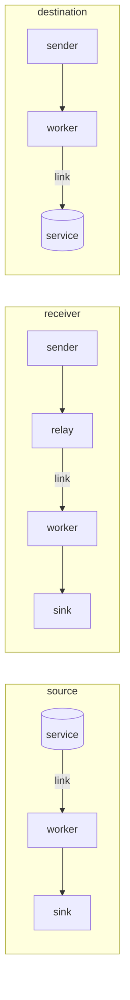

# Connector benchmarks

`just connector-speed` times each source and each destination alone, through the shipped worker on one transform
thread, over a network link with the latency and loss of a path between cloud regions, and again over no link at all.
A row is one connector, and every other part of its path is a harness end that takes whatever the worker gives it, so
the row says what that connector sustains, and what held it there.

## What a row runs

- **The worker** is the `smeltr` binary built with the `dist` profile, a leader with its worker inside, deployed
  through its repository as an administrator deploys. Its one pipeline passes rows through unchanged.
- **Cores.** The transform thread runs alone on the first core, with that core's hyperthread sibling left idle.
  Everything else, the worker's other threads, the harness and every container, shares the remaining cores. The
  transform pool is one thread (`SMELTR_WORKER_THREAD_LIMIT=1`).
- **A source row** seeds its service before the worker starts, then reads it into a sink on this host. Object
  sources read files of 5,000 lines.
- **A receiver row** sends from this host through a relay container. The relay's link is shaped, so the traffic
  crosses the link once each way, and the worker delivers to a sink on this host.
- **A destination row** sends to an HTTP receiver on this host, which answers each request once the destination has
  its rows, and writes to the destination's service. Destinations that write files close one every 5 seconds, the
  least they allow.
- **The corpus** is the `json_app` reference pipeline's lines, about 330 bytes each.
- **The clock.** The first tenth of a row's records is the warm-up and is not timed. A row moves 1,000,000 records
  unless `CONNECTOR_ROWS` says otherwise.
- **Order.** Each row runs on the shaped link and on the bare one, then again in the opposite order. A host that
  slows as it warms costs both links alike.

## The link

`bench/network/network.env` is the link, and it is the one every live benchmark uses:

- 20 ms each way, so a 40 ms round trip;
- 2 ms of jitter;
- 0.05% loss each way;
- 1 Gbit/s.

`bench/bench-network.sh` puts it on both ends of each container's veth with `tc netem`. Segmentation offload is
off on both ends, so a loss drops one packet and not a 64 KiB segment. A kernel without `sch_netem` refuses the run
rather than measuring a perfect network.

## Reading a row

- **rows/s and MB/s** are what the row moved between the end of its warm-up and its last record. MB counts the
  records' bytes as the harness sent or received them.
- **Transform** is the share of a core the transform thread used. **Busiest other thread** is the worker's busiest
  thread besides it, by name. **Peer** is the share of a core the service's containers used, as their cgroups count it.
  That includes the service's own health checks.
- **Bound by** names whichever of those reached nine tenths of a core. `waits` means none did: the row waited on
  round trips, polls or acknowledgements, which is the link's share of the cost.
- **A file destination** answers a file's rows when it closes the file, so the end of a row waits up to 5 seconds
  after the last record. That makes its rate a floor, closer to the truth the more records the row moves.
- **A peer that saturates** measures the emulator, not the connector. The services are single-node test fixtures,
  so a `peer` row says how fast the fixture goes, not how fast the connector can.

## Not covered

- **The S2S receiver.** Only a universal forwarder speaks S2S, and the one in `tests/live/compose.live.yaml` clones to three test
  receivers.
- **The HTTP GET and Okta sources.** They read one page per poll, so a rate measures the poll interval.
- **The Prometheus remote write destination.** It takes metric rows, not log lines.
- **The metrics and logs sources.** They cross no network.

## Results

Run on an Intel Core i7-8650U, 4 cores and 8 threads, Linux Mint 22.3.

| Connector | Link | rows/s | MB/s | Transform | Busiest other thread | Peer | Bound by |
|---|---|---:|---:|---:|---|---:|---|
