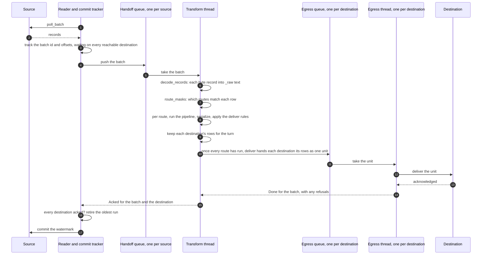
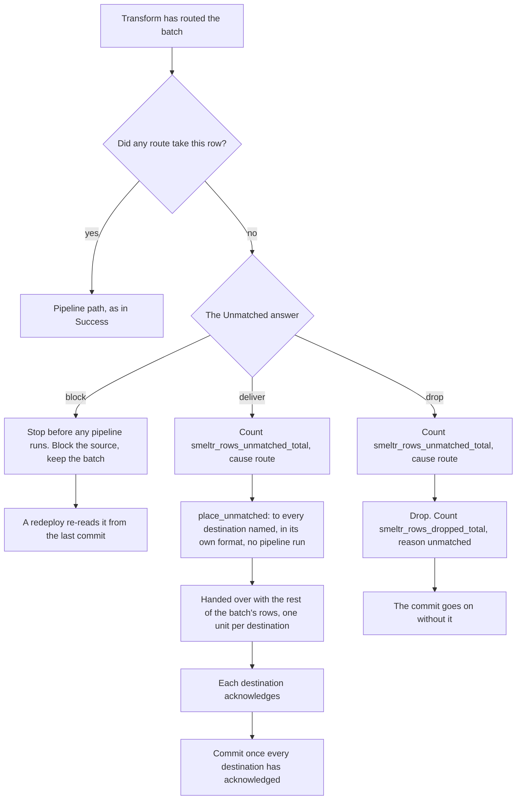
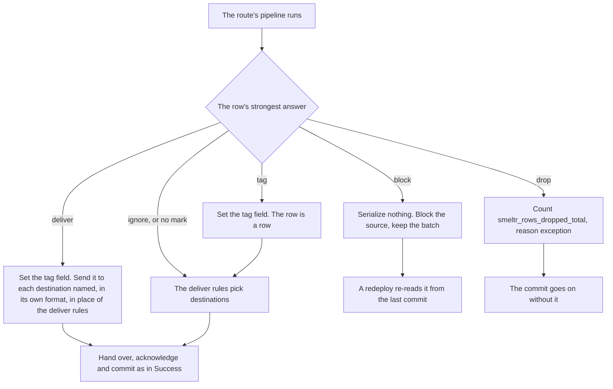
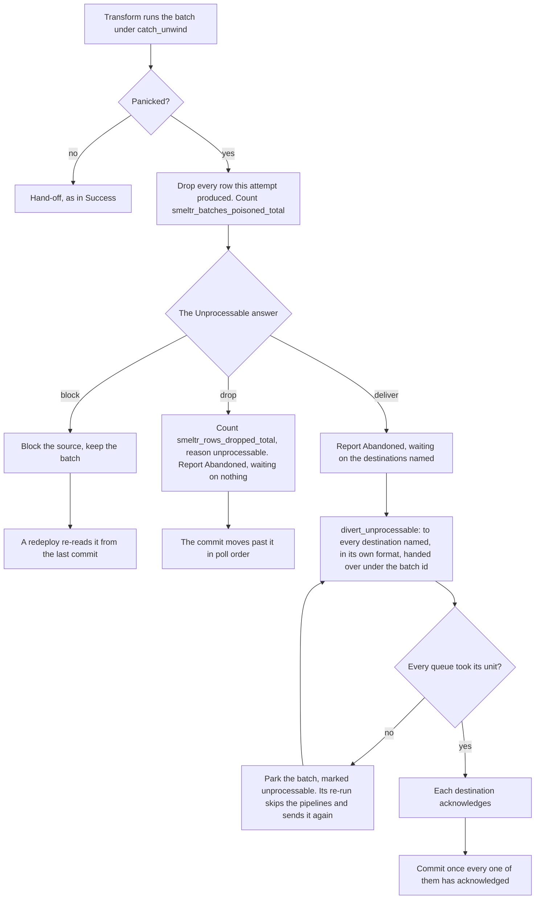
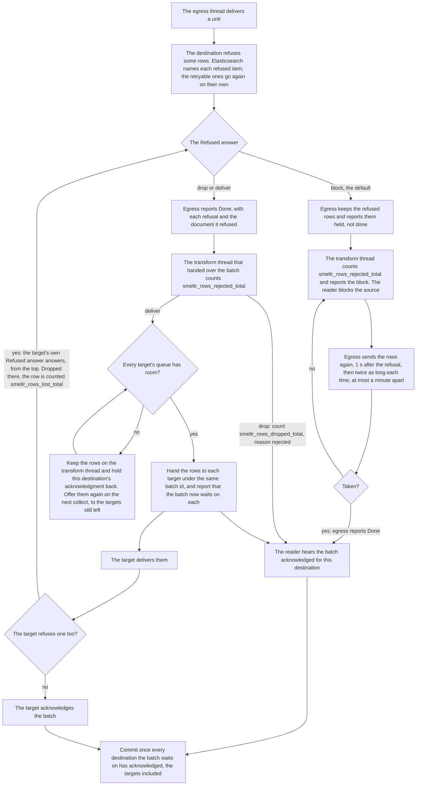
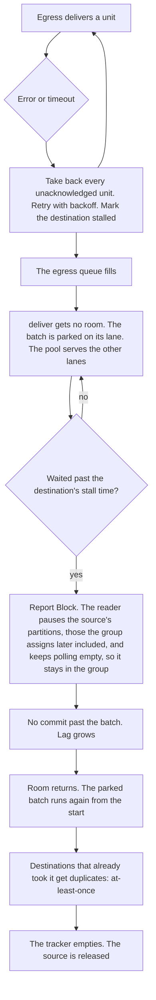

# Data paths

Every path a record takes through a worker, from the poll to the commit. Four stages carry it: the reader, one per source, which polls and tracks; the transform pool, which routes, runs pipelines and serializes; egress, one thread per destination behind a bounded queue; and the commit tracker, on the reader, which commits the oldest run of batches every destination has acknowledged. Eight things can happen to a record on the way, and each one commits differently.

| path | where the rows go | what they carry | the commit waits for |
|---|---|---|---|
| success | the destinations the route's deliver rules pick | the pipeline's row, in the format each destination writes | every destination's acknowledgment |
| unmatched | by the `Unmatched` answer, the group's for a row no route took and the route's over it for one no rule took: blocked by default, dropped, or delivered to every destination named | in each destination's format, the record object as it arrived, or the pipeline's row for one no rule took | under block, a new config; otherwise every destination's acknowledgment, the ones named included |
| pipeline exception | by the answer to each kind, the route's over the group's: tagged and placed by the deliver rules, delivered, blocked, or dropped | the pipeline's row, with its tag field, in each destination's format | under block, a new config; otherwise every destination's acknowledgment |
| unprocessable | by the `Unprocessable` answer, once a pipeline panics on the batch: blocked by default, dropped, or delivered to every destination named | in each destination's format, the record object as it arrived | under block, a new config; under deliver, the acknowledgment of every destination named, and of every target a refusal reaches |
| over budget | one record that will not fit alone meets the `Unprocessable` answer; under block the whole batch is held, otherwise the rest of the batch goes on | in each destination's format, the record object as it arrived | under block, a new config; otherwise every destination's acknowledgment |
| dropped | nowhere: a `Drop` step took the row | | every destination's acknowledgment, for the rest of the batch |
| refused | by the `Refused` answer, the destination's over the group's: kept and sent again, delivered to its targets, or dropped | the row, in the format each target writes | under block, the destination taking the refused rows; under deliver, every target's acknowledgment; under drop, the acknowledgment that carries the refusal |
| unreachable | retried by egress until it lands | the same unit again | holds until it lands |

Function names below are the code's own (`runtime.rs`, `egress.rs`, `commit.rs`).

## Success

The tracker records a batch when it is polled, waiting on every destination the source can reach. It commits the oldest run of batches every one of them has acknowledged, so a batch that finishes early waits for its elders.

- A destination the batch has nothing for answers at once from `deliver` and is acknowledged in the same turn.
- Nothing leaves before the turn ends clean. A block, a memory refusal or a panic drops the turn's rows with the turn, and the batch is held or run again whole.
- The handoff queue is bounded in bytes, and one batch larger than the bound goes in alone; each egress queue is bounded in bytes too. An Elasticsearch destination's queue holds up to its whole `bufferBytes`, as much as its pacing asks; a Kafka destination's up to half, and the producer's own queue the other half. A full egress queue refuses the unit at once, and the batch waits on its lane (Unreachable, below).
- Egress keeps each unit until it is acknowledged. The reader holds offsets, and at most one polled batch the handoff queue had no room for.
- A partition the group moves to another member commits nothing from the batches read before the move, however they finish: the source reports it revoked and the tracker forgets it. The new owner reads from the last committed offset and may already be past them, so a late commit would move it back. A record the source held from that partition is dropped.
- A commit the source refuses is counted as `smeltr_commits_dropped_total` and reading goes on: the batches are already retired, the next watermark for the same partition covers their offsets, and if none lands before the worker stops they replay from the last commit that did.

## Unmatched

No route took the row. Under block, the batch stops before any pipeline runs and is kept until a new config is deployed. Under deliver, each unmatched destination is one of the batch's destinations, so the commit waits for its acknowledgment like any other.

A row its route took and no delivery rule did meets the same answer after its pipeline, the route's over the group's, and counts in `smeltr_rows_unmatched_total` under cause `rule`, as a row no route took counts under cause `route`. Under block, the batch is held as for a marked row (Pipeline exception). Under deliver, it goes as the pipeline left it, placed like any delivered row. Under drop, it is counted under reason `unmatched`.

- A block here, or one on a marked row (Pipeline exception), holds the batch: the pool passes the source over and never re-runs it, since the same rows meet the same routes and fail the same way. A destination's own block is re-run instead, because the destination can recover by itself.
- A destination that writes the record gets the record object, the document a pipeline with no steps would write: `{"_raw": ...}` for a byte record, `{}` for one whose source's `encoding` is `none`, a typed record's fields otherwise. One that writes a field as text gets that field's text, the decoded text for `_raw` and base64 for a `bytes` field. One that writes bytes (`format: "bytes"`) gets one `bytes` field of each source record, `__source.bytes` unless it names another: the payload as the source read it, before decoding. A text destination naming a field the record lacks refuses the row.
- No pipeline ran, so there is no `__destination.id`: a destination keying on an identity gets none, counted as `smeltr_rows_without_doc_id_total`.

## Pipeline exception

A row's exceptions are its exceptions, each of a kind in one category. The `exceptions` setting, the route's over the group's, gives each kind an answer, and the row takes the strongest of its exceptions' answers, after the pipeline's last step and before any deliver rule runs.

- The tag field is one column past the plan's own (`Plan::tag_slot`), a variant holding the route, the pipeline and each exception's step, kind and message (`output::tag_type`), set on every row with an exception not ignored and null on every other. A deliver rule reads it by name, and on an untagged row reads what the row holds there, so `smeltr.exception == null` takes a healthy row whose record has no such field, and the serializer writes it beside the pipeline's fields, so a dotted name nests with them. Where a dynamic field claims the same name, or a parent of it, the tag wins on every row it is set on.
- A pipeline run through `call` is inlined; it has no answer of its own, so the route's holds.

## Unprocessable

A pipeline panicked on the batch. The same records would meet the same pipelines again, so there is no second attempt: the `Unprocessable` answer takes it. Under deliver, `Abandoned` narrows the batch's waiting list to the destinations named, so it commits once they acknowledge it. A target one of them refuses a row into is added back as it is handed the row (Refused, below).

- A batch parked as unprocessable is not run again: `step` sends it straight on.
- A destination named here answers for what it refuses with its own `Refused` answer, so its targets take the rows and the commit waits for them too.
- Over budget is the neighboring path. A range the memory budget refuses is halved and run again. A single record that still will not fit meets the `Unprocessable` answer by `divert_over_budget`: under block, the whole batch is held; under deliver, the record is handed over with this batch's rows, so that commit waits for it.

## Refused

The destination looked and said no. Its `Refused` answer, the destination's over the group's, answers: block, the default, keeps the refused rows in egress and sends them again until the destination takes them; deliver sends them on to every destination it names, its targets; drop lets them go. Every refusal is counted whatever the answer.

- Block is kept in egress because the fix for a refusal is usually the destination's own -- a mapping, a limit -- and nothing tells the worker it is done. Waiting for a redeploy would wait for a config change nobody needs to make. The kept rows count against the destination's queue until they land.
- Targets are the transform thread's to fill: it holds a handle on every destination its source reaches, targets included, and the report that the batch waits on a target goes out before this destination's acknowledgment, on the same channel, so the reader never sees the batch done while a target still has its rows.
- A target is sent the row in the format it writes, kept beside the row from when it was sent, keyed on the target's own identity, which is worked out when the row is sent, while its fields are still there. A target a delivery rule already sent the row to is not sent it again. Chains that meet -- two destinations that refuse into the same target -- deliver the row there once from each: at least once, as everywhere. The row's placement -- the `__destination.topic`, `.index` or `.prefix` its destination reads -- stays behind: it routes within the destination it was computed for.
- A target can owe one batch more than one unit -- its own rows, and rows each destination that refuses into it salvaged. The reader hears it done with the batch only once every one has come back.
- A destination can refuse a row as it is handed the batch, before any acknowledgment. `deliver` answers with the refusal and its row, and the destination's `Refused` answer answers exactly as above. An `EgressHandle` refuses nothing itself, so in a deployment every refusal comes with the acknowledgment.

## Unreachable

The destination did not answer. Nothing commits past the batch until it lands.

- A stalled destination stops only the sources that feed it.
- A reader whose batches stop coming back reaches its in-flight limit, or its lane's handoff queue fills, and it takes no more work. Past `MEMBERSHIP_AFTER` of that it keeps its source's membership in place of polling: `keep_membership` polls with every partition paused, so the group's rebalances do not wait on it and it is not evicted.
- A failed credential and throttling count as unreachable: they get fixed, then retried.
