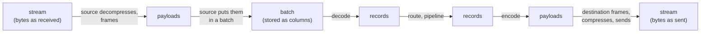

# Definitions

One name for each thing in the data path, for every page, comment and message to use. Where the website's documentation already has a name, that name is the one.

## Data

| name | what it is |
|---|---|
| value | One datum of one type: a number, text, a time, bytes. |
| field | A named, typed place for a value. `status: i64` is a field. |
| record | One value for each field. A record is what a pipeline works on and what a destination is sent. Its fields whose names begin `__` are smeltr's own and are never sent. |
| batch | Many records that travel together, stored as columns: one column for each field, and never record by record. A batch is what a source hands over, and it is committed or held whole, never in part. |
| column | Every value of one field in a batch, stored together. |
| row | One position across every column of a batch: the counterpart of a column. Each row of a batch holds one record. Say row when the subject is how a batch is stored or worked over, record when it is what is processed or sent. A database table's row is the same idea in the database, and a source reads each as one record. |
| stream | The bytes a source receives over one connection or from one object, before they are framed into payloads, and the bytes a destination sends, once its payloads are framed. |
| payload | The bytes of one thing outside smeltr: a Kafka message's value, or one line of an object in storage. A source hands over the payloads it received, and transform decodes them into records. Transform encodes records into the payloads a destination sends. A source and a destination change nothing within a payload. A received payload is a value in the batch's payload column, the field `__source.bytes`. |
| source fields | The `__source` fields of a record: where it came from. Such as its topic, partition, offset and headers, and the payload column, `__source.bytes`. |

## What is done to data

| name | what it is |
|---|---|
| decompress | Undo the compression of a stream a source receives, such as a gzip object or request. A source decompresses, before it frames. |
| frame | Mark where one payload ends and the next begins in a stream of bytes: at each line, by a length prefix, or by another rule. A source frames to divide the stream it receives into payloads, by its `framing` setting. A destination frames to join payloads into the stream it sends. |
| decode | Read bytes as typed values. Transform decodes a batch's payload column into its records' fields, once for the batch, before routing: text payloads become one field, `_raw`, read in the source's text encoding, and payloads in a format with its own fields, such as Avro or OTLP, become those fields. One payload may become several records. An author can also decode in a pipeline, with `decode(bytes, encoding)`. |
| parse | A pipeline step that reads fields out of a text field, such as `json(_raw)`. |
| route | Choose which pipelines run on which records of a batch. |
| encode | Write typed values as bytes: the reverse of decode. Transform encodes a batch's records into payloads, in the format each destination sends. The one exception is a file destination writing Parquet: a Parquet file is built from the columns of many batches, so that destination encodes it on its own threads. An author can also encode in a pipeline, with `encode(text, encoding)`. |
| compress | The reverse of decompress: shrink the bytes a destination sends, such as a gzip object or request body. A destination compresses, after transform has encoded. |
| send | A destination writes the payloads of a delivery unit to its outside system. A send can fail, and is then retried. |
| deliver | A record is delivered once it is in the destination's system: a send that succeeded. |
| acknowledge | A destination says that records it sent were delivered. |
| commit | Tell a source that a batch is finished, so the source never hands it over again. A batch commits once every destination it reached has acknowledged it. |
| hold | Keep a batch, commit nothing past it, and stop its source, until a new configuration arrives or, for refused records, the destination takes them. It is what the `block` answer to an exception does ([exception taxonomy](architecture/exception-taxonomy.md)). |
| retry | Send a delivery unit again, or the records of it a destination says were not delivered. |

## Stages

The five stages a batch passes through, as [runtime stages](architecture/runtime-stages.md) describes them.

| name | what it is |
|---|---|
| source | Receives bytes from an outside system, decompresses and frames them into payloads, and hands the payloads over as batches. Its own threads. Its work is per stream, so it scales by connections. |
| receiver | A source that senders connect to and send to, such as an HTTP endpoint. |
| reader | One per source. Tracks each batch until it commits, queues it for transform, and stops the source while the queue is full. Never touches a record. |
| transform | A pool of threads that decodes, routes, runs pipelines and encodes. The only stage that reads what is inside a payload, and the only one that touches a record. |
| egress | One per destination. Queues each delivery unit, paces it, hands it to the destination whole, retries it, and reports what was acknowledged. Never touches a record. |
| destination | Takes a delivery unit, frames its payloads into what its outside system takes, compresses where its setting asks, and sends. A file destination also encodes Parquet itself. Its own threads. Its work is per connection, so it scales by connections. |

## Parts of a batch

| name | what it is |
|---|---|
| slice | A run of a batch's records that transform works on at one time, sized to fit a thread's cache. Only transform knows of slices. |
| delivery unit | The payloads one batch makes for one destination. What egress queues and retries. |

## Formats

| name | what it is |
|---|---|
| format | How bytes outside smeltr are laid out: lines of JSON, Avro, OTLP, Parquet. A source's format says how its payloads are decoded; a destination's says how its records are encoded. |
| text encoding | Which characters the bytes of text spell: UTF-8, Latin-1, or detected. Always the two words. "Encoding" alone is the work of encode. The setting and the function argument are spelled `encoding`. |

## Words these replace

Each of these has been used for something above. The name on the right is the one to use.

| word | use |
|---|---|
| document, for what a destination is sent | record. The website says document for what Elasticsearch stores. |
| ingest | decode, for bytes becoming records. Otherwise name the stage that does the work. |
| chunk | batch. The code's `RecordChunk` is a batch as a source hands it over. |
| event, message, log line | payload before decode, record after |
| byte record, row record, typed row, source record | a record, or a payload if it is not yet decoded |
| reader, for what decodes a format | decode. A reader is the stage. |
| cut, split, break, for dividing a stream | frame |
| land | deliver |
| deliver, for handing a destination what it is to send | send. The code's `Destination::deliver` hands records over and starts sending them. |
| serialize | encode |
| encoding, for UTF-8 and the like | text encoding |
| unit | delivery unit |

## The processing model in these terms

1. A source decompresses and frames what it receives into payloads and hands them over in batches. A batch arrives with only its source fields, the payload column among them. A source whose system already gives typed values, as a database query does, hands over a batch that has its records' columns instead.
2. A reader queues each batch for transform and tracks it until it commits.
3. Transform decodes the batch, routes its records, runs their pipelines and encodes the result into payloads, one delivery unit for each destination.
4. Egress queues each delivery unit and hands it whole to its destination, whose own threads frame, compress and send its payloads. Egress retries until the destination acknowledges it.
5. When every destination a batch reached has acknowledged, the reader commits the batch to its source.

Commit and hold act on a whole batch, and retry on a delivery unit. Nothing outside transform touches a record.

These say what must hold. What is built is in [status](status.md), whose row "Only transform touches a record" reads "not built": today some sources decode before transform, and a reader and an egress each touch records.
