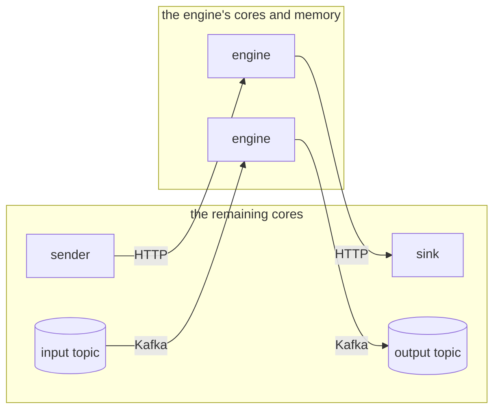

# Engine benchmarks

`just engine-speed` times smeltr beside Logstash, Vector and Apache NiFi doing the same work on the same machine.
Each engine runs in a container with the same CPUs and the same memory. It takes the same records either pushed over
HTTP, as a receiver, or pulled from a Kafka topic, and delivers what its pipeline makes the same way. Before any
engine is timed, its output is checked against what the pipeline must make, so every row is the same work done by a
different engine.

## Engines

| Engine | Image | License |
|---|---|---|
| smeltr | the `dist` binary on Ubuntu 24.04 | |
| Logstash | `docker.elastic.co/logstash/logstash-oss:9.5.6` | Apache-2.0 |
| Vector | `timberio/vector:0.62.0-debian` | MPL-2.0 |
| Apache NiFi | `apache/nifi:2.12.0` | Apache-2.0 |

Each engine's pipelines are in `tests/engines/`, under the engine's name, and its transports and settings in
`tests/engines/mod.rs`. Each is tuned as the engine's own documentation tunes it for throughput:

- **smeltr** runs its defaults, with a transform thread for each core.
- **Logstash** runs a worker for each core, batches of 1,000 and no ordering. Its heap is half the container's
  memory.
- **Vector** runs a worker thread for each core, with end-to-end acknowledgements on.
- **NiFi** runs a flow the harness builds through its REST API: the transport's consumer, a ScriptedTransformRecord
  in Groovy for the mapping, and the transport's producer. The transform runs a task for each core, the producer two,
  and the thread pool has four threads a core. Its reader is given the record schema rather than inferring one.
  Content archiving is off: NiFi stops taking records while the disk is more than half full and the archive holds
  content, which would measure the disk. Its heap is half the container's memory.

## Transports

- **HTTP** is the receiver case. The harness's sender posts 2,000 records a request, 256 requests at once, and each
  engine's HTTP listener takes them. A busy answer is retried after the time it names, or after a wait that doubles
  to a second. Each engine posts what it makes to the harness's sink.
- **Kafka** is the pull case. One Apache Kafka 4.4.0 broker serves every row, on the harness's cores, with its log on
  tmpfs so the disk sets no limit. Before the first row the harness writes three rows' worth of records to an input
  topic of 16 partitions. Each row consumes it from the start under a group of its own and produces to a topic of its
  own, which the harness counts by its offsets. Each engine uses its own Kafka client: consumer threads for each core
  where it has them, the producer batching as the clients' defaults do, and no transactions.

## Pipelines

- **passthrough** forwards each record unchanged. Each engine sends its own event shape: the line, or an event with
  the line in one field beside the engine's metadata.
- **json_app** is the `json_app` reference pipeline (`tests/reference/json_app.rs`): parse the JSON, drop debug
  lines, compute `event.duration`, and move the application's fields to their ECS names.

The check sends the first 20,000 records to each engine and compares the documents that arrive with what the
pipeline must make, as a multiset: no document missing, none extra. An engine that fails the check is not timed.

## What a row runs

- **Cores.** The engine's container gets the first `n` CPUs, a core's hyperthreads together, set by `ENGINE_CORES`.
  The harness runs on the rest.
- **Memory.** Every container gets the same limit, 4 GB unless `ENGINE_MEMORY_GB` says otherwise.
- **When an HTTP request is answered.** Smeltr and Vector answer once the records are delivered. Logstash answers once the
  records are in its in-memory queue, and NiFi once they are in its content repository. Both hold at most what their
  queues hold, so the timed rate is the rate of delivery for all four.
- **The clock** starts once the engine has delivered a tenth of the row's records and run for 20 seconds, so the JVM
  engines have compiled their hot paths. Under Kafka, an engine fast enough to reach the end of the input topic's
  warm-up share starts its clock sooner. A row then times 2,000,000 records unless `ENGINE_ROWS` says otherwise.
- **Order.** Each of `ENGINE_ROUNDS` rounds, three by default, runs every row. Each round starts with a different
  engine and runs the core counts the other way, so a host that slows as it warms costs every engine alike.

## Reading a row

- **rows/s** is input records a second, the median of the rounds. **Spread** is the fastest round less the slowest,
  over the median.
- **rows/s per core used** divides by the cores the container used, as its cgroup counts them.
- **Peak memory** is the most the container held, page cache included, as its cgroup counts it.
- **Broker cores** is what the Kafka broker used. Near the harness's cores, the broker set the row's speed.
- **Harness busy** is how busy the harness's cores were, the broker included. Near 100%, the harness, not the engine, set the row's
  speed.

## Results

RESULTS
