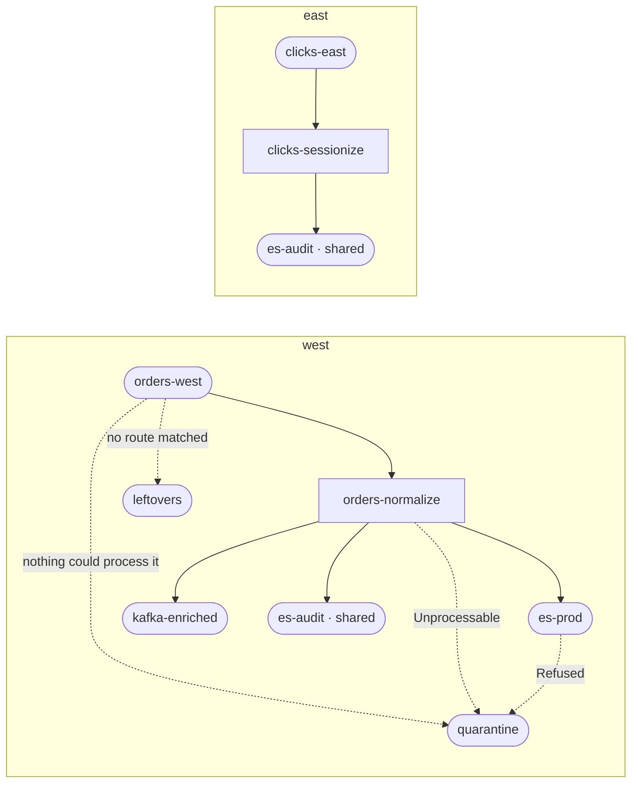
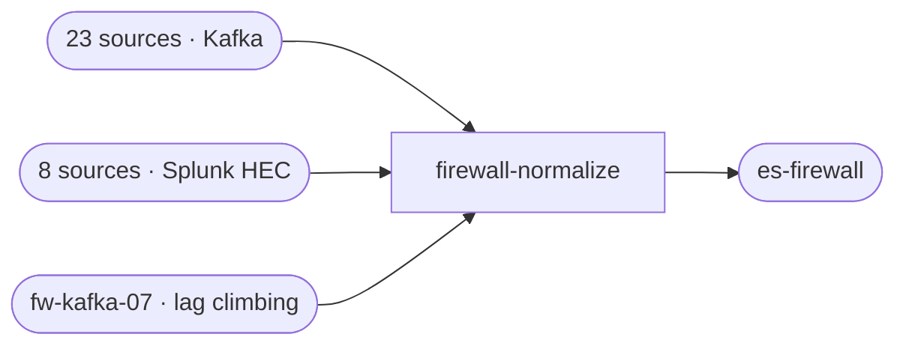
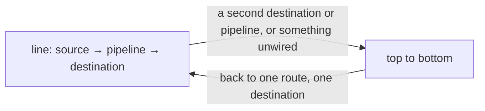
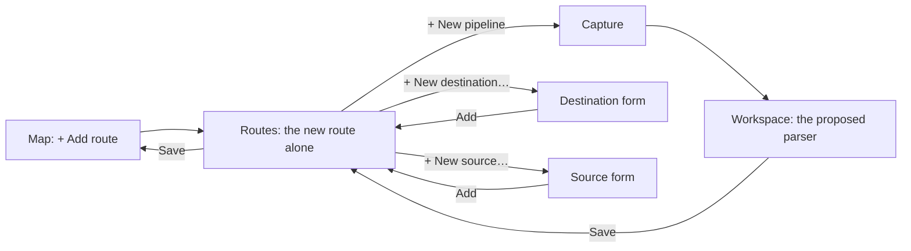
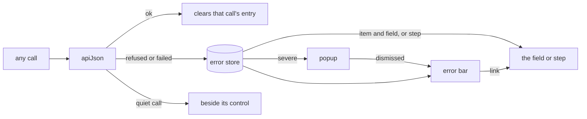
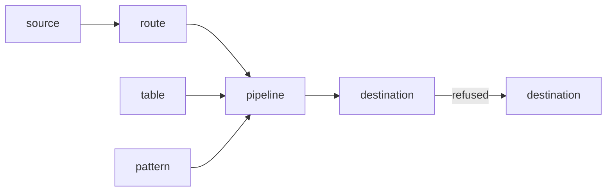

# Smeltr — GUI design

The GUI is the authoring surface; the JSON bundle is its output. The leader
links the same compiler and executor a worker does and runs a pipeline in
process against pasted or captured rows, the same path a live record takes
as a batch of length one. No worker is involved in editing or previewing.
The visual language is `gui-frontend/STYLE_GUIDE.md`.

## Five areas

Areas are named for what someone came to do. **Status** is the operator's:
what is wrong now, then flow over a chosen window, then a group, a source
or a destination in detail. **Map** is the topology. **Build** is the
authoring surface: a pipeline workspace, the objects it reads and writes,
and the sample and test library. **Changes** holds branches, review,
deploy, rollback and the history. **Admin** holds workers, groups, people
and roles, credentials and the service itself.

Areas are not named for files, because a page per bundle file is the
storage layout used as a screen layout: it puts declaring a parser's fields
on a different page from the sample that would fill them in, and asks an
operator watching a stall to know which file a source lives in.

## Status

Status leads with the current conditions, then the fleet's own totals in
and out over a chosen window, then a table ranked by distance from normal
rather than by size: with a hundred sources a chart of totals hides one
dying while another spikes, and a chart of a hundred lines shows nothing.
A group is a screen of its own: its workers, and its sources and
destinations with their own rates and conditions, each leading onward. A
worker that enrolled and never started, or was revoked before its next
heartbeat, appears as "Never heartbeated" or "Revoked" rather than not at
all. The registry is ephemeral, so "never started" and "was heartbeating
before the leader restarted" are indistinguishable, and nothing claims an
online or offline state beyond that. A worker's detail names where each receiver it
runs listens, under the host's name when it listens on every address, since
that is where a sender sends. It folds out its memory
part by part, each part's max beside what it holds now, against the total the
fit allotted it and its limit. The ribbon at the top names only the
worst of it; **Issues** holds all of it, grouped by condition rather than
by subject, since a bad rollout that silences six workers is one thing
wrong, not six.

**Logs** is what the fleet's workers have said, beside what is wrong now. A warning is a condition and clears when its fact
stops; a log is something that happened and stays. Every filter is in the
address, so a view worth showing someone is a link. Filtering happens at the
leader -- the table holds far more than a screen, and far too much to narrow
in the browser -- and a message cut on delivery is marked as cut, since a
search cannot reach past the cut.

## The map

The map is the running topology, one band per group, laid out left to right
as rows travel: sources, then pipelines, then destinations. Lines show what
connects to what and nothing else. Every reading -- rate, buffer fill, lag
-- is on a node's card and in the panel docked beside the map, which holds
the selected object's details. Selecting an object draws its directed path
in front of everything else and dims the rest.

### Lines

A source→pipeline line is a route; a pipeline→destination line is a
delivery rule on that route. Route and delivery lines always draw.

A fallback line carries a row its path could not finish. Fallback lines
draw only on a selected path that can take them, and they are dashed:
a dash means fallback. There are three.

- **Unmatched**, in the warning color: a source→destination line for a row
  no route claimed, taking the deployment's unmatched destination with no
  pipeline in between.
- **Poison**, in the error color: a source→destination line for a batch
  nothing could process, taking the poison DLQ.
- **Exception answer**, in the error color: a pipeline delivering an
  exception kind to a destination, or a destination's refusals going to
  another destination.

An unmatched line is drawn from the configuration, since the path exists
whether or not anything is on it right now. A poison line is drawn from
traffic: every source can panic on a batch, so configuration says "all of
them", and a line from each of them converging on one node says nothing.
Where unmatched rows block or drop there is no destination, so there is no
line to draw. A blocked source carries its warning badge; a source dropping
them shows the count in its panel.

Width carries no throughput. A line says a path exists; how much moves on
it is read on the cards at either end.

A called pipeline is not a node. A callee's steps are spliced into its
caller before anything compiles, so a called pipeline does not exist in the
running topology, and a pipeline→pipeline line would break the
left-to-right reading the map rests on. A call is a badge on the calling
node and a step in the workspace.

### Cards

Each worker group is a card, its name and summary in a strip across the
top, and the map takes the page's full width. A source or destination is a
rounded card, a pipeline a square one. A band names its three columns once
at their heads, with how many each holds, so a card carries only what is its
own: its name beside the glyph of the system behind it; a second line naming
that system, or how many routes run through a pipeline, with a `shared` tag
when it comes from `shared/`; and one reading line, its rate beside a
source's unmatched rows or lag, or a destination's busiest buffer. A source
whose rows no route claims says how many a second, whatever the deployment
does with them. A destination's card has a
buffer bar along its foot. What a reading means is in `?` help, not on the
card.

Color is the warning catalog: a node the catalog names takes the error
color, or the warning color for a warning. Distance from normal is in the
catalog too: a source reading outside its expected throughput, learned from
the same time of day over its last week, warns, and its panel draws that
range behind its chart, bucket by bucket (`leader::throughput`). The catalog's held-source and
refusing-destination conditions name what a snapshot most needs spotted: a
source that should be busy and is not.

### Selection

Selecting an object shows its directed path, drawn in front of everything
else, with the rest dimmed. The path is the routes that run through the
selection: a source's routes and a pipeline's end to end, and a
destination's routes up to it. A pipeline two routes share joins a source only
to its own route's destinations. A fallback line joins a path only on its
downstream side, from what the selection can send there, and follows a
chain of refusals to its end, so a destination's path does not gather every
source's poison line. A fallback destination's
path is whatever falls into it, back to the routes it falls from.

Clicking empty canvas clears the selection. The selection lives in the
address, so it is a link and Back undoes it.

One map, not one per persona. The topology an engineer reads and the one
an author edits are the same topology, so there is no overlay switch: a
line is painted once, and every node carries its own way in for that
source, pipeline or destination.

### Shared objects

An object declared in `shared/` is a running thing in each group that
merges it, so it is drawn in each group that uses it: where a line in that
group touches it or a warning names it there, and nowhere else. Each copy
carries the `shared` tag, and selecting one lights up every copy across
the groups. Its panel says where else it runs, and its pencil opens it in
`shared/`'s editor.

### Stacks

A fleet of hundreds draws a card per kind of thing rather than per thing.
Sources or destinations of one system that connect to exactly the same
pipelines are one card, a stack, once there are three of them; two cards read
fine side by side. Their lines become the stack's, so a stack's path is
drawn like any other card's. A stack reads its members' rates summed, their
most lag and their fullest buffer. A column's head still counts objects, not
cards.

A member stands outside its stack whenever the reader needs it on its own:
when it is selected, when it is a copy of a selected shared object, when a
search matches it, and when Needs attention lists it. Problems are never
inside a stack. A problem that comes or goes moves its object with the next
**Update layout**, so no card moves under a pointer. A shared object and an object on no route are never
stacked.

Selecting a stack opens its panel, which lists its members with each one's
reading. A member is a link that selects it; it steps out of the stack with
its own path and its own panel, and Back returns to the stack. The rest of
the map holds still, so a stack of hundreds stays one card.

### The panel

The selected object's details sit in a panel docked beside the map, so
the map stays in view. A window too narrow for both moves the panel out of
the map's way, which keeps the width its three columns need: what needs
attention goes above the map, a selection's details below it. The panel opens on an overview: the object's
throughput and a line chart of it over the window. A clock beside the
chart picks the window, from ten minutes to thirty days; the link carries
it, and the next panel opened keeps it. The pointer reads the chart at the
moment under it: the value, the expected range, and any warning that held
then, whose span the chart marks. A destination's
overview adds a buffer summary by its busiest current worker; a source's
adds its backlog. Tabs hold the rest: **Buffers**, per worker and paged;
**Backlog**, the Kafka lag and whether intake is held; **Steps**, a
pipeline's steps in the order they run; and **Routes**. A
pencil leads into the object's editor, and × closes the panel. **Only
this path** hides everything off the selection's path, keeping the other
copies of a shared selection.

Counts are one object at a time, over a recent window, and each kind
answers in the shape its own content has. A source's rows split across
its routes, so each route carries its share, beside the share that
matched no route. A pipeline's rows do not split, they narrow: its steps are a
list in the order they run, each with what it dropped and what it cost. A
destination's rows only arrive, so it is a tally, and refusals broken out
by the source that sent them -- the only part of its traffic that can be
traced back, since what arrived is counted against the destination alone.

Of those, only what matched no route is exact. A route's share is what
its condition matched, which is the most it can have delivered; a
pipeline can drop a row afterward and a delivery rule can decline it.
Every route sees every row, so the shares can sum past everything the
source read. The view says so rather than normalizing them into a total
that adds up.

### Live readings

The page polls the current measurements -- rate, last seen, lag, queue
summary, warning conditions -- apart from the layout, once a bucket, and says
how long ago the readings on screen arrived, and they come from
the heartbeat-fed metrics, which makes this a leader-tier view. A
measurement nobody reported is shown as absent, never as zero. A worker
past the stale window is shown as stale, never as current pressure.

A changed topology, or a warning that adds or drops a shared object, is
applied only when the reader asks for it, with **Update layout**, so the
selection and the scroll survive every poll.

### Search

Search is one box. A bare word matches a name. A term filters on a field:
`kind:`, `system:`, `shared`, `calls:` and `id:`, the whole id, on what an object is;
`warning:` with the start of a catalog condition, `pressure:`,
`pressure:near` and `pressure:held`, `unmatched:`, `stale:`
and `nodata:` on what it reads now. Terms AND together. A field nothing on
the map can answer says so, rather than matching nothing in silence.

The box folds open to suggested searches built from the live topology and
readings, each with how many objects it matches.

What survives a search is the matches and their direct neighbors, a
neighbor dimmed since hiding it would leave a pipeline with an input or
output from nowhere; everything connected to no match is gone. A filtered
map is a smaller graph, not the same graph with holes.

### Needs attention

With nothing selected, the panel's place holds a **Needs attention** list:
every warning the control plane's catalog names on an object the map draws
or on its group, under the catalog's own name for it, and each object's own
worst reading -- backpressure, a buffer near capacity, rows no route takes,
stale readings. Failures come first, then warnings, then stale readings. A
condition added to the catalog appears here with nothing on the map to
change. A full buffer behind a failure on the same object is that failure's
effect and is not listed twice. Each row opens where its problem is shown: a
warning on its object's overview, which carries the catalog's sentence, or on
Issues when no drawn object is its subject.

Each group's header carries a one-line summary of its worst problem, which
leads to the row that has it. On a large fleet, a group with
nothing wrong starts folded; any group folds.

## Routes

The Routes page is a card per source, holding every route that reads it.
Routes have no order, so the list has none to change. A route is a branch of
its source's card: its condition, its pipeline, then its delivery rules out to
destinations. Splitting a source's rows between pipelines is two routes, each
with its condition. The source is read once, and each pipeline runs over the
rows its condition takes.

A card of one route to one destination is a line, left to right the way rows
travel, since that is the common route. A second destination or a second
pipeline turns it top to bottom, and so does anything one line cannot show: a
destination brought on and not yet wired, or a condition that sends nowhere.
The turn keeps a card that fans out from reading like the map's left-to-right
columns; the boxes glide between the two shapes, and the card turns back once
it is one line again. The shape follows the routes,
so there is no mode to switch.

A condition nobody has written is a [+] on its line. The line from the source
to a pipeline holds the route's condition, which reads the source's record. A
line from a pipeline to a destination holds a delivery rule's: a condition over
the pipeline's output, drawn as a box that feeds the destinations wired from
it. A rule with no condition is plain lines. On a card drawn top to bottom, a
condition's box sits centered over its destinations, and boxes that would
overlap push each other aside. A condition reads whole wherever there is room
for it, as every condition field does (The workspace): its box takes the room it
has, out to halfway to the boxes beside it, or its column's share of a line,
and shrinks to the text laid out in it. Lines turn in elbows, as the map's do, and none
runs through a box. The + beside "pipeline" adds a
route from the same source, and the + beside "destination" brings one onto the
card. Wiring is direct. A wire is drawn from a pipeline or a condition to a
destination or back, a socket click offers the same choice as a list, and a
line is cut from the cross hovering it shows. A line card has no sockets: its
+ beside "destination" wires what it brings on, and a pill's ✕ cuts it. The card is the route's
connections, so a route has no Connections line of its own.

A card brings on the destinations already configured, or makes one there and
then in the same dialog the Destinations page adds with; that one is saved
on Add, so the route that names it can be saved after.

Every card ends in its routes' Exceptions, folded: each route's own answers
over the group's, which open with the card when the route changes any. The
group's Exceptions sit at the foot of the page. A card's ✕ removes its routes.
On a card of several routes, a pipeline's ⋯ moves it left or right, removes its
one route, or moves it to another source: the route leaves for that source's
card, so a card a source change merged splits back one route at a time.

A card only fans out. Each pipeline's destinations sit under it, so a
destination two pipelines send to has a pill under each. Their order is the
order of the route's rules, which says nothing about delivery since every rule
is its own test, so it is saved with the route. A box's destinations sit
together. A destination's ⋯ moves it left or right among its pipeline's, or
stops that pipeline sending to it; a pipeline's moves take its destinations
along. Dragging a pill onto another of its pipeline's, or a pipeline onto
another, does the same. A condition put on a line, or taken off, keeps the
line's place.

A route or condition that sends nowhere and a destination nothing sends to
are warned inline, and none blocks a save: each is a real configuration that
is almost never what its author meant. A new route from + Add route is seeded
with a destination for the same reason; a route added from the + beside
"pipeline" waits for its pipeline, and is wired from it.

## Routing what arrives

The map shows what arrives that no route takes, and Build is where it is
routed, with the editors smeltr already has. A source's unrouted-stream
warning (Observability, Streams) draws its card, and its panel lists the
streams the warning names, each with + Add route, and rows filed under no
stream with + Add route for the whole source.

+ Add route opens the Routes page of the scope that declares the source, on a
new route from it and nothing else. A stream's route takes it by the
condition the leader writes for the kind of the source as its group runs
it. The pipeline is chosen by hand, and its picker offers a new one. A new
pipeline opens the workspace on a capture of what the route takes, the
route's condition as the capture's filter, and every capture made there
proposes the steps that parse it. The route waits unsaved while its
pipeline is made, as any edit does, and the pipeline's Save brings it back
with the new pipeline on it. The route's Save returns to the map.

A source saved on a branch has not run, so the map has nothing to show of
it. Routes is first in Build, and its + Add route needs nothing saved
before it: the card's source picker offers a new source, as its
destination picker offers a new destination, and the pipeline picker's new
pipeline captures from it as from any other.

The leader reads the capture's text (`leader::onboard`) and proposes the step that
parses it: a JSON, Key/value or CSV Parser, a Grok Parser on the built-in
whole-line pattern of a syslog or web access log line, written out so each
field it fills shows in the step, or for CEF a Code
step that spreads `cef(_raw)`. A CSV capture that opens with a header row takes its
column names from it, and a Drop step ahead of the Parser takes out that
row, which a source sends once per file. Records that arrive as fields need
none. A Parser's fields are declared from the capture the way the workspace
proposes them, and they are the starting point the author edits, with the
captured rows beside it.

## The workspace

A pipeline is edited with its steps on one side and the selected sample and
the rows it produces on the other, recomputed as the author types, so
previewing is not an action anyone takes. Which side gets the room changes
with the work, so the split is a divider that drags, with snap points,
rather than a mode to choose.

A condition, in a step or wherever else one is written, reads whole when it is
left: laid out to the width it has, broken before its `&&` and `||`, a
bracketed group broken only where it cannot fit on a line of its own, three
lines at most. Written in, it grows with its text. An `if`'s condition takes a
row of its own under the step's head, as another step's fields do.

Every step has an id, an `if` included. A compile error pinned to a step
names it by that id and lands on that step, in the preview as on save. An
error in an `if`'s condition lands on the `if`.
An error inside a callee names a step the caller does not have.
An error pinned to no step names none. Neither lands on a step. Both stay
in the message that reports the failure.

Declaring a parser's fields is authoring's most tedious step, and which
answer the workspace already holds depends on the parser.

A **dynamic** parser -- JSON or key-value -- takes a field's name from the
record, so only what it has read knows what arrives: the sample beside it,
and what the step read in production (Observability, Streams). The
workspace infers each field's shape from both, side by side, and offers it
as the starting point of a field list the author owns from there, adding a
field neither held, retyping one they got wrong, dropping one they do not
want. Production stands in for the sample where none is chosen. Four
rules hold. The inference is a suggestion, never a silent write, since a
declared type pins behavior. It signals the weak spots: a field absent
from some rows, one whose rows disagree about its type. It
reports shapes the builder cannot represent as "declare it in the raw JSON"
rather than dropping them. The inference is not reimplemented in
TypeScript: a second copy of the type table would drift from the one that
runs.

A **static** parser needs no sample at all, so the author never types a
name: Grok's fields are its captures and CSV's are its ordered column
table, and the workspace fills the names in from the configuration and
leaves only the type to choose. Grok's fields follow the pattern as it is
edited, in capture order. A name that survives keeps the type chosen for
it. A new name starts as `str`. A name the pattern lost goes with it. A
column CSV should drop is typed `skip`, which keeps the columns after it
aligned without inventing a field.

## Lists

A page of configured objects is one list of them, built for hundreds: a
search, a chip per type where types mix, and sortable columns. A row folds
open to edit in place. Adding is a dialog that asks for the type first and
then the fields that type needs, because every field after the type
depends on it; a type cannot change once added, so nothing typed into one
type's fields is carried into another's. What `shared/` declares appears
among the group's own, marked, since the group runs both. The shapes are
in `gui-frontend/STYLE_GUIDE.md`, "Lists".

## Errors

Every refusal and failed call reaches the person on its own, without a page
having to show it. The one function every call goes through reports each
failure to one store, and one bar under the nav, held at the top as the page
scrolls, shows what the store holds. An error the leader pins to a field or a
step shows there, and the bar links to it rather than saying it twice. A
failure that leaves the person believing something happened that did not, a
deploy or a rollback, opens a popup first, which collapses into the bar when
dismissed. An error that belongs to its own control, a rename box or a lookup
probe, stays beside that control, and its call keeps out of the store.

- A call is one entry, by its method, its path, and the branch, scope and
  commit it is about: a poll that keeps failing is one line, and the call's next success clears it. Leaving the page a call
  was made from clears it, except a popup's, which leaves only when
  dismissed.
- A page that shows a refusal itself, on a field, a step, or the panel for
  a branch that moved, claims it, so the bar does not say it twice.
- What a page catches that no call reported, a bug among them, goes to the
  bar too.
- The popup is rare on purpose, so dismissing one never becomes a habit.
- A dialog hides the page's bar, so it shows its own, holding what was
  reported while it was open.
- Errors are drawn by `ErrorBar`, `InlineError` and `Field` only. A test
  fails on any other `class="error"`, so a new page cannot put a failure where
  nobody looks.

## Connections

Every object's editor but a route's card (Routes) opens with one folded
line of what a change to it reaches (A5): what is downstream of it, and the groups that run it. Upstream
appears only where the object holds an implicit contract on fields, since a
change can break against it there: a pipeline lists the sources whose rows it
processes, and a destination the pipelines whose rows it writes.

Each row is a kind of object, named for the side it sits on where the
editor's own kind could sit on both: a pipeline is `called by` pipelines, and a
destination is `refused to` destinations. A row names its first five and links
the rest as the list narrowed to them. The folded line names an object where a
row has one and counts where it has several; routes stay off it.

It answers for the branch being edited, from the bundles alone, so an object
that does not compile still answers. An object `shared/` declares is answered
in every group the person may see that runs it. Where the map draws the
object, the line links to it there: to its node, or where several groups each
draw it, to the map searched for every one of them.

## Lookup tables

Tables live on the Lookup Tables page and steps reference them by id.
Uploading a CSV or MMDB file is a commit like any other save; for CSV the
header row comes back and is kept on the table so the column pickers work
after a reload.

## Schemas

The Schemas page lists the bundle's own schemas, then `shared/`'s. A search
reaches into fields, so a field's path finds the schemas that name it. A schema
folds open to its table of fields, narrowed to the search, and any schema
exports as JSON Schema. A schema is added empty, from a JSON Schema, or
imported: a pipeline of the bundle is picked and a file uploaded, the leader
runs the pipeline over the file's records as a preview runs, and each row it
writes is a field.

A pipeline names what it produces in the editor's Produces row, and a
destination what it accepts on its own form. Where the rows do not fit, the
editor says so at the step that wrote the field, and gives each field a
schema requires and the rows lack a column of its own, with the type to write
it as, and lists it in the Fields menu. Review lists it under its
Schemas tab and counts it in the dock, and none of it blocks a save or a
deploy.

## Backed by the file

Every page that affects configuration is backed by the JSON file that is
actually used. The JSON stays directly editable: every page has a raw sub-page
showing that section's content. A save reads the current bundle fresh from
the branch, applies the one change, and lands as long as the full error list
does not get worse than it already was. Reading is lenient: a read returns
whatever individually parses, with an advisory error list, and is of a commit,
so nothing can move under it. There is no in-memory copy of the bundle
between requests. The files are the state.

An unsaved edit is not the bundle, and it is the one thing the files do not
hold. It belongs to the tab, not to the page that made it: moving between
pages leaves it where it was, and coming back brings it out again. It is
kept per branch and per group, because those decide which file a save
writes; a group the reader has left still holds its work, and a branch
cannot be reached again without a reload, so nothing is kept for one.

An edit outliving its read is what makes staleness a question at two moments
rather than one. When a page reads, it compares what it read against what
the edit was made against. The same: the edit goes back and nothing is said.
Different: the file moved while the edit waited, and the page says so and
waits, showing the file rather than the edit, so the reader chooses against
what is there. A save then carries the commit its page read at, so the
leader's refusal is judged against what the writer actually saw.

Held work is memory. It does not survive the document: closing the tab, a
reload, or a session ending takes it, and the exits that do are the ones the
GUI asks about. Nothing unsaved is written to disk, and nothing unsaved
crosses a person -- a session ending drops all of it.
