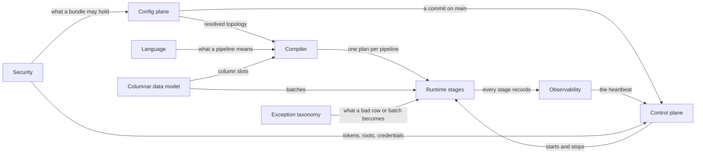

# Smeltr — Design Document

A Rust stream-processing engine. Kafka in, Kafka or Elasticsearch out, JSON
records, no state between records. This document states the whole and how
its systems join; each system has a file of its own under
[`architecture/`](architecture/). What is built lives in
[`status.md`](status.md); why each shape was chosen lives in the review
documents beside it.

## The whole

Smeltr is two tiers. A **worker** moves data: it reads batches from a source,
runs each through the pipelines its routes select, delivers the results and
records progress once every destination has acknowledged them. A **leader**
holds everything that is not moving data: the git repository every
configuration lives in, the people who change it, the credentials workers
need, and a picture of the fleet assembled from what workers report. Workers
pull from the leader and never the reverse. Configuration is a directory of
files committed to `main`; a deploy points the fleet at one commit of `main`'s
history, and a worker runs exactly one at a time.

```text
  people ── GUI ──►  leader                          worker
                     repository: deployed  ◄─ fetch ─┤
                     store: credentials    ─ secrets ►│
                     registry: the fleet   ◄─ heartbeat ┘

  source ──► ingest ──► transform ──► egress ──► destination
                └────── commit ◄──── acknowledgments ──┘
```

Ten systems make this up. Five live inside a worker, four describe how work
reaches it, one crosses both tiers.

| system | governs |
|---|---|
| **Inside a worker** | |
| [Language](architecture/language.md) | what a pipeline means: names, types, null, declarations and the expression language |
| [Columnar data model](architecture/columnar-data-model.md) | what a record is in memory: batches, columns, and the rules a step obeys |
| [Compiler](architecture/compiler.md) | turning declared configuration into executable instructions |
| [Runtime stages](architecture/runtime-stages.md) | ingest, transform, egress, commit, and how much concurrency each gets |
| [Exception taxonomy](architecture/exception-taxonomy.md) | what a stage does when a row or a batch goes wrong |
| **How work arrives** | |
| [Control plane](architecture/control-plane.md) | what a worker is running and when it changes |
| [Config plane](architecture/config-plane.md) | the bundle, its validation, and how a change becomes a commit on `main` |
| [Security](architecture/security.md) | trust between worker and leader, people and their access, credentials, and the cryptography under them |
| [API](architecture/api.md) | the routes the leader answers, who may call each, and the shape of an answer |
| **Cross-cutting** | |
| [Observability](architecture/observability.md) | the metrics registry and the cursors that read it, logs, and what each source's streams look like |

A system nests inside another when it has no meaning without it: the failure
taxonomy needs stages for things to fail in, the secrets boundary needs a
bundle to keep secrets out of. The config plane is a peer of the control
plane: a bundle holds with no leader present, and the control plane owns only
which commit runs where. Observability is a peer of both, one registry read by
the heartbeat, by a smeltr metrics source and by a worker's metrics endpoint.

**One invariant holds across every system: a bundle names a credential and
never carries one.** Everything else here is the current shape and may be
redesigned.

## Seams

Each system's file ends with its seams: what it takes from the others and
what it hands them.



---

## Scope

### In v1

Sources: Kafka and Azure Event Hubs through its Kafka endpoint, their payloads as they arrived or Avro read with a schema registry's schema, the objects S3 announces on an SQS queue, the blobs Event
Grid announces on an Azure Storage queue, the objects Cloud Storage announces
on a Pub/Sub subscription, the objects under a prefix of an S3 bucket, a Cloud
Storage bucket, an Azure container or a directory on an SFTP server found by listing it, what an API answers a GET
or a POST of a fixed body with, asked on a timer, an Okta org's System Log, what senders POST to a port every worker of a group listens on, what Splunk HEC clients send to one, what
Prometheus sends over remote_write to one, what
Elasticsearch clients send to one's Bulk API, smeltr metrics and smeltr logs; an object source's objects as lines, events, whole objects or Avro container files. Destinations:
Kafka and Azure Event Hubs through its Kafka endpoint, writing Avro under a schema registry's schema or as other destinations write; Elasticsearch via the Bulk API and Splunk via its HTTP Event
Collector, the destinations that refuse records rather than being
unreachable; any service taking a POST of NDJSON, a JSON array or one record per request, with the headers it asks
for; Prometheus and any store taking its remote_write; a Log Analytics workspace, through a data collection rule; S3, Google Cloud Storage, Azure Blob Storage and a directory on an SFTP server, as NDJSON, JSON, text, the bytes as they arrived, Parquet or Avro, one file per prefix across batches. Functions: Call, Code, Comment, Drop,
Eval, Lookup, Parser, Rename, Unroll. Parsers: JSON, CSV, key-value, Grok.
Multiple routes per source. At-least-once delivery, metrics excepted. JSON
output.

### Out of scope, permanently

Stateless is a hard boundary: no record's handling depends on another's. It
forecloses aggregation, suppression, deduplication and stateful sampling, and
buys no record state to store, no rebalance migration and trivially parallel
workers. What a source has delivered is progress, not record state: Kafka
keeps its offsets, and the leader keeps a single-worker source's.

### Deferred

Mask/redact, flatten/unflatten, non-JSON output. How
a destination renders a `datetime` and a `duration`: RFC 3339 or an epoch, a
count in seconds, micros or nanos, chosen per destination rather than fixed at
ISO 8601 and micros.

Learning a schema is the leader's, never a worker's: a worker reports what a
batch contained and forgets it (Observability, Streams), and the leader
accumulates. What it proposes from that -- declarations, drift, a new
stream's pipeline -- is authoring, reviewed before it runs anywhere. No
worker adapts how it parses to what it has seen.
