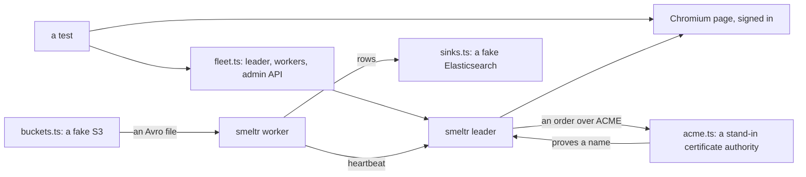

# GUI tests

`just check-gui` builds the debug binary and drives the GUI in Chromium, one test per thing a user story in
[`docs/user-stories.md`](../../docs/user-stories.md) asks for. Every test starts a leader of its own, and the
workers it needs, from empty data directories, so tests run side by side and none depends on another.



`fleet.ts` arranges what a test is not about through the API; the story itself is driven through the page,
by role and label. What a person does on a page more than one test needs is in `moves/`. Rows flow without
Kafka or Elasticsearch: a worker reads its own `metrics` source and delivers to the fake in `sinks.ts`.
An Avro source reads its file from the fake S3 in `buckets.ts`. A certificate ordered over ACME comes from the
authority in `acme.ts`, which validates against the leader the way a public one does and signs under a root of
its own, minted again on demand.

| file                         | stories                                 |
| ---------------------------- | --------------------------------------- |
| `specs/first-start.spec.ts`  | S9                                      |
| `specs/admin.spec.ts`        | S1, S2, S3, S6, S7, S8, S10, G5, P8, P9 |
| `specs/authoring.spec.ts`    | A1, A2, A3, A4, A6, A8, A9, A10, E8     |
| `specs/change.spec.ts`       | W1 to W11, S4                           |
| `specs/fleet.spec.ts`        | E1, E2, E4, E5, E7, G1, G2, G3          |
| `specs/end-to-end.spec.ts`   | W12                                     |
| `specs/sign-in.spec.ts`      | signing in from any page                |
| `specs/gui-fuzz.spec.ts`     | every screen, as every person           |
| `specs/journey-fuzz.spec.ts` | an administrator's whole journey        |

A story that is not built has no test, unless a `test.fixme` holds its place. A `test.fixme` says what it
waits on: a bug, or a feature not built or not in this build.

Once per machine: `cd tests/gui && npm install && npx playwright install chromium`.

```
just check-gui                         # every test
just check-gui specs/change.spec.ts    # one file
just check-gui -g 'rolls the fleet'    # tests whose title matches
just fuzz-gui                          # the GUI fuzzer over 64 seeds; check-gui runs 6
just fuzz-journey                      # the journey fuzzer, 16 long seeds; check-gui runs 1
SMELTR_FUZZ_SEED=3 just check-gui specs/gui-fuzz.spec.ts   # replay one seed
SMELTR_FUZZ_SEED=3 just check-gui specs/journey-fuzz.spec.ts
```

A failure leaves a screenshot, a trace and the page's accessibility tree under `tests/gui/results/`.

A run keeps every test's data directories under `$TMPDIR/smeltr-gui-runs/` and removes them when it ends
(`run.ts`). A run that was killed leaves its processes behind; the next run stops them.
