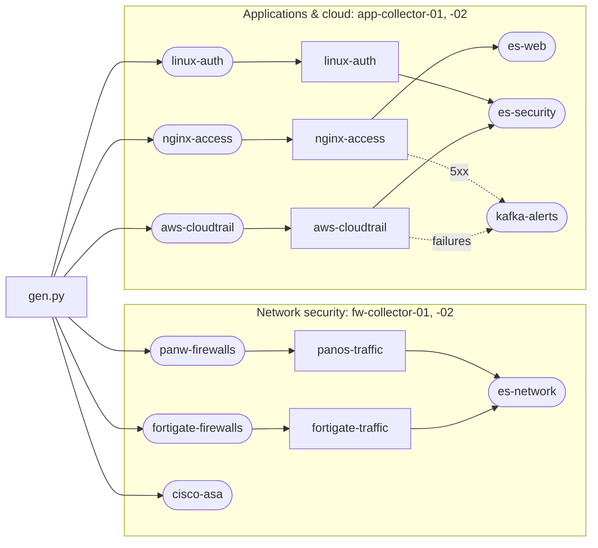

# Screenshots

`just screenshots` stages a demo fleet on an empty leader and captures every major GUI page in light and dark.
Run it again after a GUI change. It builds first, since the binary embeds the GUI.

```
just screenshots                          # ~25 min, most of it the paced history and the settle
tools/screenshots/run.sh capture          # capture again, against the fleet still up
tools/screenshots/run.sh stop             # stop the fleet and its traffic
PACE=0 SETTLE_MIN=2 just screenshots      # ~10 min: the history lands at once and the charts are short
```

The PNGs land in `shots/` as `<nn>-<page>-<light|dark>.png`, 1440 px wide at 2x (History at 1600, where
1440 cuts off its last column), with `contact-sheet.png` beside them.

## What it stages



- **Traffic.** `gen.py` writes about 1,600 records a second to Kafka, in the shapes of the sample logs in
  elastic/integrations: PAN-OS TRAFFIC over syslog, FortiGate key=value, nginx access, sshd and sudo, and
  CloudTrail JSON, and Cisco ASA connection builds and teardowns. Every value is synthetic; addresses outside
  10/8 come from the MaxMind test ranges. Now and then an nginx line is cut short and fails to parse; it reaches
  es-web tagged with its exception.
- **Something to fix.** No route takes cisco-asa, so the leader warns that its stream is unrouted. FGT-SIN-01
  names `proto` (`tcp`) where the FortiGate pipeline declares the protocol number, so the leader warns that the
  field is not its declared type.
- **Pipelines** (`bundle.py`), each normalizing to ECS: grok and a positional CSV table for PAN-OS, with CIDR,
  directory and App-ID lookups; key=value for FortiGate; grok with a custom pattern for nginx; grok and a code
  step for auth.log; JSON with nested structs for CloudTrail. Each has a sample and a locked test. Each group
  holds its own tables, pipelines and destinations: the editor cannot preview a group's pipeline that reads
  from `shared/`.
- **History** (`stage.py`). Three accounts write it through the leader's API. The admin adds a worker group,
  Priya Raman onboards the firewalls, Marcus Webb onboards the web and cloud feeds and adds a 5xx alert, and
  the admin rotates the Elasticsearch key. Priya's App-ID risk change stays open for review; Marcus's Cisco ASA
  draft stays a branch.
- **Incident** (`incident.py`). Issues and a Status that needs attention need something wrong: it freezes
  fw-collector-02 until the leader reports it silent, captures those two pages, and thaws it.

## Setup

Once:

```
pip install -r tools/screenshots/requirements.txt
npm --prefix tools/screenshots ci
npx --prefix tools/screenshots playwright install chromium
```

A run also needs Docker, for `tests/live/compose.live.yaml`'s Kafka and Elasticsearch, and ports 8443, 19092 and 9200 free.
It leaves that Elasticsearch with no disk watermark and a `logs-*` template of no replicas, which a single test
node wants; `just down` discards both.

Everything else a run writes is under `tools/screenshots/`, and the next run clears it: `state/` holds the leader,
the workers and their logs, `shots/` the PNGs. `stop` ends only the processes a run started.

## Changing a shot

`shots.json` lists the pages: the route, the scope and branch the GUI opens on, the window, and the steps that
bring the page to the state worth showing. Against a fleet that is up, this captures the shots whose names match:

```
cd tools/screenshots && node shoot.mjs shots.json '^06-'
```

A shot with `site` is one of the website's images: it also writes `website/static/<site>-<theme>.png`. The
site's pages crop those images by pixel, so a shot with `site` keeps its page, window and state; a change that
moves what the page shows also moves the crops in `website/src/routes`.
