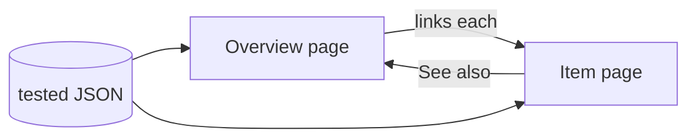
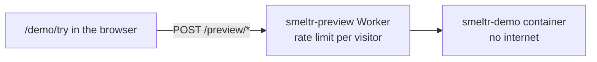

# smeltr public website

The public site. Deployed to Cloudflare Workers from `main`.

SvelteKit with `adapter-static`, so a build is a directory of HTML with no
server behind it. The same toolchain as `gui-frontend`: one frontend
stack.

```
npm install
npm run dev      # http://localhost:5173
npm run build    # -> build/
npm run preview  # serve build/ as a plain static server
```

Documentation search uses Pagefind. `npm run build` indexes the rendered docs
and expression reference after prerendering. Results link to pages and matching
headings; the navigation and search page stay out of the index. To test search
locally, use `npm run build` then `npm run preview`; the Vite dev server does not
generate or serve the production search index.

## Scope

Marketing pages explain authoring, review, deployment, and operation. The
docs hub introduces the pipeline walkthrough, review and operations guides,
and expression reference. The hub and reference share
a sticky section sidebar on desktop and a sticky, collapsible contents control
on mobile. The reference sidebar searches function names and summaries;
examples stack expressions above results on narrow screens.

The site links the repository in one place, `src/lib/release.ts`, which names
the repository's owner once and builds the source, download, image and license
links from it:
`/get` links each release file at `releases/latest/download/<name>`,
which GitHub serves from the newest published release, and the image at its
`latest` tag. Nothing else on the site names a file in the repository or tells
a reader to build from source; the engine walkthrough at commit `0dbf31d` is
the page that could not hold to that.

The reference is data — `src/lib/reference.json`, rendered by
`src/routes/docs/code-reference/+page.svelte`. It is checked from the other
direction: `tests/website-reference-tests.rs` (a Rust test, in the
repository root's suite) asserts the catalog covers every
`ops::stdfuncs` row exactly once, and *evaluates every example* against
the engine, comparing the documented result to the JSON the engine
emits and the documented `throws` to the exception kinds it throws. So an example on the published page cannot be wrong without that
test failing. Add or change one there, then run `cargo test --test
integration website_reference_tests::`.

Each docs page has a Markdown twin beside it, `/docs/x.md` for `/docs/x`, and
`/llms.txt` lists them, for language models. `npm run build` writes them from the
prerendered pages (`scripts/docs-markdown.js`). The leader's AI agent reads the
same Markdown, from `src/leader/docs.json`: after a docs change run `just
docs-markdown`, or `just website` fails.

Machinery for rendering Markdown into a browsable `/docs` section
(pages, a sidebar, in-page contents) exists at commit `772b8b4`.

## Reference pages

A reference group is one overview page and one item page per item: Sources and
each source kind, Destinations and each destination kind, Pipeline steps and
each step.
The overview pages share one section set and the item pages another, in the
same order and with the same titles. A section an item has nothing for is left out, never
renamed.



**Overview page**

1. Lede: what the group is, in one or two sentences.
2. Kinds: the index table, one row per item, linking its page.
3. How it works: what holds for every item, with a diagram where order or flow
   is the point.
4. Settings: the settings every item takes.
5. Fields: the record fields every item gives or reads.
6. Add one, Verify, Troubleshooting: the steps and problems every item shares.
7. See also.

**Item page**

1. Lede: what this item does, in one sentence; then a short paragraph for any
   term a reader needs before the example.
2. Example: the smallest working one, then one sentence on what it does.
3. Before you start: what must exist outside Smeltr. Link the vendor's own
   documentation for how to set it up; do not retell it.
4. Settings: only this item's own, then a link to the overview for the rest.
5. Fields it gives or reads.
6. How it works: behavior the settings table cannot say.
7. Verify: one check a reader can run, and the result to expect.
8. Troubleshooting: problems only this item has, each a symptom then the
   check. Shared problems stay on the overview.
9. See also.

**Rules for every reference page**

- Explanation comes before examples. A term is explained where it first
  appears.
- Settings and fields tables, and every code example, come from tested JSON in
  `src/lib/`. `tests/website-reference-tests.rs` loads each example in the
  engine and checks each table against the engine's own names and defaults.
  A page never types a setting, default or example into its markup.
- A setting is named as the bundle spells it.
- A settings table lists settings in the order the GUI form asks for them. Settings the form keeps under an Advanced
  section get their own table, under a heading naming that section. A kind's `form` in the JSON holds that order.
- Each sentence states a fact the reader acts on. No signposting ("this page
  covers", "as noted above"), no filler, no history.
- One name for one thing, the same on every page.

A step's settings come from `src/lib/step-reference.json`, its examples from
`src/lib/steps/`. A step page puts its topics, such as each parser format, as
`h3` subsections of How it works.

Administrator settings is one page in the item-page shape, with Other settings
for what changes outside the startup file. Its table comes from
`src/lib/startup-settings.json`, which the tests check against the file keys,
environment variables and stated defaults the binary reads.

**Expression reference**

One catalog page, not an overview and item pages: a reader scans it for an
operator or function, and its sidebar searches function names. Its sections, in
order:

1. Lede: what an expression is and where one is written.
2. How it works: what holds for every expression, with Types and Null as
   `h3`s.
3. Fields: the fields every record has. A source's own fields are on its page,
   and the fields a destination reads on its page.
4. One section per group, by the type its operators and functions work on: the
   group's rule, its notes, the operator table, what does not compile, then
   each function.
5. Exceptions: what a throw does, and every kind.
6. See also.

A function gives its signature, the engine's typed rows from
`src/lib/signatures.json`, its summary and rules, then its examples. Every other
table and example is in `src/lib/reference.json`.

## Cloudflare settings

Deployed as a Worker serving static assets. Set once, in the Worker's
**Builds** settings:

| Setting | Value |
|---|---|
| Production branch | `main` |
| Root directory | `/website` |
| Build command | `npm run build` |
| Deploy command | `npx wrangler deploy` |
| Build watch paths — include | `website/**` |

There is no build-output-directory field in the Workers dashboard; it
comes from `assets.directory` in `wrangler.jsonc`. That file is also what
makes `npx wrangler deploy` work at all — without it the deploy step
fails with nothing to deploy.

Root directory is `/website`, but Cloudflare clones the whole repository
before building. It is only the working directory, not the checkout scope.

Verify a config change without deploying:

```
npx wrangler deploy --dry-run   # validates config, lists the assets found
npx wrangler dev --local        # serves build/ the way Cloudflare will
```

`wrangler dev` is worth preferring over `npm run preview` when checking
URLs: it applies Cloudflare's own asset routing, which a plain static
server does not — notably canonicalizing `/x.html` to `/x`.

## The demo at /demo/try

`/demo` is screenshots; `/demo/try` is the real GUI, running in the
visitor's browser over a recorded fleet. What only the engine can answer,
the page asks the preview service at `/preview` on this origin. The page
and the service are one Worker, in `preview/`, so they ship together from
one commit and the page never asks a service that answers another shape.
The site's search never indexes the page.



A second Workers Build deploys it on every push to the `demo` branch, not
with the site:

| Setting | Value |
|---|---|
| Project name | `smeltr-preview` |
| Production branch | `demo` |
| Root directory | `/website` |
| Build command | `npm ci` |
| Deploy command | `npx wrangler deploy --config preview/wrangler.jsonc` |
| Build watch paths — include | `src/**`, `Cargo.toml`, `Cargo.lock`, `build.rs`, `website/preview/**`, `gui-frontend/**` |

The deploy builds the page (`preview/build-try.mjs`, which runs
`gui-frontend`'s `npm run build:demo`) and the container image. By hand,
from this directory with Docker running:

```
npx wrangler deploy --config preview/wrangler.jsonc
```

Containers need the Workers Paid plan. `max_instances` caps how many run at
once, which caps what the demo can cost.

## Visual system

The palette, type and logo are `gui-frontend`'s "Foundry" system
(`gui-frontend/STYLE_GUIDE.md`). `src/app.css` carries the Foundry palette
with the same values; the app's `:root` block is the source of truth. The
site carries Foundry only, not the app's other palettes.
The type scale is a reader's, not the app's dense one.

## Website workflow and the guided example

The marketing routes are `/`, `/siem-costs`, `/one-schema`, `/how-it-works`, `/demo`,
`/docs`, and `/docs/code-reference`. `/build`, `/review` and `/operate` redirect to
`/how-it-works`, `/build#test-heading` to `/docs/steps#verify` and `/build#filtering`
to `/siem-costs#drop-heading`.

The homepage opens with the Smeltr wordmark, a short tagline and its two actions.
`HomeDataFlow.svelte` shows sources, processing, and destinations using
`src/lib/home-flow-example.json`: three firewall records enter, the NTP record is dropped,
and both denied connections leave in ECS fields. The paragraph saying what Smeltr is sits
under that section's heading. The flow uses the shared source/destination glyphs and stacks
vertically on narrow screens.
The editor section uses the supplied light/dark screenshots of a running PAN-OS pipeline
with a directory lookup open. `pipeline-editor-{light,dark}.png` are the unchanged
2880×2000 originals from `07-editor-panos-lookup-step` in the supplied screenshot set.
Its staging README identifies the data as synthetic. `EditorScreenshot.svelte` shows two labeled CSS crop windows on the homepage and
the complete image on How it works. Original screenshot pixels are unchanged. Both views follow
the site’s selected theme, load lazily, and link to their full-size originals.

`/siem-costs` runs ten PAN-OS traffic logs through a Parser, Drop, Remove and Code step whose
destination writes text. `siem-pipeline-{light,dark}.png` and `siem-step-*-{light,dark}.png`
are shots of that pipeline in the demo GUI. `SiemSteps.svelte` folds open each step's
settings, and `SiemCutExample.svelte` lists every record and its bytes from
`src/lib/siem-cut-example.json`, the preview service's answer for that run.
`/one-schema` shows sources mapped to one schema from `src/lib/one-schema-example.json`.
The detailed review screenshot is not used here because its identity notice is outdated. Competitor names and links are omitted. The worked tutorial
at `/docs/first-pipeline` takes an existing installation from a saved sample
through regression tests, route preview, deployment and a live Kafka output
check. Keep its control names aligned with the GUI.

Legacy documentation URLs `/docs/build` and `/docs/configuration` redirect in the
browser, including their former section anchors. Without JavaScript they show
links to the replacement topics. These compatibility pages stay out of search.

The primary links on Home and Build open the demo at `/demo/try`: the GUI over a recorded fleet, with a guide
whose tasks tick as the visitor fixes the fleet's two problems (`gui-frontend/src/demo/guide.ts`). `/demo` sends
the browser there.

The homepage introduces the source → Smeltr → destination data path without a
connector count. `/docs/sources` and `/docs/destinations` follow
[Reference pages](#reference-pages). The kind indexes live in
`src/lib/connections.ts`, settings in `src/lib/connector-reference.json` and
examples in `src/lib/connector-examples.json`. Shared authentication
lives in `/docs/secrets`. Keep private repository links
out of rendered pages. The setup guide retains `#connections` as
a short set of links for existing bookmarks.
The setup guide's completion checklist links each expected result to its procedure.

`WorkflowDiagram.svelte` renders the compact mental models on Build, Review, and
Operate from `src/lib/workflow-diagrams.json`. Each has wide and narrow layouts,
accessible SVG descriptions, and a text caption. Review's diagram is also used by
`/docs/git/configuration`, which explains the leader-managed repository, workers fetching main,
and comparing the deployed main commit with each worker’s reported Commit. `/docs/git/external-host`
covers following a Git host.
Workers use an in-process Git client; only the leader needs Git's HTTP backend.
`/docs/routing/exceptions` owns exception answers; `/docs/delivery` owns hold and
retry, refused-record handling, retention and replay.
Destination guides link there.

The expression reference lives at `/docs/code-reference`, alongside the administrator
and parser references. `/reference` redirects there with its query and section bookmark
intact and is excluded from search. Keep future references under `/docs`; reserve
`/docs/api-reference` for an API guide when it is ready.

`FilteringExample.svelte` gives the first-pipeline tutorial its three illustrative inputs and their expected outputs
from `src/lib/filtering-example.json`.
The tutorial gives JSON Parser, Drop, and Eval settings plus a deliberate failing-test
check. The JSON serializer omits null object fields; this is why clearing `debug`
and `_raw` removes them from delivery. Keep field omission distinct from dropping
a whole record. These fixtures describe expected results, not a recorded live run.

The `system` entry in `workflow-diagrams.json` shows the leader/Git relationship
and direct worker data connections. Setup embeds it; the Git guide links to it.
The standalone and Kubernetes diagrams use the same renderer and
role glyphs from `src/lib/diagram-glyphs.ts`. Keep each role consistent across
diagrams. The standalone diagram joins the leader and one worker inside a single process,
with administrator, source, and destination connections outside that boundary.
The overview uses stacked worker cards to represent one or more workers.
Distributed placement is explained in prose. Solid arrows show
data or administrator connections; dashed arrows show
workers fetching `main` and reporting status. Dotted lines connect persistent
volumes. Each topology includes a separate narrow-screen layout.

For documentation edits, review twice: first explain unfamiliar terms where they
are introduced, then shorten instructions and make each expected result explicit.
Preserve actual setting names, UI labels, defaults, and limitations during both passes.

Standalone setup enables both roles in one process. Its worker enrolls automatically
and keeps state beneath the leader data directory; stopping that process stops both
roles. Keep setup, backup and restart instructions consistent with that distinction.
The parser guide covers JSON, CSV, key/value and Grok with expected field examples
and separate handling for whole-record failures and field conversion warnings.
Code and parser guides describe step filters, Unroll restrictions, whole-object copies,
and object-building limits against the implementation through PR #410.

The Code steps, Capture a sample, and Routing guides cover the authoring workflows
added around PRs #348–398. Exceptions and Delivery distinguish unmatched records,
unprocessable batches, pipeline errors, and destination refusal. Keep UI labels and
policy defaults aligned with the product. Worker groups select work; the cluster is
the trust boundary for configuration and leader-stored credentials.

`map` and `filter` are expression syntax rather than StdFunc entries. The website
reference test includes them explicitly and evaluates their catalog examples using
the same pipeline compiler as other expressions. They do not have generated
StdFunc signature rows. HTTP/Splunk remain outside this documentation update until merged and checked.
The TypeScript syntax in the design-only PR #408 is not yet supported.

The Capture a sample guide uses `capture-running-{light,dark}.png` from
`16b-capture-running` in the supplied September 27 screenshot archive. These are unchanged 2880×2200
images. `ProductScreenshot` uses optional CSS crop coordinates to focus on the
capture dialog and keeps a link to the complete screenshot.

The capture setup form uses the supplied `16b-capture-form` light/dark images,
stored unchanged as `capture-form-{light,dark}.png` (2048×1280). The guide
shows a CSS crop of the form and links to the complete screenshot.

Operations uses real `fleet-map` and `fleet-attention` screenshots in place of
the simulated map and status views. Troubleshooting reuses the attention view.
Routing shows `route-preview`; Review uses the existing Changes overview and
`deployment-history`. Assets are unchanged light/dark images from `04-map`,
`01b-status-needs-attention`, `15-route-preview`, and `21-history` in the supplied
September 27 archive. CSS crops focus each view on the point its caption explains.
The detailed review screenshot still contains an outdated identity notice and is
not displayed. A failing-test screenshot is still needed.
